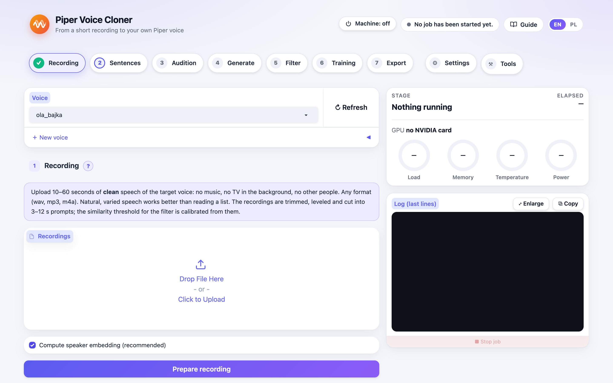

# Piper Voice Cloner

[Polski](README.pl.md)

Turn a short recording (10–60 seconds) into your own [Piper](https://github.com/OHF-Voice/piper1-gpl)
text-to-speech voice. Example: a character voice for a child's room in Home Assistant.

```
reference audio ─► cloning model ─► ~2600 clips ─► quality filter ─► ~2000 clips ─► Piper training ─► .onnx voice
  (10–60 s)        (Chatterbox)                  (Whisper, speaker,                  (piper1-gpl)
                                                  MOS, length)
```

The tool is public. The voices you make with it are yours and stay private. Nothing from
`voices/` is ever meant to be committed or published (see [Privacy and law](#privacy-and-law)).



## How I run it: hardware and support

This project was built for, and tested on, exactly one setup:

- **macOS** runs the panel in the browser. From there everything is sent over SSH to
- **Ubuntu 24.04 with an NVIDIA GeForce RTX 4090 (24 GB)**, where cloning, the quality filter, training (piper1-gpl, PyTorch) and listening tests run.

All scripts (`scripts/setup.sh`, PyTorch with CUDA, batch sizes and memory settings) are prepared for this card. **The project will not be adapted to other GPUs,
other machines or other operating systems.** You are welcome to use it (MIT license), but supporting
your own hardware is up to you. Please don't open issues or requests to add other cards.

## Why

Piper is fast enough for a Raspberry Pi or a Jetson, but it can only speak in voices that were
trained for it. Zero-shot cloning models (Chatterbox, XTTS) can imitate a voice from a few
seconds of audio, but they are too slow for a voice assistant. This tool bridges the two:
- it uses the cloning model to read a few thousand sentences;
- it throws away the bad clips;
- it trains a small, fast Piper voice from the rest.

## Features

- **Backends**:
  - **Chatterbox Multilingual** (default, MIT, 23 languages incl. Polish);
  - **XTTS-v2** (non-commercial CPML license);
  - **ElevenLabs** (cloud, optional, key from the panel or `ELEVENLABS_API_KEY`, an account voice reads a chosen sentence set without a GPU).
- **Plain-text corpus**:
  - Sentences with digits, times, dates, list numbering, symbols or abbreviations are rejected,
    not rewritten. They teach the voice inconsistent readings; numbers belong to the runtime text
    normalizer.
  - Sentences are picked greedily for phoneme and diphone coverage (espeak-ng, the same
    phonemizer Piper uses).
- **Audition**: tries a grid of backend settings on a few sentences and gives you an HTML page
  with players and scores, so you can choose by ear and by numbers.
- **Quality filter**, per clip:
  - Whisper character error rate;
  - speaker similarity to the reference (CAM++, threshold calibrated on the reference itself);
  - UTMOS naturalness;
  - length vs. text (catches cut-offs and hallucinations).
- **Training with your choice of starting point**:
  - `bazowy-pl`: your own base model trained from random weights, nothing English inside;
  - `lessac`: the classic English `en_US-lessac-medium` checkpoint (fast to fine-tune);
  - `ckpt:<path>`: any Piper medium checkpoint.
- **Import of existing datasets**:
  - takes old LJSpeech folders, including MP3 files named `.wav`;
  - re-checks their text with the same rules;
  - writes real 22,050 Hz / 16-bit WAV, so old voices can be retrained cleanly.

## Requirements

- Ubuntu 24.04 with an NVIDIA GeForce RTX 4090 (24 GB) - the only tested and supported machine (see above).
- `ffmpeg`, `espeak-ng`, `build-essential cmake ninja-build`, and [uv](https://docs.astral.sh/uv/).

```bash
git clone https://github.com/witold-gren/piper-voice-cloner.git
cd piper-voice-cloner
./scripts/setup.sh                         # .venv (cloning + checks) and .venv-train (piper1-gpl)
export PVC_HOME=$HOME/home-assistant/voices-private # private data lives OUTSIDE the repository
export PVC_TRAIN_PYTHON=$PWD/.venv-train/bin/python
source .venv/bin/activate
```

Only cloning on a Mac (Apple Silicon)? `make setup-mac` installs the generation and filter side
with the Apple GPU (`mps`); training stays on the Linux machine with an NVIDIA card.

## Web interface

Prefer clicking to typing? `pvc ui` serves every step in the browser:
- each step has a description;
- audio players for references, audition and filter results;
- training-time estimates;
- long jobs run in the background with a live log;
- the GPU machine in the top bar: a job running on it, and a power button through Home Assistant.

```bash
pvc ui --lang en                       # http://<machine>:7860 (/en/ and /pl/), PVC_UI_AUTH=user:password
./scripts/install-service.sh           # or: run it as a service that starts at boot (systemd --user)
```

The service listens on your local network and requires a login, which is generated into
`~/.config/piper-voice-cloner/env`. Running jobs keep going when the UI restarts. For access
from outside your home, use a VPN such as WireGuard. Never expose the port to the internet.

### GPU machine over SSH

Working on a Mac while the GPU sits in another computer? **⚒ Tools → GPU server (SSH)** (or
`make remote-configure / remote-check / remote-push / remote-install / remote-pull`) sends the code
and the data there with rsync, installs the environments with the UI service and brings the
finished voices back. Details in the [guide](docs/en/guide.md#gpu-machine-over-ssh-working-from-a-mac-or-laptop).

### Power of the GPU machine through Home Assistant

The machine on a smart plug? **⚒ Tools → Home Assistant**: the address, a long-lived admin token
(kept only in `~/.config/piper-voice-cloner/home_assistant.json`, mode 600, never shown back) and
the machine's switch with the plug's power sensor. The top bar then shows the machine (off /
starting / on · W / shutting down) and switches it on or off after a confirmation - never off
while a job runs on it. The page never waits for the machine nor for Home Assistant. Example
Home Assistant package: [`docs/home-assistant/maszyna_gpu.yaml`](docs/home-assistant/maszyna_gpu.yaml);
details in the [guide](docs/en/guide.md#power-of-the-gpu-machine-through-home-assistant).

## Quick start

Every step also has a `make` target; `make help` lists them in order (English or Polish, from `$LANG`):

```bash
make setup-gpu                    # once, on the GPU machine
make init VOICE=kuba_bajka PIPER_NAME=pl_PL-kuba_bajka
make ui-remote                    # or step by step: make reference / corpus / audition / … VOICE=kuba_bajka
```

The same steps with `pvc` directly:

```bash
pvc init kuba_bajka --piper-name pl_PL-kuba_bajka
pvc reference kuba_bajka recordings/*.m4a        # 10–60 s of clean speech, any format
pvc corpus kuba_bajka --source my_sentences.txt  # plain sentences, one per line
pvc audition kuba_bajka --apply-best             # listen: voices/kuba_bajka/audition/audition.html
pvc synthesize kuba_bajka                        # resumable; Ctrl+C and run again
pvc filter kuba_bajka                            # builds voices/kuba_bajka/dataset/
pvc train kuba_bajka --base lessac               # or bazowy-pl after `pvc base train`
pvc export kuba_bajka                            # voices/kuba_bajka/export/pl_PL-kuba_bajka-medium.onnx
```

The step-by-step guide is in [docs/en/guide.md](docs/en/guide.md). It covers choosing thresholds,
training your own base, retraining old voices, deploying to Home Assistant, and adding a language.

## Privacy and law

- **Children's voices**: record and use them only with a parent's or guardian's consent, and keep
  everything local. The default backend runs entirely on your machine. ElevenLabs sends text to
  the cloud and the tool says so whenever it is used.
- **Cartoon and film characters**: the recordings are copyrighted, and voice actors have
  personality and performance rights. Keep such voices for private use. Don't publish the model or
  its samples, and never use them commercially.
- **Model licenses**: Chatterbox is MIT. XTTS-v2 is CPML, which is non-commercial, so treat its
  outputs and voices trained on them as non-commercial too. Chatterbox adds an inaudible
  watermark (Resemble Perth) to everything it generates.
- If you ever publish synthetic speech, label it as AI-generated (EU AI Act, Art. 50).

This is not legal advice.

## License

MIT, see [LICENSE](LICENSE). Piper (piper1-gpl) is GPL-3.0 and runs as a separate program. The
cloning models keep their own licenses.
