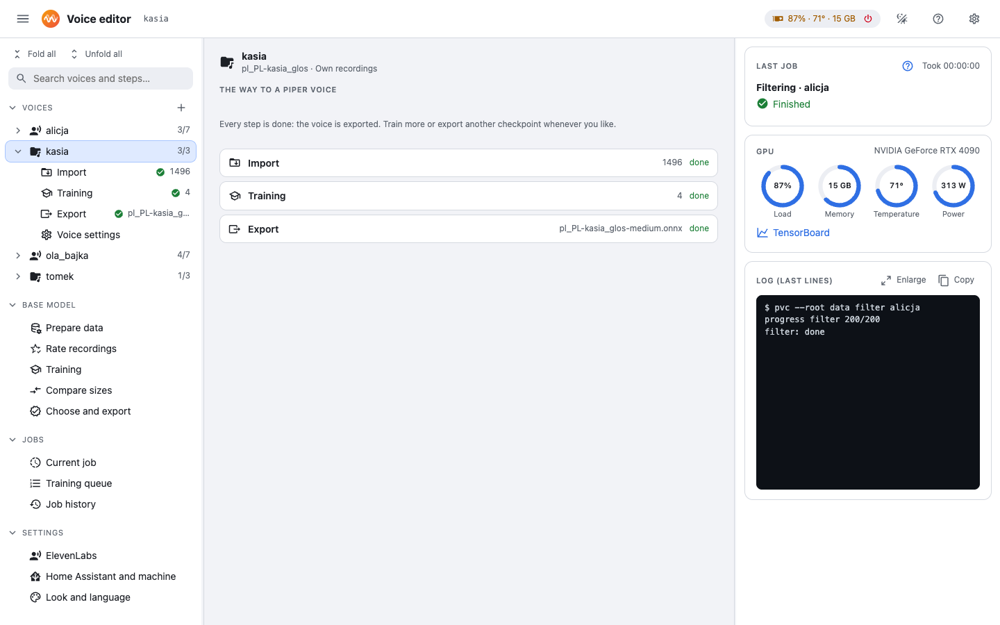

# Piper Voice Cloner

A voice editor for [Piper](https://github.com/OHF-Voice/piper1-gpl) that runs on a machine with an NVIDIA
card: from a short recording (or a voice of your ElevenLabs account, or your own ~1500 recordings) to a
Piper voice for Home Assistant. It runs in Docker, starts with the machine and is used from a browser.

**Guide (PL/EN, with screenshots):** https://witold-gren.github.io/piper-voice-cloner/ ·
[Polski](README.pl.md)



## Two ways to a voice

| | Cloning | Own recordings |
|---|---|---|
| You have | 10–60 s of the voice, or a voice in ElevenLabs | about 1500 clips with their text |
| Steps | Recording → Sentences → Audition → Generate → Filter → Training → Export | Import → Training → Export |

Training starts from your own Polish base (`bazowy-pl`, trained from scratch in the editor) or from
Piper's `lessac`; the editor shows the training chart, lets you listen to every epoch and says what
resuming will do. More in the guide: [training well](https://witold-gren.github.io/piper-voice-cloner/training/).

## Try it on a Mac

1. **You need** only Docker Desktop, running. No GPU, no Python, no Home Assistant.
2. **One command:** `make demo` (the first build of the demo image takes a minute or so, later ones seconds).
3. **Open** http://localhost:7861 and log in as `demo` / `demo`.
4. **What is pretend:** made-up voices, a fake GPU and jobs that only pretend to work, all inside the
   container; nothing goes to Home Assistant, ElevenLabs or the machine. Ctrl+C stops and removes the
   container; `make demo-clean` removes the image too.
5. **The guide and programmers:** `make docs` builds this guide in Docker and opens it. `make test` and
   `make test-browser` need `make setup` (uv, which fetches the Python itself; Google Chrome for the
   browser tests). `make doctor` says what is missing.

## Install

Ubuntu 24.04 with an NVIDIA card (tested: RTX 4090, driver 580), Docker and the NVIDIA container
toolkit ([step by step](https://witold-gren.github.io/piper-voice-cloner/installation/)).

From your computer, with the machine in `~/.config/gpu-studio/host.mk` (`GPU_HOST = user@host`):

```bash
make install    # first time: code, checks, login, build, start (starts with the machine afterwards)
make login      # the editor's user and password
make deploy     # every update
make stop       # stop the editor (make deploy starts it again)
make uninstall  # remove it from the machine; the voices stay
```

Or on the machine: `git clone … && docker/install-ubuntu.sh`. Then open `http://<machine>:7860`.

## Privacy and law

Recordings, datasets and models stay in the data folder on the machine, never in this repository. Clone a
voice only with its owner's consent; children's voices only with a parent's consent; character voices
for private use only. Details: [law and consent](https://witold-gren.github.io/piper-voice-cloner/legal/).

## License

MIT. Models have their own licences (Chatterbox MIT, XTTS-v2 CPML non-commercial, piper1-gpl GPL).
