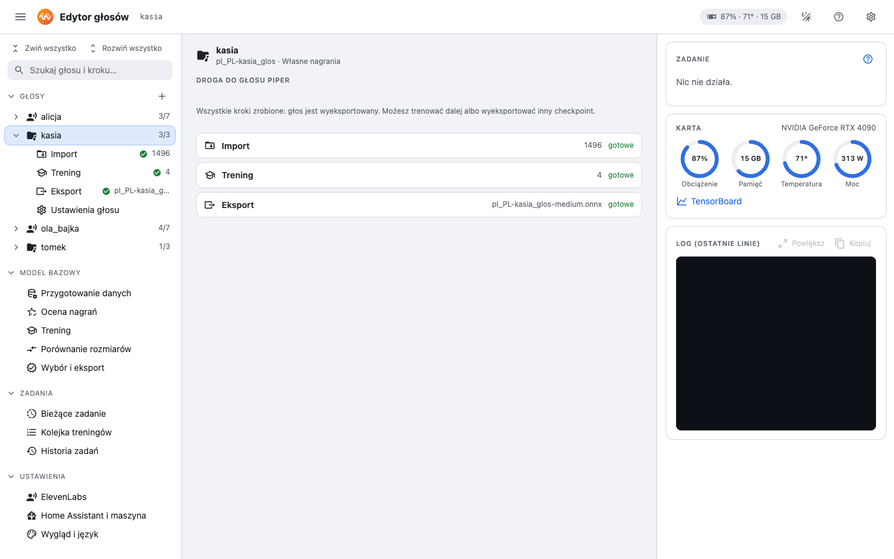

# Piper Voice Cloner

Edytor głosów dla [Pipera](https://github.com/OHF-Voice/piper1-gpl), który działa na maszynie z kartą
NVIDIA. Z krótkiego nagrania, z głosu na koncie ElevenLabs albo z własnych ok. 1500 nagrań robi głos Piper
dla Home Assistant. Działa w Dockerze, startuje razem z maszyną, a obsługujesz go z przeglądarki.

**Instrukcja (PL/EN, ze zrzutami):** https://witold-gren.github.io/piper-voice-cloner/pl/ ·
[English](README.md)



## Dwie drogi do głosu

| | Klonowanie | Własne nagrania |
|---|---|---|
| Masz | 10–60 s głosu albo głos w ElevenLabs | ok. 1500 klipów z tekstem |
| Kroki | Nagranie → Zdania → Odsłuch → Generowanie → Filtr → Trening → Eksport | Import → Trening → Eksport |

Trening zaczyna od Twojej polskiej bazy `bazowy-pl` (wytrenujesz ją od zera w edytorze) albo od `lessac`
Pipera. Edytor pokazuje wykres treningu, pozwala posłuchać każdej epoki i mówi, co zrobi wznowienie.
Więcej w instrukcji: [jak dobrze trenować](https://witold-gren.github.io/piper-voice-cloner/pl/training/).

## Wypróbuj na Macu

1. **Potrzebujesz** tylko uruchomionego Docker Desktop. Bez karty graficznej, bez Pythona, bez Home Assistanta.
2. **Jedno polecenie:** `make demo` (pierwsza budowa obrazu demo trwa około minuty, kolejne kilka sekund).
3. **Otwórz** http://localhost:7861 i zaloguj się jako `demo` / `demo`.
4. **Co jest udawane:** wymyślone głosy, udawana karta i zadania, które tylko udają pracę, wszystko w
   kontenerze. Nic nie trafia do Home Assistanta, ElevenLabs ani na maszynę. Ctrl+C zatrzymuje i usuwa
   kontener, a `make demo-clean` usuwa też obraz.
5. **Instrukcja i dla programisty:** `make docs` buduje tę instrukcję w Dockerze i ją otwiera. `make test`
   i `make test-browser` potrzebują `make setup` (uv, który sam pobiera Pythona; Google Chrome do testów w
   przeglądarce). `make doctor` mówi, czego brakuje.

## Instalacja

Ubuntu 24.04 z kartą NVIDIA (sprawdzone: RTX 4090, sterownik 580), Docker i zestaw NVIDIA dla kontenerów
([krok po kroku](https://witold-gren.github.io/piper-voice-cloner/pl/installation/)).

Z Twojego komputera, z adresem maszyny w `~/.config/gpu-studio/host.mk` (`GPU_HOST = użytkownik@host`):

```bash
make install    # pierwszy raz: kod, kontrole, login, budowa, start (potem startuje razem z maszyną)
make login      # użytkownik i hasło edytora
make deploy     # każda aktualizacja
```

Albo na samej maszynie: `git clone … && docker/install-ubuntu.sh`. Potem otwórz `http://<maszyna>:7860`.

## Prywatność i prawo

Nagrania, datasety i modele zostają w folderze danych na maszynie, nigdy w tym repozytorium. Klonuj głos
tylko za zgodą właściciela. Głosy dzieci tylko za zgodą rodzica, a postacie wyłącznie do prywatnego użytku.
Szczegóły: [prawo i zgoda](https://witold-gren.github.io/piper-voice-cloner/pl/legal/).

## Licencja

MIT. Modele mają własne licencje (Chatterbox MIT, XTTS-v2 CPML niekomercyjna, piper1-gpl GPL).
