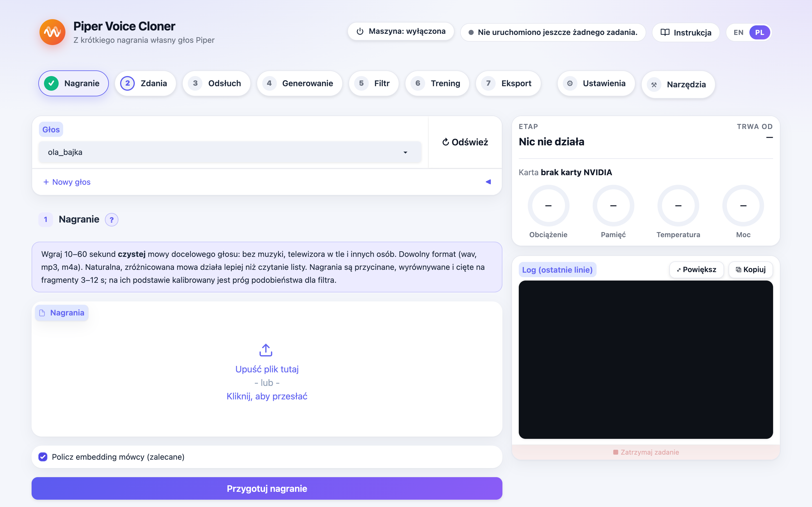

# Piper Voice Cloner

[English](README.md)

Krótkie nagranie (10–60 sekund) zamienia we własny głos [Piper](https://github.com/OHF-Voice/piper1-gpl)
do syntezy mowy. Przykład: głos postaci z bajki do pokoju dziecka w Home Assistant.

```
nagranie ─► model klonujący ─► ~2600 klipów ─► filtr jakości ─► ~2000 klipów ─► trening Piper ─► głos .onnx
(10–60 s)     (Chatterbox)                    (Whisper, barwa,                  (piper1-gpl)
                                               MOS, długość)
```

Narzędzie jest publiczne. Głosy, które nim zrobisz, są Twoje i zostają prywatne. Nic z katalogu
`voices/` nie powinno trafić do repozytorium ani do internetu (patrz
[Prywatność i prawo](#prywatność-i-prawo)).




## Jak to u mnie działa: sprzęt i wsparcie

Projekt powstał i był sprawdzany na dokładnie jednym zestawie:

- **macOS** uruchamia panel w przeglądarce. Stamtąd wszystko jest wysyłane przez SSH na
- **Ubuntu 24.04 z kartą NVIDIA GeForce RTX 4090 (24 GB)**, gdzie odbywa się klonowanie, filtr jakości, trening (piper1-gpl, PyTorch) i odsłuch.

Wszystkie skrypty (`scripts/setup.sh`, PyTorch z CUDA, rozmiary paczek i ustawienia pamięci) są przygotowane pod tę kartę. **Projekt nie będzie dostosowywany do
innych kart, innych maszyn ani innych systemów.** Każdy może z niego korzystać (licencja MIT), ale
wsparcie dla własnego sprzętu musi zapewnić sam. Proszę nie zgłaszać próśb o dodanie innych kart.
## Po co

Piper jest na tyle szybki, że działa na Raspberry Pi czy Jetsonie, ale mówi tylko głosami
wytrenowanymi specjalnie dla niego. Modele klonujące zero-shot (Chatterbox, XTTS) naśladują głos
z kilku sekund nagrania, ale są za wolne dla asystenta głosowego. To narzędzie łączy jedno z
drugim:
- model klonujący czyta kilka tysięcy zdań;
- słabe klipy są odrzucane;
- z reszty trenuje się mały, szybki głos Piper.

## Możliwości

- **Backendy**:
  - **Chatterbox Multilingual** (domyślny, MIT, 23 języki, w tym polski);
  - **XTTS-v2** (licencja CPML, niekomercyjna);
  - **ElevenLabs** (chmura, opcjonalnie, klucz z panelu albo `ELEVENLABS_API_KEY`, głos z konta czyta wybrany zestaw zdań bez karty graficznej).
- **Korpus ze zwykłego tekstu**:
  - Zdania z cyframi, godzinami, datami, numeracją list, symbolami albo skrótami są odrzucane,
    a nie przerabiane. Uczą głos niespójnego czytania, a liczby to zadanie normalizacji tekstu
    w czasie działania.
  - Zdania są wybierane pod pokrycie fonemów i difonów (espeak-ng, ten sam co w Piperze).
- **Odsłuch (audition)**: siatka ustawień backendu na kilku zdaniach i strona HTML z
  odtwarzaczami i wynikami. Wybierasz uchem i liczbami.
- **Filtr jakości**, dla każdego klipu:
  - błąd znakowy Whispera (CER);
  - podobieństwo barwy do referencji (CAM++, próg kalibrowany na samej referencji);
  - naturalność UTMOS;
  - długość w stosunku do tekstu (wyłapuje ucięcia i halucynacje).
- **Trening z wyborem punktu startowego**:
  - `bazowy-pl`: własna baza trenowana od losowych wag, bez angielskiego;
  - `lessac`: klasyczny angielski checkpoint `en_US-lessac-medium` (szybki fine-tuning);
  - `ckpt:<ścieżka>`: dowolny checkpoint Piper medium.
- **Import istniejących datasetów**:
  - bierze stare katalogi LJSpeech, także z plikami MP3 nazwanymi `.wav`;
  - sprawdza ich tekst tymi samymi regułami;
  - zapisuje prawdziwe WAV 22 050 Hz / 16 bit, więc stare głosy można przetrenować na czysto.

## Wymagania

- Ubuntu 24.04 z kartą NVIDIA GeForce RTX 4090 (24 GB) - jedyna sprawdzona i wspierana maszyna (patrz wyżej).
- `ffmpeg`, `espeak-ng`, `build-essential cmake ninja-build` oraz [uv](https://docs.astral.sh/uv/).

```bash
git clone https://github.com/witold-gren/piper-voice-cloner.git
cd piper-voice-cloner
./scripts/setup.sh                         # .venv (klonowanie + kontrola) i .venv-train (piper1-gpl)
export PVC_HOME=$HOME/home-assistant/voices-private # prywatne dane POZA repozytorium
export PVC_TRAIN_PYTHON=$PWD/.venv-train/bin/python
source .venv/bin/activate
```

Samo klonowanie na Macu (Apple Silicon)? `make setup-mac` instaluje generowanie i filtr z GPU Apple
(`mps`); trening zostaje na maszynie z Linuksem i kartą NVIDIA.

## Interfejs w przeglądarce

Wolisz klikać niż pisać komendy? `pvc ui` udostępnia każdy krok w przeglądarce:
- każdy krok ma opis;
- odtwarzacze nagrań, odsłuchu i wyników filtra;
- szacunek czasu treningu;
- długie zadania działają w tle i widać ich log na żywo;
- maszyna z GPU na górnym pasku: zadanie, które na niej trwa, i przycisk zasilania przez Home Assistant.

```bash
pvc ui --lang pl                       # http://<komputer>:7860 (/pl/ i /en/), PVC_UI_AUTH=uzytkownik:haslo
./scripts/install-service.sh           # albo: jako usługa startująca z systemem (systemd --user)
```

Usługa nasłuchuje w sieci domowej i wymaga logowania; login i hasło są generowane do
`~/.config/piper-voice-cloner/env`. Uruchomione zadania działają dalej po restarcie interfejsu.
Spoza domu łącz się przez VPN, np. WireGuard. Nigdy nie wystawiaj tego portu do internetu.

### Serwer z GPU przez SSH

Pracujesz na Macu, a karta jest w innym komputerze? **⚒ Narzędzia → Serwer z GPU (SSH)** (albo
`make remote-configure / remote-check / remote-push / remote-install / remote-pull`) wysyła tam
kod i dane przez rsync, instaluje środowiska z usługą panelu i pobiera gotowe głosy. Szczegóły w
[instrukcji](docs/pl/instrukcja.md#komputer-z-gpu-przez-ssh-praca-z-maca-lub-laptopa).

### Zasilanie maszyny przez Home Assistant

Maszyna stoi na inteligentnym gniazdku? **⚒ Narzędzia → Home Assistant**: adres, token
długoterminowy administratora (tylko w `~/.config/piper-voice-cloner/home_assistant.json`, prawa
600, nigdy nie wraca na stronę) oraz przełącznik maszyny z pomiarem mocy gniazdka. Górny pasek
pokazuje wtedy maszynę (wyłączona / uruchamia się / włączona · W / wyłącza się) i po potwierdzeniu
ją włącza albo wyłącza – nigdy nie wyłącza, gdy trwa na niej zadanie. Strona nie czeka ani na
maszynę, ani na Home Assistant. Przykładowy pakiet Home Assistant:
[`docs/home-assistant/maszyna_gpu.yaml`](docs/home-assistant/maszyna_gpu.yaml); szczegóły w
[instrukcji](docs/pl/instrukcja.md#zasilanie-maszyny-przez-home-assistant).

## Szybki start

Każdy krok ma też cel `make`; `make help` pokazuje je po kolei (po polsku albo angielsku, według `$LANG`):

```bash
make setup-gpu                    # raz, na komputerze z GPU
make init VOICE=kuba_bajka PIPER_NAME=pl_PL-kuba_bajka
make ui-remote                    # albo krok po kroku: make reference / corpus / audition / … VOICE=kuba_bajka
```

Te same kroki bezpośrednio przez `pvc`:

```bash
pvc init kuba_bajka --piper-name pl_PL-kuba_bajka
pvc reference kuba_bajka nagrania/*.m4a          # 10–60 s czystej mowy, dowolny format
pvc corpus kuba_bajka --source moje_zdania.txt   # zwykłe zdania, jedno w linii
pvc audition kuba_bajka --apply-best             # odsłuch: voices/kuba_bajka/audition/audition.html
pvc synthesize kuba_bajka                        # można przerwać i wznowić
pvc filter kuba_bajka                            # tworzy voices/kuba_bajka/dataset/
pvc train kuba_bajka --base lessac               # albo bazowy-pl po `pvc base train`
pvc export kuba_bajka                            # voices/kuba_bajka/export/pl_PL-kuba_bajka-medium.onnx
```

Instrukcja krok po kroku jest w [docs/pl/instrukcja.md](docs/pl/instrukcja.md). Opisuje dobór
progów, własną bazę, przetrenowanie starych głosów, wdrożenie w Home Assistant i dodanie języka.

## Prywatność i prawo

- **Głosy dzieci**: nagrywaj i używaj ich tylko za zgodą rodzica lub opiekuna i trzymaj wszystko
  lokalnie. Domyślny backend działa w całości na Twoim komputerze. ElevenLabs wysyła tekst do
  chmury i narzędzie za każdym razem to zaznacza.
- **Postacie z bajek i filmów**: nagrania są chronione prawem autorskim, a aktor ma prawo do
  głosu (dobra osobiste) i do wykonania. Takie głosy zostaw do prywatnego użytku. Nie publikuj
  modelu ani próbek i nigdy nie używaj ich komercyjnie.
- **Licencje modeli**: Chatterbox to MIT. XTTS-v2 ma licencję CPML, niekomercyjną, więc jego
  wyniki i wytrenowane na nich głosy też traktuj jako niekomercyjne. Chatterbox dodaje do
  wszystkiego niesłyszalny znak wodny (Resemble Perth).
- Jeśli kiedykolwiek publikujesz syntetyczną mowę, oznacz ją jako wygenerowaną przez AI
  (AI Act, art. 50).

To nie jest porada prawna.

## Licencja

MIT, patrz [LICENSE](LICENSE). Piper (piper1-gpl) ma licencję GPL-3.0 i działa jako osobny
program. Modele klonujące mają własne licencje.
