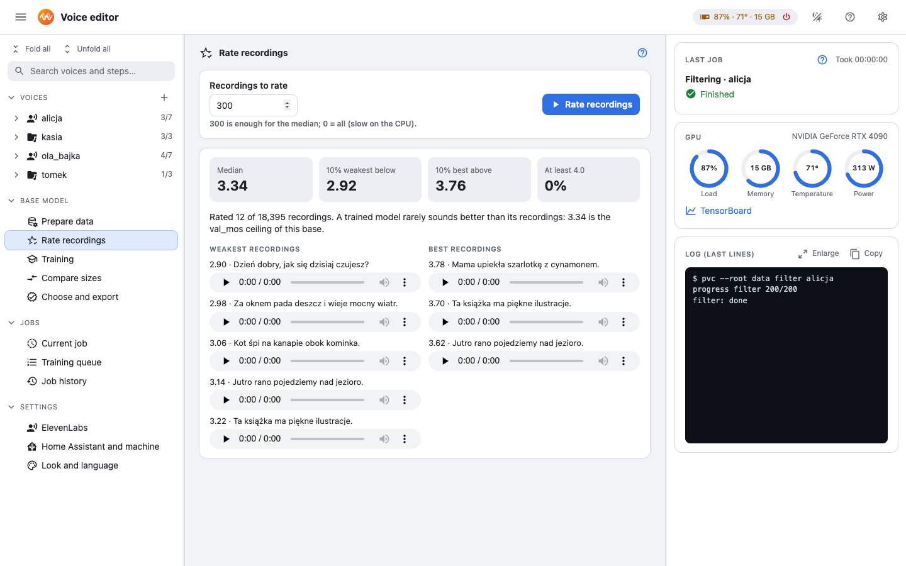

# The base model `bazowy-pl`

The base is a Polish Piper model trained **from scratch** on one speaker with many recordings
(thousands of clips). Every new voice then starts from it instead of the English `lessac`: it learns
Polish faster, says Polish sounds better and sounds more natural. You make it once.

**When:** you have a big clean set of one speaker (e.g. an imported voice with 18 000 clips). Without
one, train from `lessac` – it works too.

**Order:** Prepare data → Rate recordings (optional) →
Training → Compare sizes → Choose and export.

## 1. Prepare data

Pick the voice with a dataset (the largest first) or type an LJSpeech folder,
Prepare the base data. It goes to `bases/pl-scratch/dataset`.

## 2. Rating the recordings {#score}

{ .shot }

Rate recordings computes UTMOS for a random sample with the same model as
`val_mos` in training. **The median is the ceiling:** a model rarely sounds better than its recordings.
Runs next to a training (CPU, about 7 recordings/s); 300 is enough for the median. Listen to the weakest
ones – maybe leave them out.

## 3. Training

| Size | For |
|---|---|
| **medium** | Piper's standard: quick to train and to speak (Raspberry Pi, Jetson). Batch 32. |
| **high** | 8× larger decoder: cleaner sound, 2–3× slower training and speech. Batch 16 to fit 24 GB. |

A base from scratch trains long – thousands of epochs, days on an RTX 4090. `val_mos` rises for a few
hundred epochs, then flattens (18 000 clips: medium about 3.55 after 150–200 epochs, best about 3.75).
The chart and listening work as in [voice training](training.md); with two sizes, switch the model
above the listening.

## 4. Compare sizes

Medium and high side by side: the mean of the last 10 epochs both reached (one epoch of `val_mos` is
noisy) and the best values; below, the ceiling from the rating.

## 5. Choose and export

Pick the base checkpoint (the best `val_mos` of a flat stretch – and how it sounds) and
Use as bazowy-pl. From then on `bazowy-pl` is in the training starts.
Export as a voice makes a normal Piper voice of the base, to hear it in Home
Assistant.
