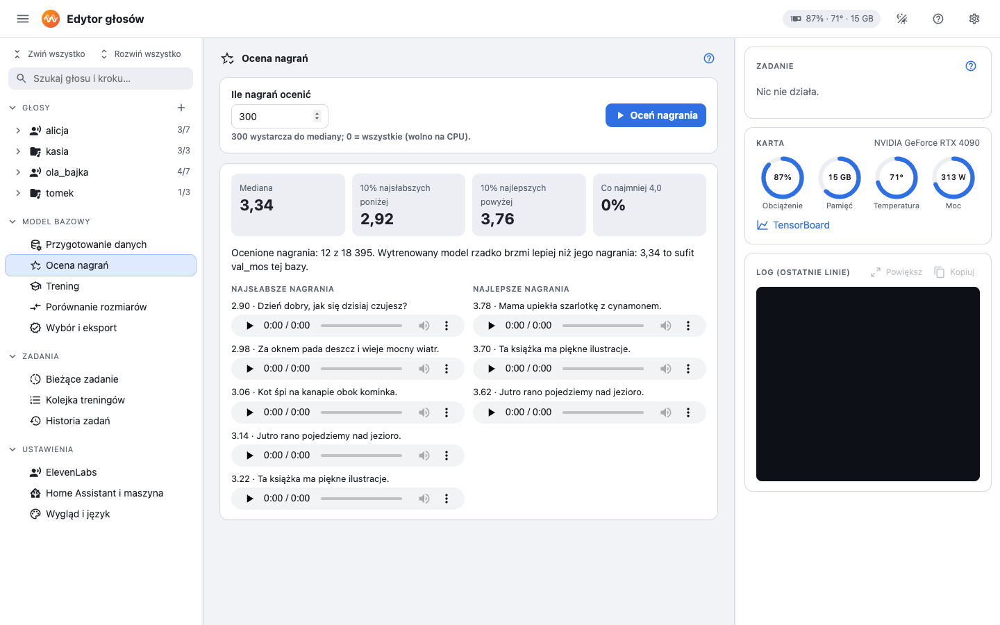

# Model bazowy `bazowy-pl`

Baza to polski model Piper wytrenowany **od zera** na jednym mówcy z wieloma nagraniami (tysiące klipów).
Każdy nowy głos zaczyna potem od niej zamiast od angielskiego `lessac`. Szybciej uczy się polskiego,
lepiej wymawia polskie głoski i brzmi naturalniej. Bazę robisz raz.

**Kiedy:** gdy masz duży, czysty zbiór jednego mówcy, np. zaimportowany głos z 18 000 klipów. Bez takiego
zbioru trenuj od `lessac`, bo to też działa.

**Kolejność:** Przygotowanie danych → Ocena nagrań
(opcjonalnie) → Trening → Porównanie rozmiarów →
Wybór i eksport.

## 1. Przygotowanie danych

Wybierz głos z datasetem (największe są na górze) albo wpisz folder LJSpeech i kliknij
Przygotuj dane bazy. Dane bazy trafiają do `bases/pl-scratch/dataset`.

## 2. Ocena nagrań {#score}

{ .shot }

Oceń nagrania liczy UTMOS losowej próbki nagrań, tym samym modelem co `val_mos`
w treningu. **Mediana to sufit jakości**, bo model rzadko brzmi lepiej niż jego nagrania. Ocena działa
obok treningu (na CPU, ok. 7 nagrań/s). 300 nagrań wystarcza do mediany. Najsłabsze nagrania warto
przesłuchać i ewentualnie usunąć ze zbioru.

## 3. Trening

| Rozmiar | Dla kogo |
|---|---|
| **medium** | standard Pipera: szybki trening i szybkie mówienie (także na Raspberry Pi i Jetsonie). Batch 32. |
| **high** | 8× większy dekoder: czystszy dźwięk, 2–3× wolniejszy trening i mówienie. Batch 16, żeby zmieścić się w 24 GB. |

Baza od zera trenuje się długo: tysiące epok, czyli dni na RTX 4090. Jakość `val_mos` rośnie przez kilkaset
epok, potem się wypłaszcza. Na 18 000 klipach baza medium doszła do ok. 3,55 po 150–200 epokach, a
najlepsza była ok. 3,75. Odsłuch i wykres działają jak przy [treningu głosu](training.md). Przy dwóch
rozmiarach przełączasz model nad odsłuchem.

## 4. Porównanie rozmiarów

Tabela pokazuje medium i high obok siebie. Bierze średnią z ostatnich 10 epok, do których doszły oba
treningi (jedna epoka `val_mos` jest zaszumiona), i najlepsze wartości. Na dole jest sufit z oceny nagrań.

## 5. Wybór i eksport

Wybierz checkpoint bazy (najlepszy `val_mos` z płaskiego odcinka i to, jak brzmi) i kliknij
Użyj jako bazowy-pl. Od tej chwili `bazowy-pl` jest na liście startów treningu.
Eksportuj jako głos robi z bazy zwykły głos Piper, żeby posłuchać jej w Home
Assistant.
