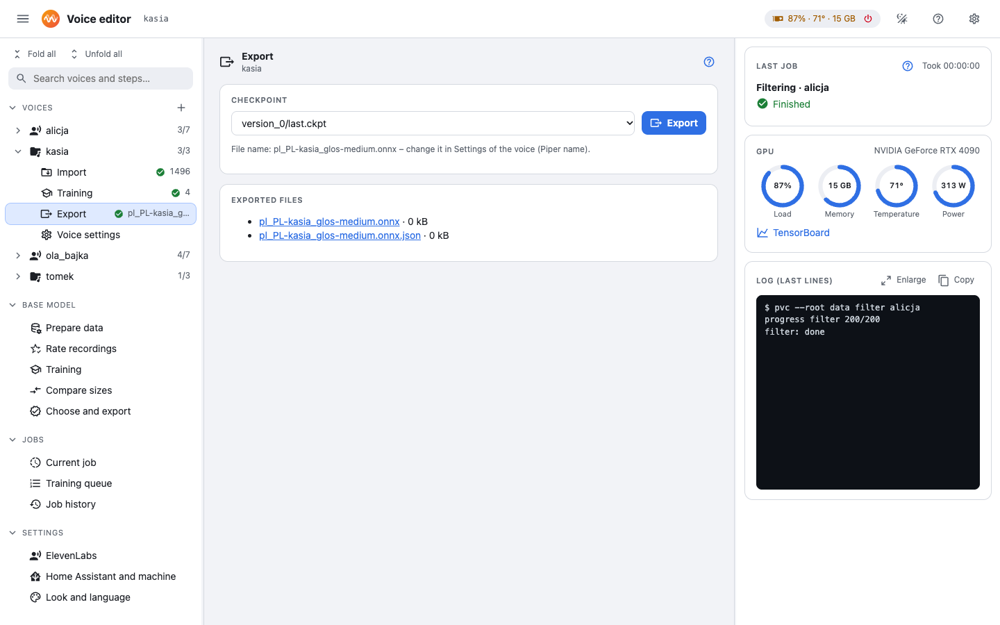

# Export and Home Assistant

{ .shot }

## Export

Pick the checkpoint that sounded best (see [Training](training.md)) and <span class="ui">Export</span>.
Two files appear in `voices/<voice>/export/`:

- `pl_PL-<name>-medium.onnx` – the voice;
- `pl_PL-<name>-medium.onnx.json` – its settings (language, rate, phonemes).

The file name is set in <span class="ui">Voice settings</span> → **Name and Piper file** (e.g.
`pl_PL-kuba_bajka`). Download both from the editor or take them from the data folder on the machine.

## Into Home Assistant (Wyoming Piper)

1. **Copy both files** to Piper's model folder (e.g. `/share/piper/` for the Piper add-on, or the
   `/data` volume of a `wyoming-piper` container). Use a new name – the same name replaces a voice in use
   (back it up first).

   ```bash
   scp ~/piper-voice-cloner/data/voices/kuba_bajka/export/pl_PL-kuba_bajka-medium.onnx* \
       <user>@<piper-server>:/path/to/piper/models/
   ```

2. **Refresh the voices:** **Settings → Devices & services → Wyoming Protocol**, at Piper
   **⋮ → Reload** (older versions may need a restart of Piper).
3. **Choose the voice:** **Settings → Voice assistants** → the assistant → text-to-speech → the new
   voice.
4. **Listen:** **Try** next to the voice, or talk to the assistant. Try sentences outside the training,
   with numbers and dates too (Piper's text normalizer reads them).

To go back, choose the previous voice in the assistant.
