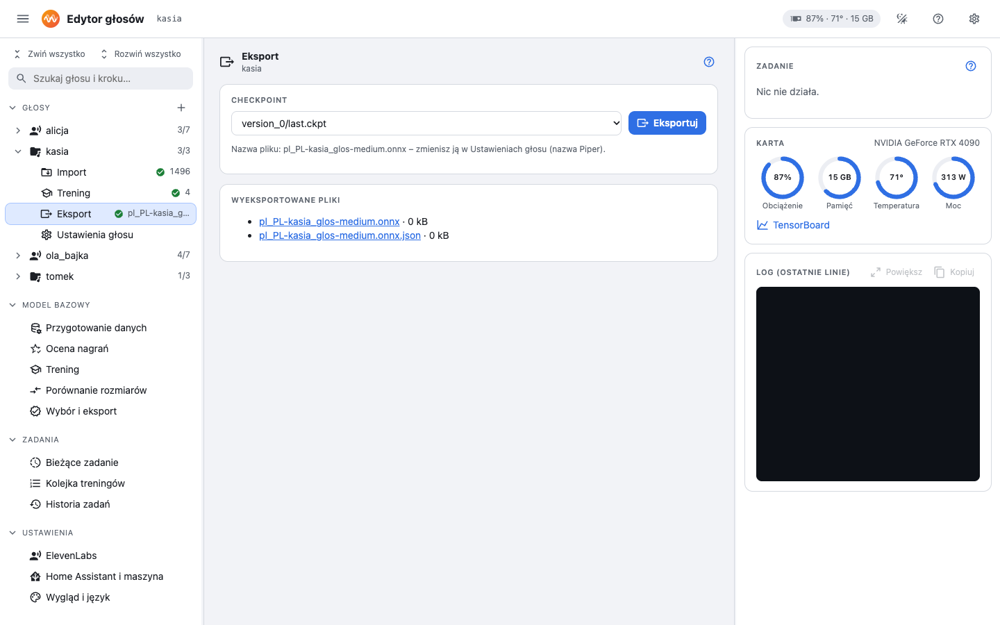

# Eksport i Home Assistant

{ .shot }

## Eksport

Wybierz checkpoint, który brzmiał najlepiej (zob. [Trening](training.md)), i kliknij
<span class="ui">Eksportuj</span>. Powstaną dwa pliki w `voices/<głos>/export/`:

- `pl_PL-<nazwa>-medium.onnx`: sam głos;
- `pl_PL-<nazwa>-medium.onnx.json`: jego ustawienia (język, częstotliwość, głoski).

Nazwę pliku ustawiasz w <span class="ui">Ustawienia głosu</span> → **Nazwa i plik Piper**, np.
`pl_PL-kuba_bajka`. Oba pliki pobierzesz z edytora albo znajdziesz w folderze danych na maszynie.

## Wgranie do Home Assistant (Wyoming Piper)

1. **Skopiuj oba pliki** do katalogu modeli Pipera, np. `/share/piper/` przy dodatku Piper albo do
   wolumenu `/data` kontenera `wyoming-piper`. Użyj nowej nazwy. Ta sama nazwa nadpisze działający głos,
   więc najpierw zrób jego kopię.

   ```bash
   scp ~/piper-voice-cloner/data/voices/kuba_bajka/export/pl_PL-kuba_bajka-medium.onnx* \
       <użytkownik>@<serwer-pipera>:/ścieżka/do/piper/models/
   ```

2. **Odśwież listę głosów:** otwórz **Ustawienia → Urządzenia i usługi → Wyoming Protocol**, przy Piperze
   wybierz **⋮ → Załaduj ponownie**. Starsze wersje mogą wymagać restartu Pipera.
3. **Wybierz głos:** otwórz **Ustawienia → Asystenci głosowi**, wybierz asystenta i ustaw nowy głos w
   zamianie tekstu na mowę.
4. **Posłuchaj:** **Wypróbuj** przy głosie albo zwykła rozmowa z asystentem. Sprawdź zdania spoza
   treningu, także z liczbami i datami, bo czyta je normalizacja tekstu Pipera.

Żeby się wycofać, wybierz poprzedni głos w asystencie.
