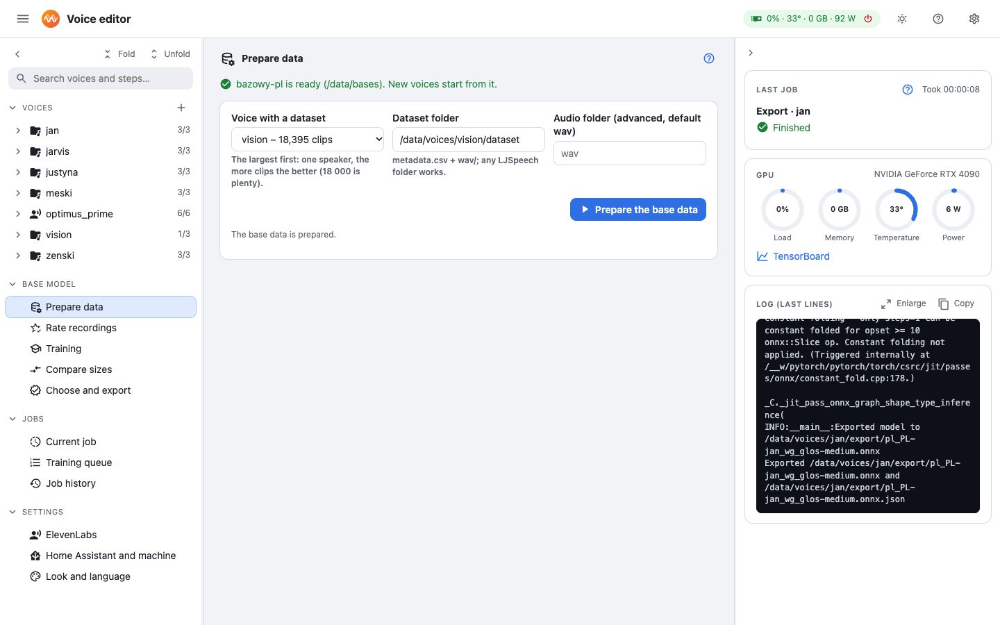
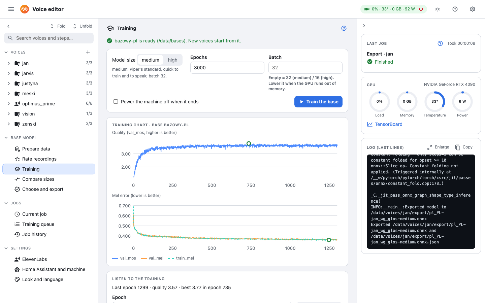
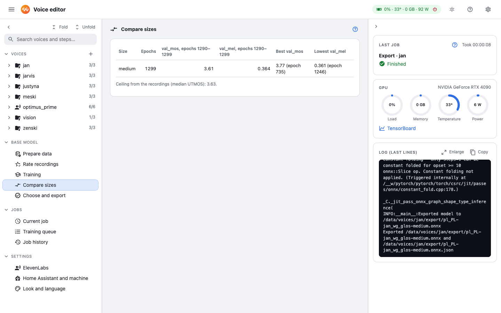
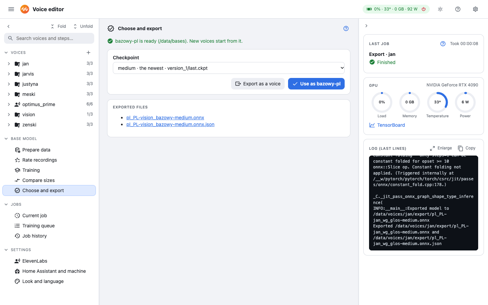

# Train the base voice

The base `bazowy-pl` is a Polish Piper model trained **from scratch** on one speaker with many
recordings. Every new voice then starts from it instead of the English `lessac`: it learns Polish faster
and sounds more natural. You make it once. At the end of this page `bazowy-pl` is ready and appears in
Start from of every training.

**You need:** one speaker, thousands of clean clips with their text – for example a voice imported in
[way B](guide-train.md#import) (the voice `vision` in the pictures has 18 395 clips). No such set? Train
your voices from `lessac` – that works too.

**The order** is the order in the tree under Base model:
Prepare data → Rate recordings →
Training → Compare sizes →
Choose and export.

## 1. Prepare data {#prepare}

{ .shot }

1. Open Base model → Prepare data.
2. **Voice with a dataset** – choose the voice. The largest is on top.
   The **Dataset folder** fills in by itself. You can also type any LJSpeech
   folder there (`metadata.csv` + `wav/`).
3. **Audio folder (advanced, default wav)** – leave it empty.
4. Click Prepare the base data. When it is done, the step says
   The base data is prepared.

## 2. Rate the recordings {#score}

Optional, but worth the few minutes: it tells you the **ceiling** – how good the base can get.
Step by step: [Rate recordings → Rate the base recordings](guide-rate.md#score). In the pictures the
median is 3.63.

## 3. Train the base {#train}

{ .shot }

1. Open Base model → Training.
2. **Model size**:
    - **medium** – Piper's standard: quick to train and quick to speak, also on a Raspberry Pi or a Jetson.
      Start with this one.
    - **high** – an 8× larger decoder: cleaner sound, but 2–3× slower training and speech.
3. **Epochs** – e.g. 3000. You will stop earlier when the chart is flat.
4. **Batch** – leave it empty: 32 for medium, 16 for high (fits 24 GB). Lower it
   only after an "out of memory" error.
5. Tick Power the machine off when it ends if you want.
6. Click Train the base.

What to expect:

- **It takes days.** A base from scratch needs hundreds to thousands of epochs; on an RTX 4090 with
  18 000 clips that is days, not hours.
- **`val_mos` rises fast, then flattens.** In the picture it is about 3.5 after a hundred or so epochs and
  hardly moves later: the best was 3.77 at epoch 735, the last epoch (1299) had 3.57.
- **The ceiling holds.** With a median of 3.63 from the rating, values around 3.6–3.7 are the end of the
  road. More epochs will not help.
- Below the chart is **Listen to the training** – it works as for a voice
  ([Train a voice](guide-train.md#listen)). With two sizes, switch the model above it.

!!! warning "The GPU is busy"
    While the base trains, no other GPU job can run (rating the recordings can – it uses the CPU).
    Stop ends the training at any time; Train the base
    later resumes from the last checkpoint.

## 4. Compare sizes {#compare}

{ .shot }

Did you train both medium and high? Compare sizes puts them side by side:

- `val_mos` and `val_mel` as the mean of the last 10 epochs both reached – one epoch is noisy;
- Best val_mos and Lowest val_mel with their epochs;
- below, the ceiling from the recordings (median UTMOS).

High is worth it only when it is clearly better **and** you like the sound. Otherwise keep medium – it
speaks faster.

## 5. Choose and export {#select}

{ .shot }

1. Open Base model → Choose and export.
2. **Checkpoint** – choose the checkpoint of the base. Take one from the flat
   stretch with a good `val_mos` that also sounds good.
3. Optionally Export as a voice – makes a normal Piper voice of the base
   (the files show under **Exported files**). Useful to hear the base in Home
   Assistant ([Export to Home Assistant](guide-export.md)).
4. Click Use as bazowy-pl.

The green line at the top says "bazowy-pl is ready (/data/bases). New voices start from it."

## 6. Use the base {#use}

- **A new voice:** in Training choose `bazowy-pl` in
  Start from. With about 1500 clips, 500–1000 epochs are enough; the base's colour
  usually turns into the new voice after 50–100 epochs.
- **Several voices:** in Training queue choose `bazowy-pl` for all of them.
- **A better base later:** train more, choose another checkpoint and click
  Use as bazowy-pl again. Voices trained earlier keep their own checkpoints.
  The base before stays as `bases/pl-scratch-1.ckpt` (`-2`…); go back to it with `ckpt:<path>` in
  Start from.

More: [Base model](base-model.md).

Next: [Export to Home Assistant](guide-export.md).
