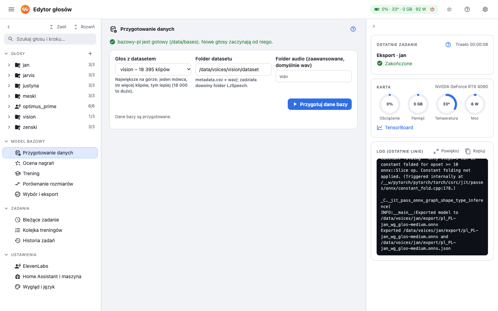
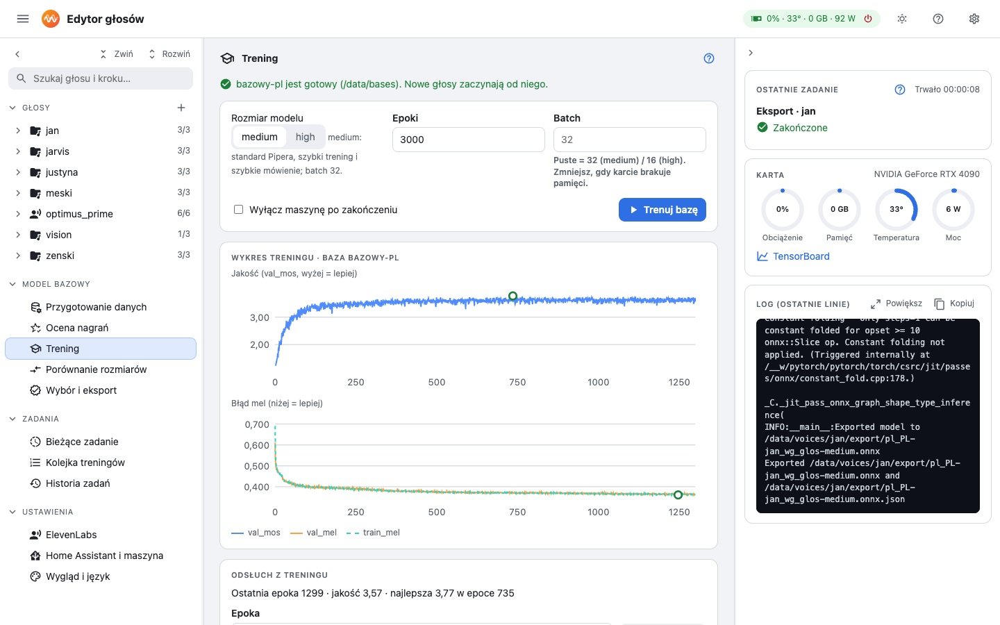
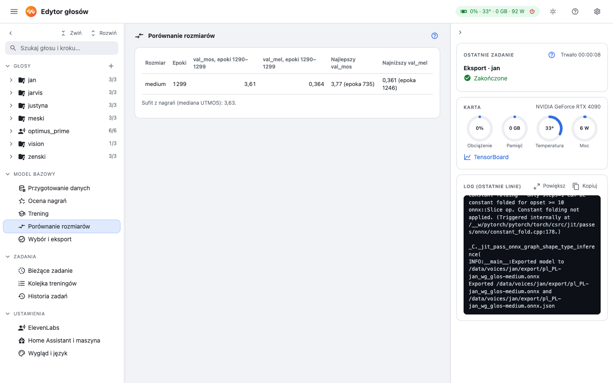
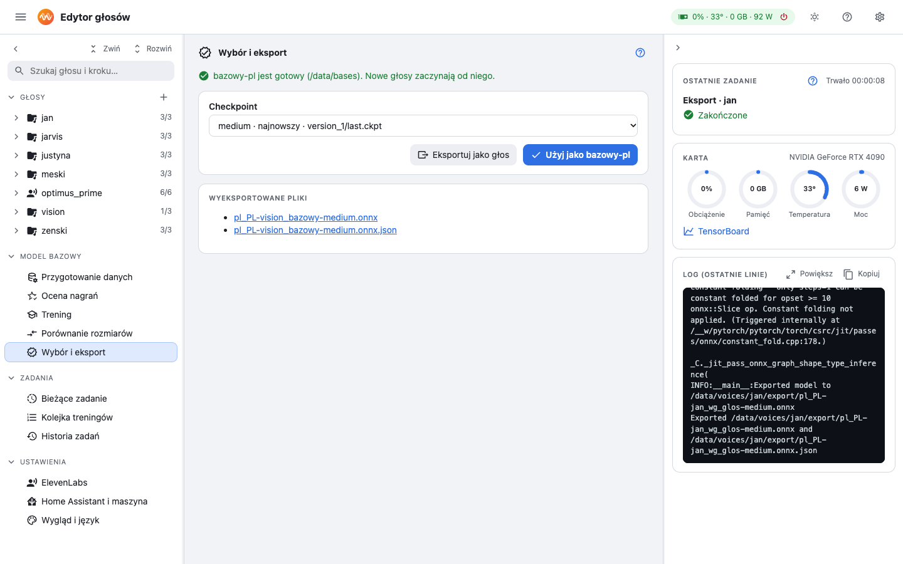

# Wytrenuj głos bazowy

Baza `bazowy-pl` to polski model Piper wytrenowany **od zera** na jednym mówcy z wieloma nagraniami.
Każdy nowy głos zaczyna potem od niej zamiast od angielskiego `lessac`: szybciej uczy się polskiego
i brzmi naturalniej. Bazę robisz raz. Na końcu tej strony `bazowy-pl` będzie gotowy i pojawi się w polu
Start od każdego treningu.

**Potrzebujesz:** jednego mówcy i tysięcy czystych klipów z tekstem – np. głosu zaimportowanego
[ścieżką B](guide-train.md#import) (głos `vision` na obrazkach ma 18 395 klipów). Nie masz takiego
zbioru? Trenuj głosy od `lessac` – to też działa.

**Kolejność** jest taka jak w drzewie pod Model bazowy:
Przygotowanie danych → Ocena nagrań →
Trening → Porównanie rozmiarów →
Wybór i eksport.

## 1. Przygotuj dane {#prepare}

{ .shot }

1. Otwórz Model bazowy → Przygotowanie danych.
2. **Głos z datasetem** – wybierz głos. Największy jest na górze.
   **Folder datasetu** wypełni się sam. Możesz tam też wpisać dowolny folder
   LJSpeech (`metadata.csv` + `wav/`).
3. **Folder audio (zaawansowane, domyślnie wav)** – zostaw puste.
4. Kliknij Przygotuj dane bazy. Po skończeniu krok pokaże
   Dane bazy są przygotowane.

## 2. Oceń nagrania {#score}

Krok opcjonalny, ale wart tych kilku minut: pokazuje **sufit**, czyli jak dobra może być baza.
Krok po kroku: [Oceń nagrania → Oceń nagrania bazy](guide-rate.md#score). Na obrazkach mediana wynosi
3,63.

## 3. Wytrenuj bazę {#train}

{ .shot }

1. Otwórz Model bazowy → Trening.
2. **Rozmiar modelu**:
    - **medium** – standard Pipera: szybki trening i szybkie mówienie, także na Raspberry Pi i Jetsonie.
      Zacznij od niego.
    - **high** – 8× większy dekoder: czystszy dźwięk, ale 2–3× wolniejszy trening i mówienie.
3. **Epoki** – np. 3000. Przerwiesz wcześniej, gdy wykres się wypłaszczy.
4. **Batch** – zostaw puste: 32 dla medium, 16 dla high (mieści się w 24 GB).
   Zmniejsz dopiero po błędzie braku pamięci.
5. Jeśli chcesz, zaznacz Wyłącz maszynę po zakończeniu.
6. Kliknij Trenuj bazę.

Czego się spodziewać:

- **To trwa dni.** Baza od zera potrzebuje setek, a nawet tysięcy epok; na RTX 4090 przy 18 000 klipach
  to dni, nie godziny.
- **`val_mos` szybko rośnie, potem się wypłaszcza.** Na obrazku ma ok. 3,5 po mniej więcej stu epokach
  i potem prawie się nie zmienia: najlepszy był 3,77 w epoce 735, ostatnia epoka (1299) miała 3,57.
- **Sufit trzyma.** Przy medianie 3,63 z oceny nagrań wartości ok. 3,6–3,7 to koniec drogi. Więcej epok
  nie pomoże.
- Pod wykresem jest **Odsłuch z treningu** – działa jak przy głosie
  ([Wytrenuj głos](guide-train.md#listen)). Przy dwóch rozmiarach przełączasz model nad nim.

!!! warning "Karta jest zajęta"
    Gdy baza się trenuje, żadne inne zadanie na GPU nie ruszy (ocena nagrań tak – liczy się na CPU).
    Zatrzymaj przerywa trening w każdej chwili, a późniejsze
    Trenuj bazę wznawia od ostatniego checkpointu.

## 4. Porównaj rozmiary {#compare}

{ .shot }

Trenujesz i medium, i high? Porównanie rozmiarów stawia je obok siebie:

- `val_mos` i `val_mel` jako średnia z ostatnich 10 epok, do których doszły oba – jedna epoka jest
  zaszumiona;
- Najlepszy val_mos i Najniższy val_mel z numerami epok;
- na dole sufit z nagrań (mediana UTMOS).

High opłaca się tylko wtedy, gdy jest wyraźnie lepszy **i** podoba Ci się jego brzmienie. W przeciwnym
razie zostań przy medium – mówi szybciej.

## 5. Wybierz i wyeksportuj {#select}

{ .shot }

1. Otwórz Model bazowy → Wybór i eksport.
2. **Checkpoint** – wybierz checkpoint bazy. Weź taki z płaskiego odcinka,
   z dobrym `val_mos`, który do tego dobrze brzmi.
3. Opcjonalnie Eksportuj jako głos – robi z bazy zwykły głos Piper (pliki pojawią
   się w części **Wyeksportowane pliki**). Przydaje się, żeby posłuchać bazy
   w Home Assistant ([Eksport do Home Assistant](guide-export.md)).
4. Kliknij Użyj jako bazowy-pl.

Zielona linia u góry potwierdzi: „bazowy-pl jest gotowy (/data/bases). Nowe głosy zaczynają od niego.”

## 6. Korzystaj z bazy {#use}

- **Nowy głos:** w kroku Trening wybierz `bazowy-pl` w polu
  Start od. Przy ok. 1500 klipach wystarczy 500–1000 epok; barwa bazy zwykle
  zmienia się w nowy głos po 50–100 epokach.
- **Kilka głosów:** w Kolejka treningów wybierz `bazowy-pl` dla wszystkich.
- **Lepsza baza później:** dotrenuj, wybierz inny checkpoint i znowu kliknij
  Użyj jako bazowy-pl. Głosy wytrenowane wcześniej zostają przy swoich
  checkpointach, a poprzednia baza zostaje obok jako `bases/pl-scratch-1.ckpt` (`-2`…). Wrócisz do niej
  przez `ckpt:<ścieżka>` w Start od.

Więcej: [Model bazowy](base-model.md).

Dalej: [Eksport do Home Assistant](guide-export.md).
