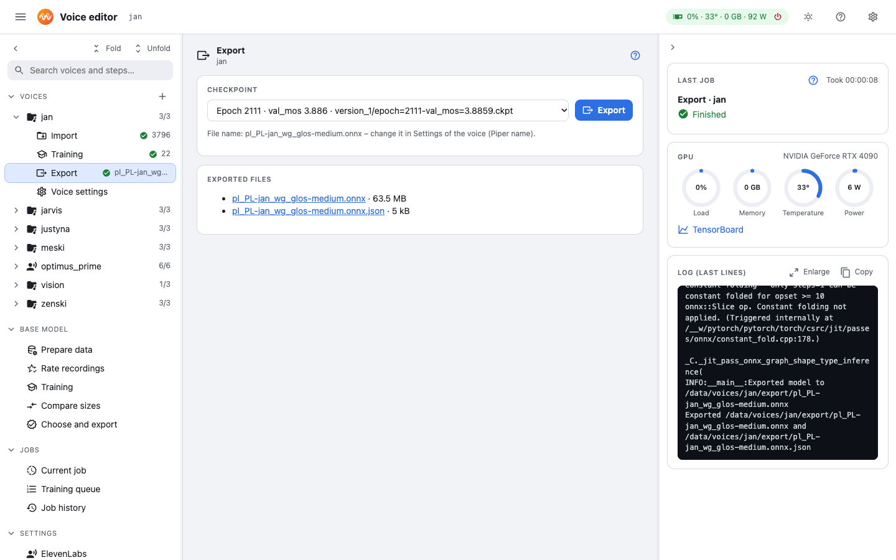

# Export to Home Assistant

The last step: you turn the chosen checkpoint into a Piper voice and use it in Home Assistant. At the end
your assistant speaks with the new voice.

You need a trained voice: [Train a voice](guide-train.md).

## 1. Export the voice {#export}

{ .shot }

1. Open the voice → <span class="ui">Export</span>.
2. **<span class="ui">Checkpoint</span>** – the list shows each saved model with its epoch and `val_mos`,
   e.g. `Epoch 2111 · val_mos 3.886`. Choose the one that sounded best
   ([Train a voice → Listen](guide-train.md#listen)).
3. Click <span class="ui">Export</span>. It takes a few seconds.
4. Under **<span class="ui">Exported files</span>** two files appear:
    - `pl_PL-<name>-medium.onnx` – the voice (about 60 MB);
    - `pl_PL-<name>-medium.onnx.json` – its settings (a few kB).
5. Click each name to download it.

The file name comes from the Piper file name of the voice. Change it in
<span class="ui">Voice settings</span> → <span class="ui">Name and Piper file</span>, then export again.
On the machine the files are also in `~/piper-voice-cloner/data/voices/<voice>/export/`.

!!! warning "Always both files"
    Piper needs the `.onnx` and the `.onnx.json` side by side, with the same name. One of them alone is
    not a voice.

## 2. Copy the files to Piper {#copy}

Home Assistant speaks with Piper through Wyoming. Copy both files to Piper's model folder:

- **The Piper add-on** (Home Assistant OS): the `/share/piper/` folder. Use the Samba share
  (`share\piper`) or the SSH add-on.
- **A `wyoming-piper` container**: the volume mounted as `/data`.

From the machine, for example:

```bash
scp ~/piper-voice-cloner/data/voices/kuba_bajka/export/pl_PL-kuba_bajka-medium.onnx* \
    <user>@<piper-server>:/path/to/piper/models/
```

!!! warning "Do not overwrite a voice in use"
    The same file name replaces the old voice. Want to keep it? Back the old files up first, or give the
    new version another Piper file name (e.g. `pl_PL-kuba_bajka_v2`) and compare both.

## 3. Let Home Assistant see the voice {#reload}

1. Open **Settings → Devices & services → Wyoming Protocol**.
2. At the Piper entry click **⋮ → Reload**.
3. Still not in the list? Restart the Piper add-on (or the container).

## 4. Choose the voice {#choose}

1. Open **Settings → Voice assistants**.
2. Click your assistant.
3. Under **Text-to-speech** choose Piper, the language Polish and the new voice.
4. Click **Update**.

## 5. Listen {#test}

1. Click **Try** next to the voice (the play button) and listen.
2. Talk to the assistant: ask for the weather, the time, a timer.
3. Try sentences that were **not** in the training, also with numbers and dates – Piper turns them into
   words itself.

Does it sound worse than in the editor? Compare with the samples of the same epoch in
<span class="ui">Listen to the training</span>. When it hisses or stutters, the cause is usually in the
recordings: [FAQ](faq.md).

## 6. Go back or try another epoch {#rollback}

- **Back to the old voice:** choose it again in the assistant (step 4). Nothing else changes.
- **Another epoch:** go back to <span class="ui">Export</span>, choose another checkpoint, export, copy
  and reload. Give it another file name if you want to compare both in Home Assistant.
- **Train more:** <span class="ui">Resume training</span> continues from the last checkpoint; export
  again afterwards.

More: [Export and Home Assistant](export.md).
