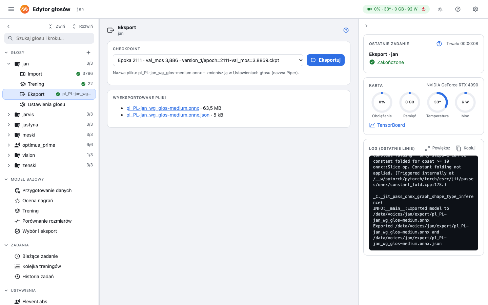

# Eksport do Home Assistant

Ostatni krok: z wybranego checkpointu robisz głos Piper i używasz go w Home Assistant. Na końcu Twój
asystent mówi nowym głosem.

Potrzebny jest wytrenowany głos: [Wytrenuj głos](guide-train.md).

## 1. Wyeksportuj głos {#export}

{ .shot }

1. Otwórz głos → <span class="ui">Eksport</span>.
2. **<span class="ui">Checkpoint</span>** – lista pokazuje każdy zapisany model z epoką i `val_mos`,
   np. `Epoka 2111 · val_mos 3,886`. Wybierz ten, który brzmiał najlepiej
   ([Wytrenuj głos → Posłuchaj](guide-train.md#listen)).
3. Kliknij <span class="ui">Eksportuj</span>. Trwa to kilka sekund.
4. W części **<span class="ui">Wyeksportowane pliki</span>** pojawią się dwa pliki:
    - `pl_PL-<nazwa>-medium.onnx` – sam głos (ok. 60 MB);
    - `pl_PL-<nazwa>-medium.onnx.json` – jego ustawienia (kilka kB).
5. Kliknij każdą nazwę, żeby pobrać plik.

Nazwa pliku pochodzi z nazwy pliku Piper głosu. Zmienisz ją w <span class="ui">Ustawienia głosu</span>
→ <span class="ui">Nazwa i plik Piper</span>, a potem wyeksportujesz jeszcze raz. Na maszynie pliki
leżą też w `~/piper-voice-cloner/data/voices/<głos>/export/`.

!!! warning "Zawsze oba pliki"
    Piper potrzebuje `.onnx` i `.onnx.json` obok siebie, z tą samą nazwą. Jeden z nich to jeszcze nie głos.

## 2. Skopiuj pliki do Pipera {#copy}

Home Assistant mówi Piperem przez Wyoming. Skopiuj oba pliki do katalogu modeli Pipera:

- **Dodatek Piper** (Home Assistant OS): folder `/share/piper/`. Skorzystaj z udziału Samba
  (`share\piper`) albo z dodatku SSH.
- **Kontener `wyoming-piper`**: wolumen podpięty jako `/data`.

Z maszyny, na przykład:

```bash
scp ~/piper-voice-cloner/data/voices/kuba_bajka/export/pl_PL-kuba_bajka-medium.onnx* \
    <użytkownik>@<serwer-pipera>:/ścieżka/do/piper/models/
```

!!! warning "Nie nadpisuj używanego głosu"
    W edytorze eksport nigdy nie nadpisuje pliku: gdy nazwa jest zajęta, nowy dostaje numer
    (`pl_PL-kuba_bajka_2-medium.onnx`). Na serwerze Pipera ta sama nazwa pliku zastępuje jednak stary
    głos. Kopiuj pliki z ich nową nazwą (z numerem), a obie wersje zostaną w Home Assistant obok siebie.

## 3. Pokaż głos Home Assistantowi {#reload}

1. Otwórz **Ustawienia → Urządzenia i usługi → Wyoming Protocol**.
2. Przy pozycji Piper kliknij **⋮ → Załaduj ponownie**.
3. Nadal nie ma go na liście? Uruchom ponownie dodatek Piper (albo kontener).

## 4. Wybierz głos {#choose}

1. Otwórz **Ustawienia → Asystenci głosowi**.
2. Kliknij swojego asystenta.
3. W części **Zamiana tekstu na mowę** wybierz Piper, język polski i nowy głos.
4. Kliknij **Aktualizuj**.

## 5. Posłuchaj {#test}

1. Kliknij **Wypróbuj** przy głosie (przycisk odtwarzania) i posłuchaj.
2. Porozmawiaj z asystentem: zapytaj o pogodę, godzinę, ustaw minutnik.
3. Sprawdź zdania, których **nie było** w treningu, także z liczbami i datami – Piper sam zamienia je na
   słowa.

Brzmi gorzej niż w edytorze? Porównaj z próbkami tej samej epoki w
<span class="ui">Odsłuch z treningu</span>. Jeśli syczy albo się jąka, przyczyna jest zwykle w nagraniach:
[FAQ](faq.md).

## 6. Wróć albo spróbuj innej epoki {#rollback}

- **Powrót do starego głosu:** wybierz go znowu w asystencie (krok 4). Nic więcej się nie zmienia.
- **Inna epoka:** wróć do <span class="ui">Eksport</span>, wybierz inny checkpoint, wyeksportuj,
  skopiuj i załaduj ponownie. Nadaj inną nazwę pliku, jeśli chcesz porównać oba głosy w Home Assistant.
- **Dłuższy trening:** <span class="ui">Wznów trening</span> kontynuuje od ostatniego checkpointu;
  potem wyeksportuj jeszcze raz.

Więcej: [Eksport i Home Assistant](export.md).
