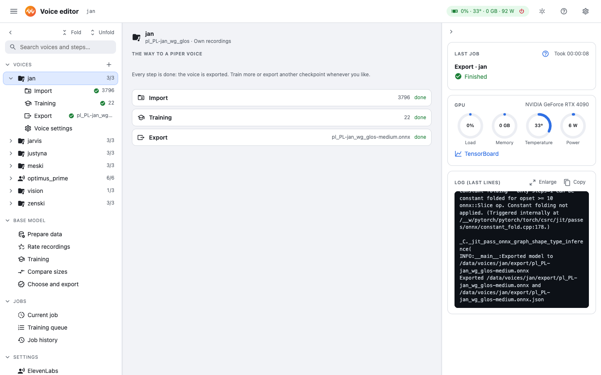
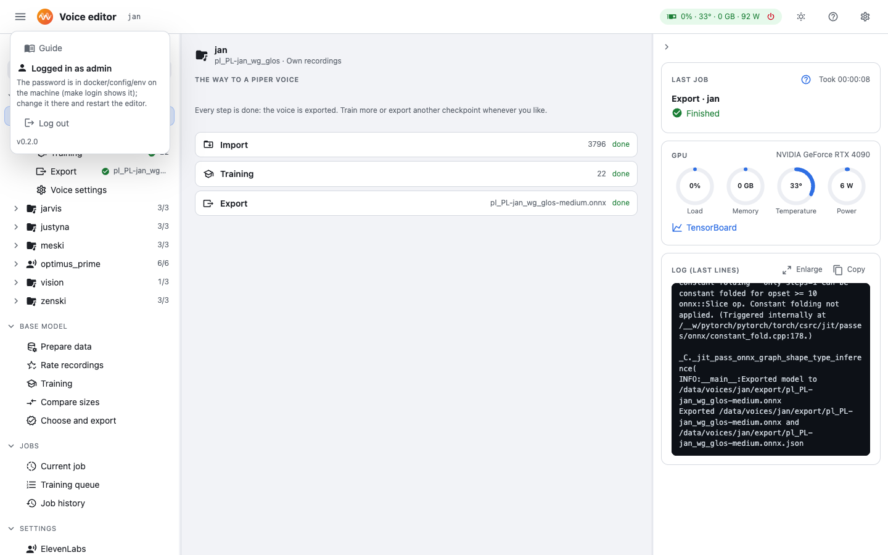
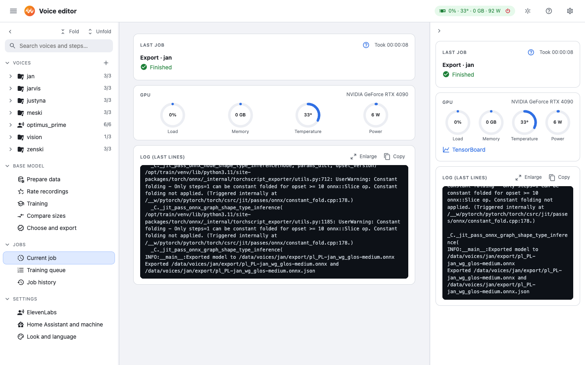
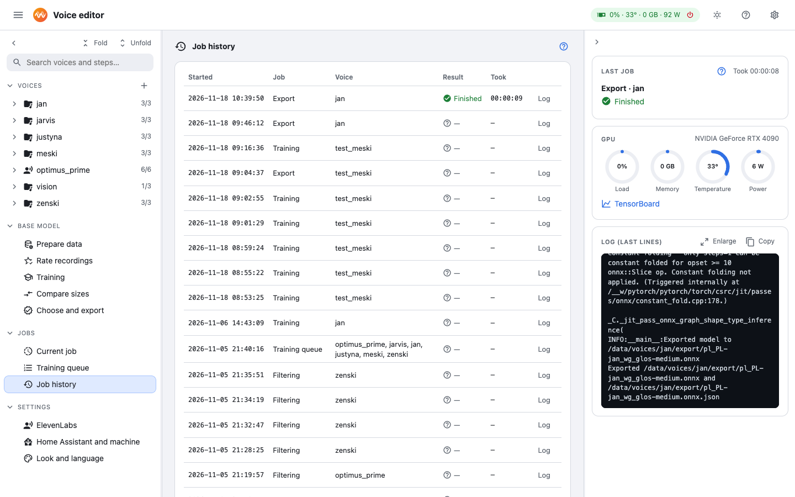
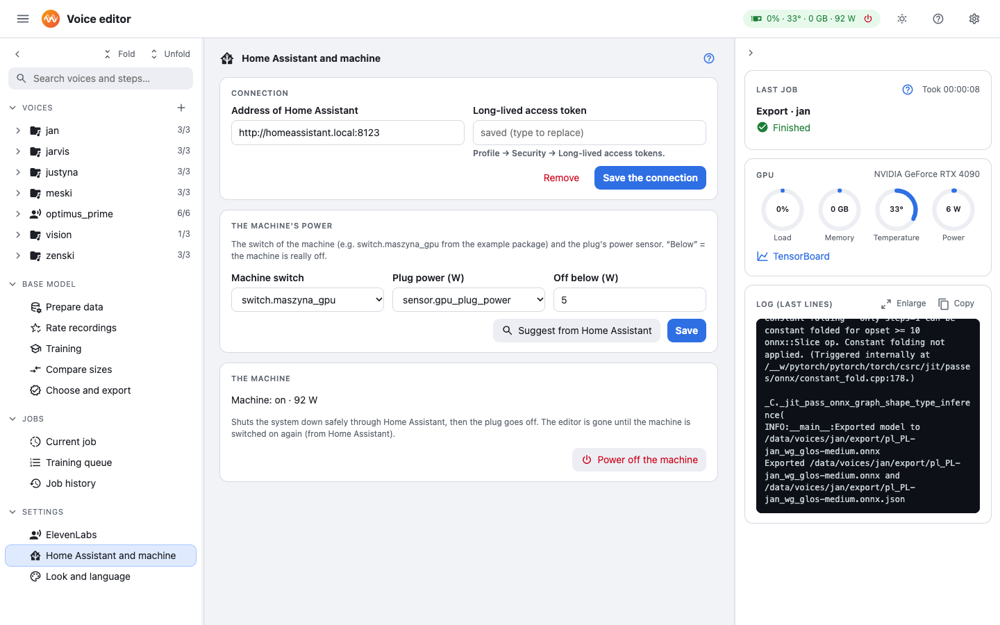
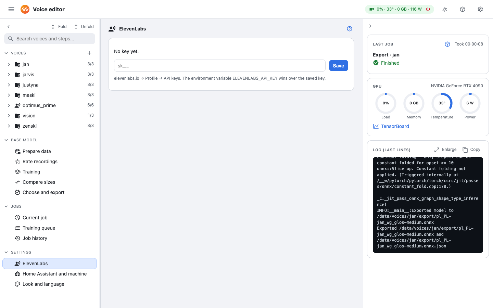

# First steps

This walkthrough starts after the [installation](installation.md). At the end you can log in, you know
every part of the screen, and the editor is connected to Home Assistant (and to ElevenLabs, if you use it).

The next pages go one task at a time:

1. **First steps** – this page.
2. [Add a new voice](guide-new-voice.md)
3. [Rate recordings](guide-rate.md)
4. [Train a voice](guide-train.md)
5. [Train the base voice](guide-base.md)
6. [Export to Home Assistant](guide-export.md)
7. [Tour and lessons in the editor](guide-tour.md)

## 1. Log in {#login}

1. Open `http://<machine>:7860` in a browser on any computer, phone or tablet at home.
2. Type the user and the password. You do not know them? Run `make login` on the Mac (or
   `docker/install-ubuntu.sh --show-login` on the machine).
3. The session lasts 30 days, so you will not log in every day.

## 2. The screen at a glance {#tour}

{ .shot }

The screen has a top bar and three columns.

**The top bar**, from the left:

- **☰** opens the menu (more below).
- **Voice editor** and the name of the open voice (here `jan`).
- **The job chip** appears while a job runs: what runs, the percentage and the time left. A click opens
  Current job.
- **The machine chip** (green, top right): GPU load, temperature, GPU memory and the power taken from the
  plug (`0% · 39° · 0 GB · 86 W`). The red ⏻ switches the machine off – only with the Home Assistant
  connection and when nothing runs.
- **The sun icon** switches the theme, **?** opens this guide, **⚙** opens a small box with the look.

**The left column** is the tree:

- Voices – every voice with the steps of its way. The icon tells the way: a
  folder with a note is an imported voice (own recordings), a speaking head is a cloned voice. The
  number on the right (`3/3`, `6/6`) says how many steps are done; an optional step
  (Audition) counts only once you do it. **+** makes a new voice.
- Base model – the five steps of the Polish base `bazowy-pl`.
- Jobs – Current job, Training queue,
  Job history.
- Settings – ElevenLabs,
  Home Assistant and machine, Look and language.

Above the tree you have the search (Search voices and steps…),
Fold and Unfold (everything at once). The arrow **‹** folds the whole
column away.

**The middle** shows what you clicked. A click on a voice shows
The way to a Piper voice: all its steps with the counts and the word
done. A click on a step opens that step. The blue **?** in the corner of every
step explains it in a small window.

**The right column** shows the job:

- the job card – the job running now or the last one (here: Last job, Export ·
  jan, Finished, Took 00:00:08);
- the GPU card – four rings: Load, Memory,
  Temperature, Power, and the
  TensorBoard link (detailed training charts);
- the log – the last lines of the job. Enlarge opens it big,
  Copy copies it (handy when you ask for help).

While a job runs, its card also shows the progress, the time left, Stop and the
box Power the machine off when it ends.

More details: [The screen](screen.md).

## 3. The menu ☰ {#menu}

{ .shot }

- Guide opens this guide.
- **Logged in as admin** – and where the password lives (`docker/config/env` on the machine). To change
  it, edit that file and restart the editor.
- Log out logs you out in this browser.
- At the bottom: the editor's version.

## 4. Look and language ⚙ {#look}

{ .shot }

1. Click **⚙** in the top right corner.
2. **Theme:** System, Light or Dark.
3. **Language:** **Polski** or **English**.
4. Changes work at once. Esc or a click beside the box closes it.

The browser remembers the choice. All of look and language opens the same settings
as a full page.

## 5. Jobs: what runs and what ran {#jobs}

Only one GPU job runs at a time. Jobs keep running when you close the browser.

{ .shot }

Current job shows the job card, the GPU and the log in the middle, wide. Use it to
read a long log while a training runs.

{ .shot }

Job history lists every job: when it started, what it was, for which voice (the
voices of a queue), how it ended and how long it took. A failed job stands out in red.
Log opens its whole log below the table – useful in the morning after a night of
training.

## 6. Connect Home Assistant (once) {#home-assistant}

With the connection, the editor shows the plug's power and can switch the machine off after a training.
You need the example package in Home Assistant first (see [Installation](installation.md#home-assistant)).

{ .shot }

1. Open Settings → Home Assistant and machine.
2. **Address of Home Assistant**, e.g. `http://homeassistant.local:8123`.
3. **Long-lived access token**: in Home Assistant open your profile →
   **Security** → **Long-lived access tokens**, make a token of an admin user and paste it here.
4. Save the connection. A saved token shows as "saved (type to replace)".
   Remove deletes the address and the token.
5. Under **The machine's power** click
   Suggest from Home Assistant, then choose:
    - Machine switch – the switch of the example package;
    - Plug power (W) – the plug's power sensor;
    - Off below (W) – below this the machine counts as off (e.g. 5).
6. Save.

The card **The machine** then shows the state (`Machine: on · 67 W`) and
Power off the machine.

!!! warning "Powering off ends the editor too"
    Power off the machine shuts the system down and then switches the plug off.
    The editor stops answering until you switch the machine on again from Home Assistant. When a job
    ends with "power off" ticked, the top bar first counts down two minutes ("Power-off in 1:45") – click
    Cancel there if you still need the machine. After Stop
    the machine never powers off.

## 7. Save the ElevenLabs key (only for ElevenLabs) {#elevenlabs}

You need this only when an ElevenLabs voice should read the sentences (way A).

{ .shot }

1. On elevenlabs.io open **Profile → API keys** and make a key.
2. In the editor: Settings → ElevenLabs.
3. Paste the key (`sk_…`) and click Save.

The key is saved once on the machine and never shown again. It works for all voices.

Next: [Add a new voice](guide-new-voice.md).
