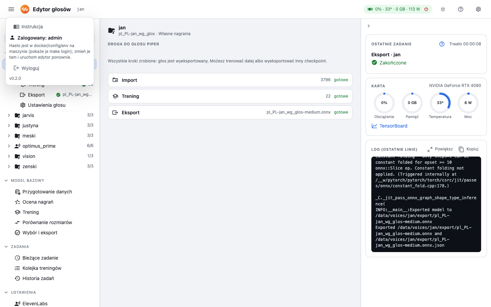
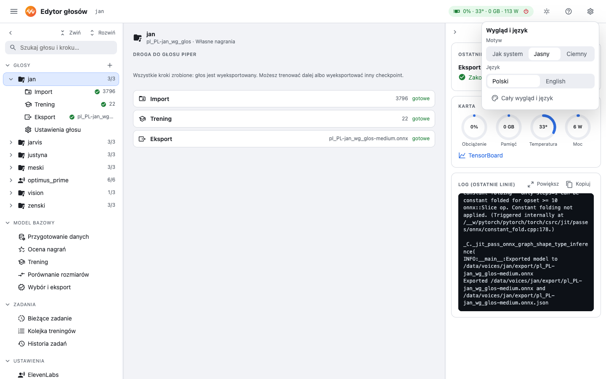
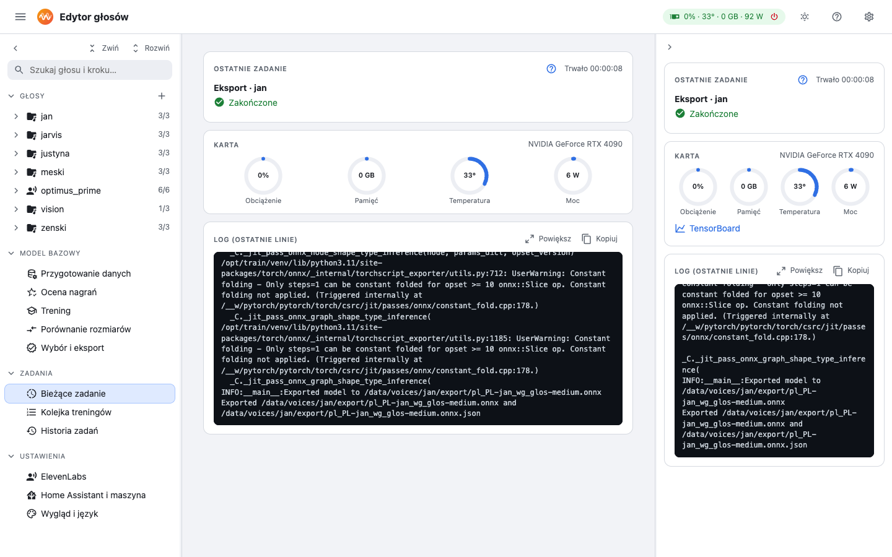
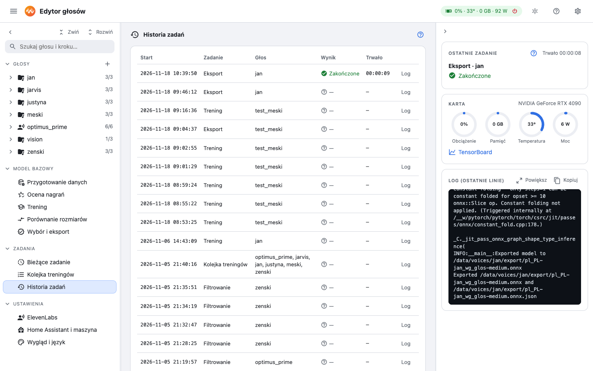
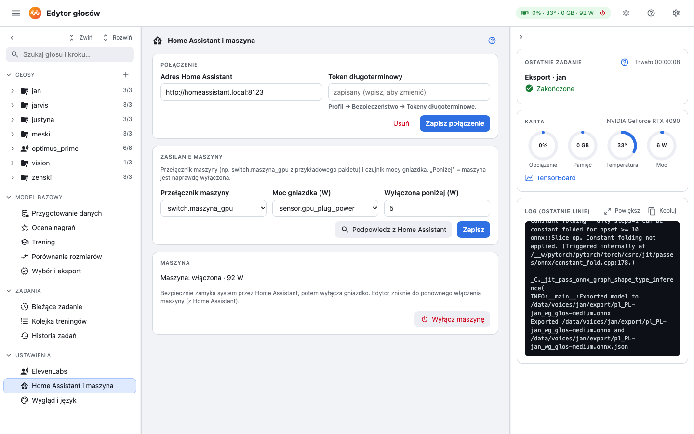
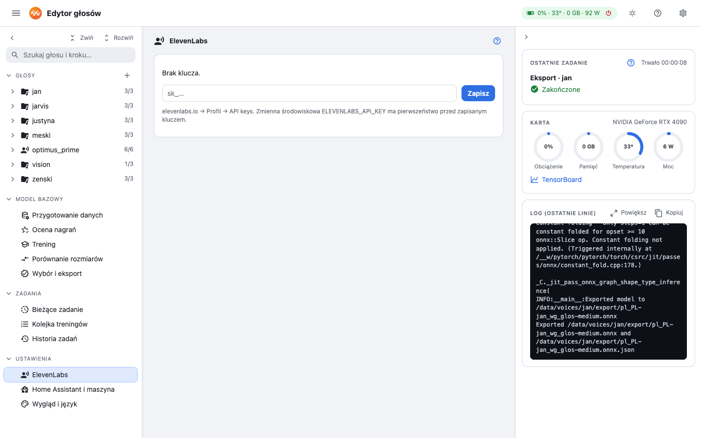

# Pierwsze kroki

Ten przewodnik zaczyna się po [instalacji](installation.md). Na końcu będziesz umieć się zalogować,
poznasz każdą część ekranu, a edytor będzie połączony z Home Assistant (i z ElevenLabs, jeśli go używasz).

Kolejne strony prowadzą przez jedno zadanie naraz:

1. **Pierwsze kroki** – ta strona.
2. [Dodaj nowy głos](guide-new-voice.md)
3. [Oceń nagrania](guide-rate.md)
4. [Wytrenuj głos](guide-train.md)
5. [Wytrenuj głos bazowy](guide-base.md)
6. [Eksport do Home Assistant](guide-export.md)
7. [Przewodnik i samouczki w edytorze](guide-tour.md)

## 1. Zaloguj się {#login}

1. Otwórz `http://<maszyna>:7860` w przeglądarce na dowolnym komputerze, telefonie albo tablecie w domu.
2. Wpisz użytkownika i hasło. Nie znasz ich? Uruchom `make login` na Macu (albo
   `docker/install-ubuntu.sh --show-login` na maszynie).
3. Sesja trwa 30 dni, więc nie logujesz się codziennie.

## 2. Ekran w skrócie {#tour}

{ .shot }

Ekran ma pasek górny i trzy kolumny.

**Pasek górny**, od lewej:

- **☰** otwiera menu (więcej niżej).
- **Edytor głosów** i nazwa otwartego głosu (tu `jan`).
- **Chip zadania** pojawia się, gdy coś działa: co trwa, procent i pozostały czas. Kliknięcie otwiera
  Bieżące zadanie.
- **Chip maszyny** (zielony, w prawym górnym rogu): obciążenie karty, temperatura, pamięć karty i moc
  pobierana z gniazdka (`0% · 39° · 0 GB · 86 W`). Czerwony ⏻ wyłącza maszynę – tylko z połączeniem
  z Home Assistant i gdy nic nie działa.
- **Słoneczko** przełącza motyw, **?** otwiera tę instrukcję, **⚙** otwiera okienko z wyglądem.

**Lewa kolumna** to drzewo:

- Głosy – każdy głos z krokami swojej ścieżki. Ikona mówi, jaka to ścieżka:
  folder z nutą to głos z własnych nagrań, mówiąca głowa to głos klonowany. Liczba po prawej (`3/3`,
  `6/6`) mówi, ile kroków jest zrobionych. Krok opcjonalny (Odsłuch) liczy się
  dopiero, gdy go zrobisz. **+** tworzy nowy głos.
- Model bazowy – pięć kroków polskiej bazy `bazowy-pl`.
- Zadania – Bieżące zadanie,
  Kolejka treningów, Historia zadań.
- Ustawienia – ElevenLabs,
  Home Assistant i maszyna, Wygląd i język.

Nad drzewem jest wyszukiwarka (Szukaj głosu i kroku…) oraz
Zwiń i Rozwiń (zwijają i rozwijają wszystko). Strzałka **‹** chowa całą
kolumnę.

**Środek** pokazuje to, co kliknięto. Kliknięcie głosu pokazuje
Droga do głosu Piper: wszystkie jego kroki z liczbami i słowem
gotowe. Kliknięcie kroku otwiera ten krok. Niebieski **?** w rogu każdego kroku
objaśnia go w małym okienku.

**Prawa kolumna** pokazuje zadanie:

- karta zadania – to, które działa teraz, albo ostatnie (tu: Ostatnie zadanie,
  Eksport · jan, Zakończone, Trwało 00:00:08);
- karta GPU – cztery kółka: Obciążenie, Pamięć,
  Temperatura, Moc, oraz link
  TensorBoard (szczegółowe wykresy treningu);
- log – ostatnie linie zadania. Powiększ otwiera go w dużym oknie,
  Kopiuj kopiuje (przydaje się, gdy prosisz kogoś o pomoc).

Gdy zadanie trwa, karta pokazuje też postęp, pozostały czas, Zatrzymaj i pole
Wyłącz maszynę po zakończeniu.

Więcej szczegółów: [Ekran](screen.md).

## 3. Menu ☰ {#menu}

{ .shot }

- Instrukcja otwiera tę instrukcję.
- **Zalogowany: admin** – i gdzie jest hasło (`docker/config/env` na maszynie). Żeby je zmienić,
  popraw ten plik i uruchom edytor ponownie.
- Wyloguj wylogowuje w tej przeglądarce.
- Na dole: wersja edytora.

## 4. Wygląd i język ⚙ {#look}

{ .shot }

1. Kliknij **⚙** w prawym górnym rogu.
2. **Motyw:** Jak system, Jasny albo Ciemny.
3. **Język:** **Polski** albo **English**.
4. Zmiana działa od razu. Esc albo kliknięcie obok zamyka okienko.

Przeglądarka zapamięta wybór. Cały wygląd i język otwiera te same ustawienia na
całej stronie.

## 5. Zadania: co działa i co działało {#jobs}

Naraz działa tylko jedno zadanie na GPU. Zadania działają dalej po zamknięciu przeglądarki.

{ .shot }

Bieżące zadanie pokazuje kartę zadania, kartę GPU i log na środku, szeroko.
Przydaje się do czytania długiego logu w czasie treningu.

{ .shot }

Historia zadań to lista wszystkich zadań: kiedy ruszyło, co to było, dla jakiego
głosu (przy kolejce: dla jakich głosów), z jakim wynikiem i jak długo trwało. Nieudane zadanie widać od
razu: ma czerwony wynik „Błąd” z kodem. Log otwiera pod tabelą cały log – przydatne rano po nocnym treningu.

## 6. Połącz Home Assistant (raz) {#home-assistant}

Po połączeniu edytor pokazuje moc z gniazdka i potrafi wyłączyć maszynę po treningu. Najpierw potrzebny
jest przykładowy pakiet w Home Assistant (zob. [Instalacja](installation.md#home-assistant)).

{ .shot }

1. Otwórz Ustawienia → Home Assistant i maszyna.
2. **Adres Home Assistant**, np. `http://homeassistant.local:8123`.
3. **Token długoterminowy**: w Home Assistant otwórz swój profil →
   **Bezpieczeństwo** → **Tokeny długoterminowe**, utwórz token użytkownika z prawami administratora
   i wklej go tutaj.
4. Zapisz połączenie. Zapisany token widać jako „zapisany (wpisz, aby zmienić)”.
   Usuń kasuje adres i token.
5. W części **Zasilanie maszyny** kliknij
   Podpowiedz z Home Assistant i wybierz:
    - Przełącznik maszyny – przełącznik z przykładowego pakietu;
    - Moc gniazdka (W) – czujnik mocy gniazdka;
    - Wyłączona poniżej (W) – poniżej tej mocy maszyna uchodzi za wyłączoną (np. 5).
6. Zapisz.

Karta **Maszyna** pokazuje wtedy stan (`Maszyna: włączona · 67 W`) i przycisk
Wyłącz maszynę.

!!! warning "Wyłączenie maszyny wyłącza też edytor"
    Wyłącz maszynę zamyka system, a potem wyłącza gniazdko. Edytor przestaje
    odpowiadać, dopóki nie włączysz maszyny z Home Assistant. Gdy zadanie z zaznaczonym wyłączeniem się
    skończy, pasek górny najpierw odlicza dwie minuty („Wyłączenie za 1:45”) – kliknij tam
    Anuluj, jeśli maszyna jest jeszcze potrzebna. Po
    Zatrzymaj maszyna nigdy się nie wyłącza.

## 7. Zapisz klucz ElevenLabs (tylko dla ElevenLabs) {#elevenlabs}

To potrzebne tylko wtedy, gdy zdania ma czytać głos z ElevenLabs (ścieżka A).

{ .shot }

1. Na elevenlabs.io otwórz **Profil → API keys** i utwórz klucz.
2. W edytorze: Ustawienia → ElevenLabs.
3. Wklej klucz (`sk_…`) i kliknij Zapisz.

Klucz zapisuje się raz na maszynie i nie jest już nigdy pokazywany. Działa dla wszystkich głosów.

Dalej: [Dodaj nowy głos](guide-new-voice.md).
