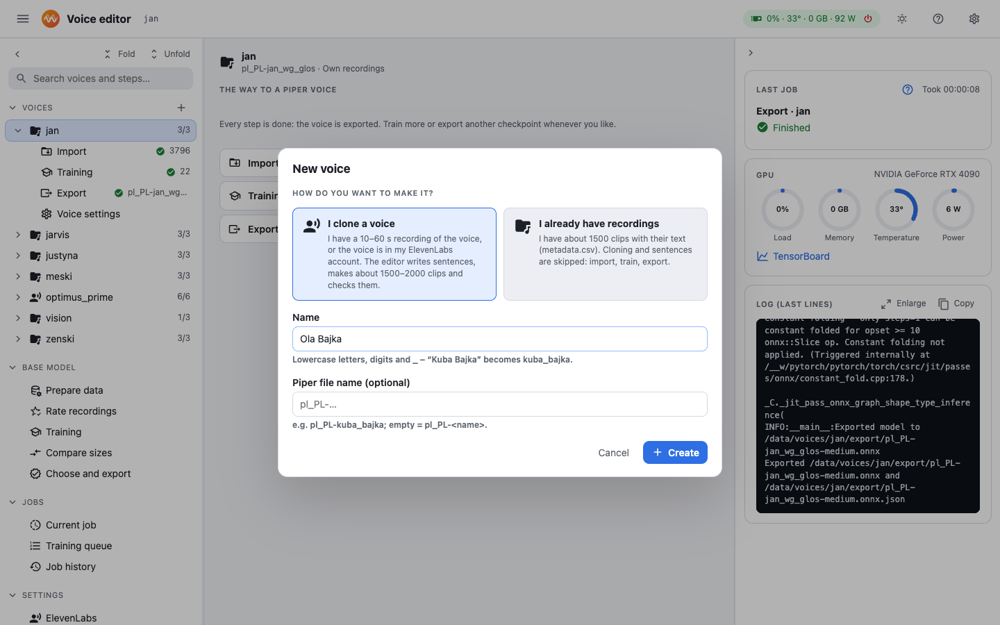
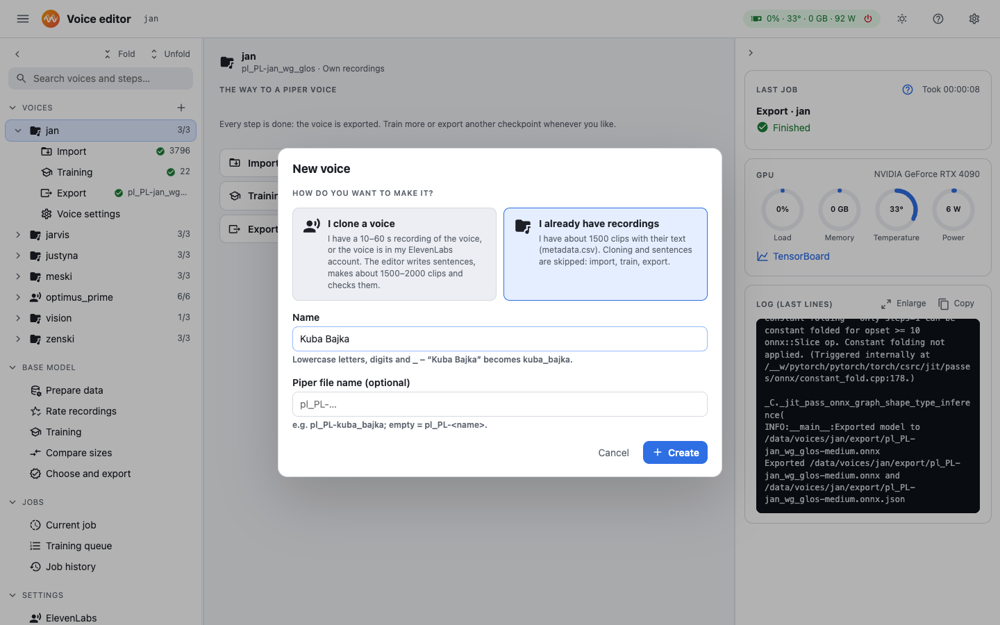
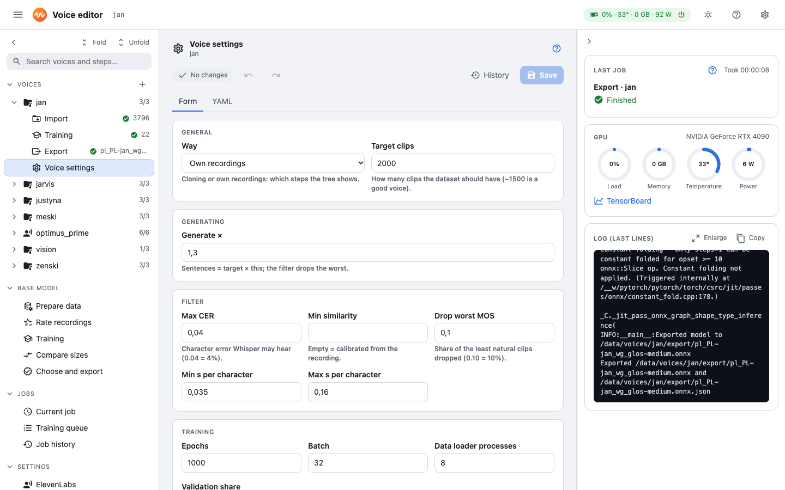

# Add a new voice

Here you make a new, empty voice. At the end it is in the tree with the steps of its way, and you know
where its settings are. Before you start, decide where the recordings come from – that decides the way.

## 1. Choose the way {#way}

| Way | Choose it when | Steps in the tree |
|---|---|---|
| **A – cloning** | you have 10–60 s of the voice, **or** the voice is in your ElevenLabs account | Recording, Sentences, Audition, Generate, Filter, Training, Export |
| **B – own recordings** | you have about 1500 clips with their text (`metadata.csv`) | Import, Training, Export |

Not sure? Thousands of clean clips of one speaker are better than any clone – take way B when you have
them.

## 2. Open the "New voice" window {#open}

1. In the tree, click **+** next to Voices.
2. The New voice window asks How do you want to make it?

{ .shot }

3. Click one of the two cards:
    - I clone a voice – way A. The editor chooses sentences, makes about
      1500–2000 clips in the voice and checks them.
    - I already have recordings – way B. Cloning and sentences are skipped:
      import, train, export.

{ .shot }

The chosen card turns blue.

## 3. Give it a name {#name}

1. **Name** – type it the way you say it, e.g. `Kuba Bajka`. The editor makes it
   a safe name: lowercase letters, digits and `_`, so it becomes `kuba_bajka`. That is the folder name
   and the name in the tree.
2. **Piper file name (optional)** – the name of the file Home Assistant will see,
   e.g. `pl_PL-kuba_bajka`. Leave it empty and it becomes `pl_PL-<name>`.
3. Click Create.

!!! tip "A name you will recognise in Home Assistant"
    The Piper file name is what you will pick from the voice list in Home Assistant. A clear name
    (`pl_PL-kuba_bajka`, not `pl_PL-test3`) saves guessing later.

## 4. What appears in the tree {#tree}

The new voice is in the tree under Voices, unfolded, with its steps:

- way A: Recording, Sentences,
  Audition, Generate, Filter,
  Training, Export;
- way B: Import, Training, Export;
- at the end always Voice settings.

A click on the voice's name shows The way to a Piper voice: every step, how far
it is and which one is next. A green ✓ next to a step means done; the number next to it says how much
(clips, epochs) or the exported file name.

Go through the steps from the top. How: [Train a voice](guide-train.md).

## 5. Voice settings {#settings}

Every voice has its own settings file (`voice.yaml`). You do not have to touch it – the defaults are
good. Open it when you want a stricter filter, a different number of epochs or a smaller batch.

{ .shot }

1. Click Voice settings under the voice.
2. Change a field in the Form tab (or edit the text in the
   **YAML** tab). The sections:
    - General – Way and Target clips;
    - Generating – Generate × (way A);
    - Filter – Max CER, Min similarity,
      Drop worst MOS, Min s per character,
      Max s per character (way A);
    - Training – Epochs, Batch,
      Data loader processes, Validation share;
    - Name and Piper file – Rename the voice or change its
      Piper file name.
3. Every change goes to a **draft** at once. The status at the top changes from
   No changes to Draft saved. The arrows next to it are
   Undo and Redo.
4. Save writes `voice.yaml`. It shows the changed lines first and lets you add a
   note.
5. History keeps 30 earlier versions. Bring back puts one
   into the draft; Save then writes it.

What each field does: [Training → Parameters](training.md#parameters). The draft in detail:
[The screen](screen.md#draft).

!!! warning "Renaming"
    A voice cannot be renamed while it trains. Files exported earlier keep their old names – export
    again after a rename.

!!! note "An imported voice stays imported"
    A way B voice keeps its recordings: it cannot generate new clips. For cloned clips make a new way A
    voice – it can read exactly the sentences of the imported voice (the **Sentence set** in
    Generate).

Next: [Rate recordings](guide-rate.md) or straight to [Train a voice](guide-train.md).
