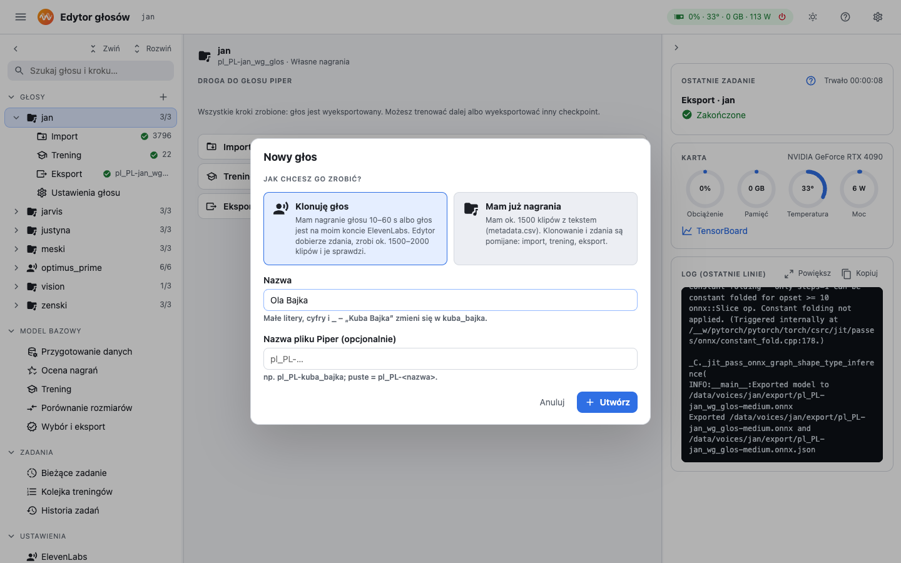
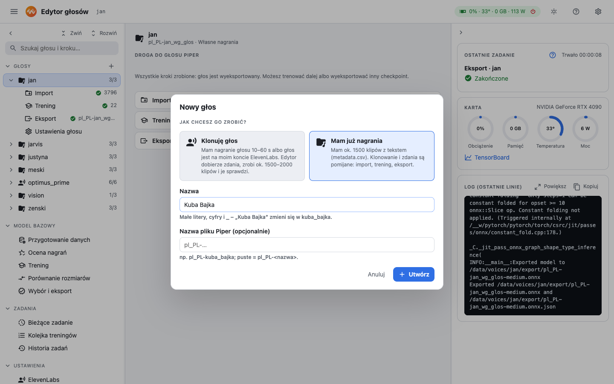
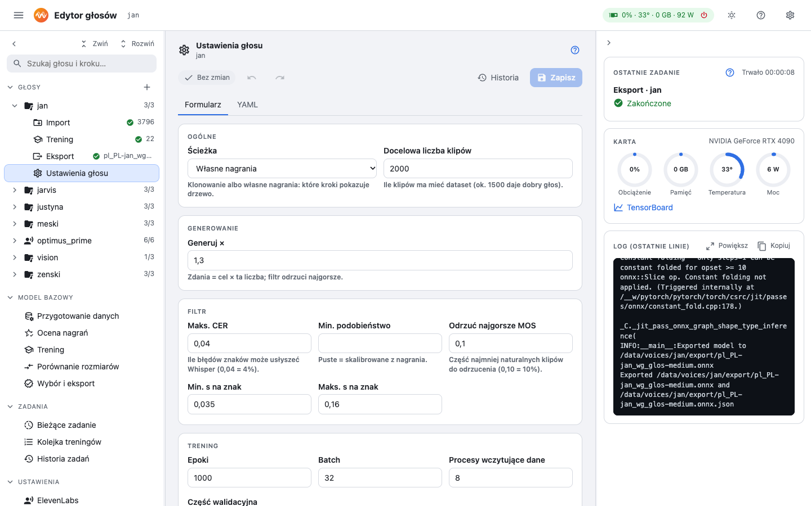

# Dodaj nowy głos

Tu tworzysz nowy, pusty głos. Na końcu będzie w drzewie z krokami swojej ścieżki, a Ty będziesz wiedzieć,
gdzie są jego ustawienia. Zanim zaczniesz, ustal, skąd wezmą się nagrania – od tego zależy ścieżka.

## 1. Wybierz ścieżkę {#way}

| Ścieżka | Wybierz ją, gdy | Kroki w drzewie |
|---|---|---|
| **A – klonowanie** | masz 10–60 s nagrania głosu **albo** głos jest na Twoim koncie ElevenLabs | Nagranie, Zdania, Odsłuch, Generowanie, Filtr, Trening, Eksport |
| **B – własne nagrania** | masz ok. 1500 klipów z tekstem (`metadata.csv`) | Import, Trening, Eksport |

Nie wiesz? Tysiące czystych klipów jednego mówcy są lepsze niż każdy klon – jeśli je masz, wybierz
ścieżkę B.

## 2. Otwórz okno „Nowy głos” {#open}

1. W drzewie kliknij **+** obok Głosy.
2. Okno Nowy głos pyta: Jak chcesz go zrobić?

{ .shot }

3. Kliknij jedną z dwóch kart:
    - Klonuję głos – ścieżka A. Edytor dobierze zdania, zrobi ok. 1500–2000
      klipów tym głosem i je sprawdzi.
    - Mam już nagrania – ścieżka B. Klonowanie i zdania są pomijane: import,
      trening, eksport.

{ .shot }

Wybrana karta robi się niebieska.

## 3. Nadaj nazwę {#name}

1. **Nazwa** – wpisz ją tak, jak ją mówisz, np. `Kuba Bajka`. Edytor zrobi z niej
   bezpieczną nazwę: małe litery, cyfry i `_`, czyli `kuba_bajka`. To nazwa folderu i nazwa w drzewie.
2. **Nazwa pliku Piper (opcjonalnie)** – nazwa pliku, którą zobaczy Home Assistant,
   np. `pl_PL-kuba_bajka`. Puste pole da `pl_PL-<nazwa>`.
3. Kliknij Utwórz.

!!! tip "Nazwa, którą rozpoznasz w Home Assistant"
    Nazwę pliku Piper wybierzesz potem z listy głosów w Home Assistant. Czytelna nazwa
    (`pl_PL-kuba_bajka`, a nie `pl_PL-test3`) oszczędza zgadywania.

## 4. Co pojawi się w drzewie {#tree}

Nowy głos jest w drzewie pod Głosy, rozwinięty, z krokami:

- ścieżka A: Nagranie, Zdania,
  Odsłuch, Generowanie, Filtr,
  Trening, Eksport;
- ścieżka B: Import, Trening, Eksport;
- na końcu zawsze Ustawienia głosu.

Kliknięcie nazwy głosu pokazuje Droga do głosu Piper: każdy krok, jak daleko
jest i który jest następny. Zielony ✓ przy kroku oznacza, że jest zrobiony; liczba obok mówi, ile go jest
(klipów, epok), albo pokazuje nazwę wyeksportowanego pliku.

Przechodź kroki od góry. Jak: [Wytrenuj głos](guide-train.md).

## 5. Ustawienia głosu {#settings}

Każdy głos ma własny plik ustawień (`voice.yaml`). Nie musisz go ruszać – wartości domyślne są dobre.
Otwórz go, gdy chcesz ostrzejszego filtra, innej liczby epok albo mniejszego batcha.

{ .shot }

1. Kliknij Ustawienia głosu pod głosem.
2. Zmień pole na karcie Formularz (albo popraw tekst na karcie **YAML**).
   Sekcje:
    - Ogólne – Ścieżka i
      Docelowa liczba klipów;
    - Generowanie – Generuj × (ścieżka A);
    - Filtr – Maks. CER, Min. podobieństwo,
      Odrzuć najgorsze MOS, Min. s na znak,
      Maks. s na znak (ścieżka A);
    - Trening – Epoki, Batch,
      Procesy wczytujące dane, Część walidacyjna;
    - Nazwa i plik Piper – Zmień nazwę głosu albo nazwę
      jego pliku Piper.
3. Każda zmiana od razu trafia do **szkicu**. Napis u góry zmienia się z Bez zmian
   na Szkic zapisany. Strzałki obok to Cofnij i
   Ponów.
4. Zapisz zapisuje `voice.yaml`. Najpierw pokazuje zmienione linie i pozwala dodać
   notatkę.
5. Historia trzyma 30 wcześniejszych wersji. Przywróć
   wstawia wersję do szkicu, a Zapisz ją zapisuje.

Co robi każde pole: [Trening → Parametry](training.md#parameters). Szkic dokładniej:
[Ekran](screen.md#draft).

!!! warning "Zmiana nazwy"
    Nie zmienisz nazwy głosu w czasie jego treningu. Wcześniej wyeksportowane pliki zachowują stare
    nazwy – po zmianie nazwy wyeksportuj głos jeszcze raz.

!!! note "Zaimportowany głos zostaje zaimportowany"
    Głos ze ścieżki B zostaje przy swoich nagraniach: nie wygeneruje nowych klipów. Na klony zrób nowy
    głos ścieżką A – może przeczytać dokładnie zdania zaimportowanego głosu (**Zestaw zdań** w kroku
    Generowanie).

Dalej: [Oceń nagrania](guide-rate.md) albo od razu [Wytrenuj głos](guide-train.md).
