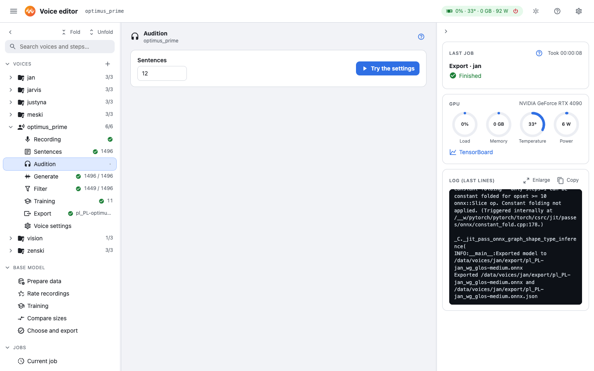
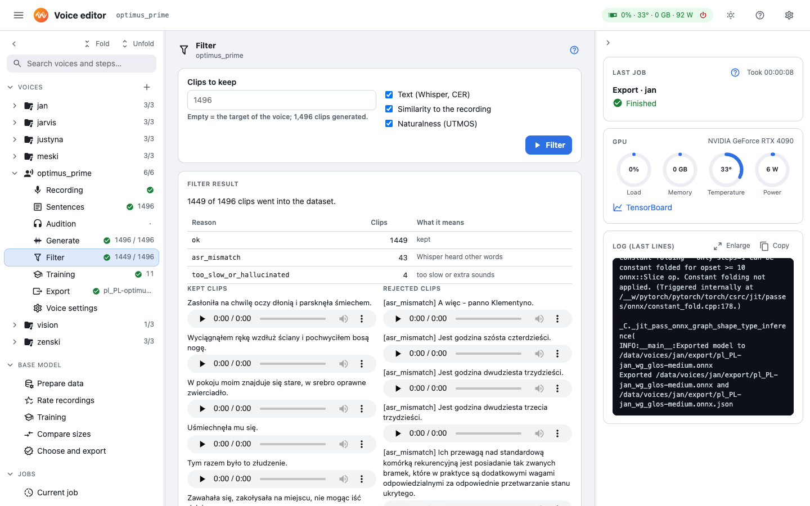
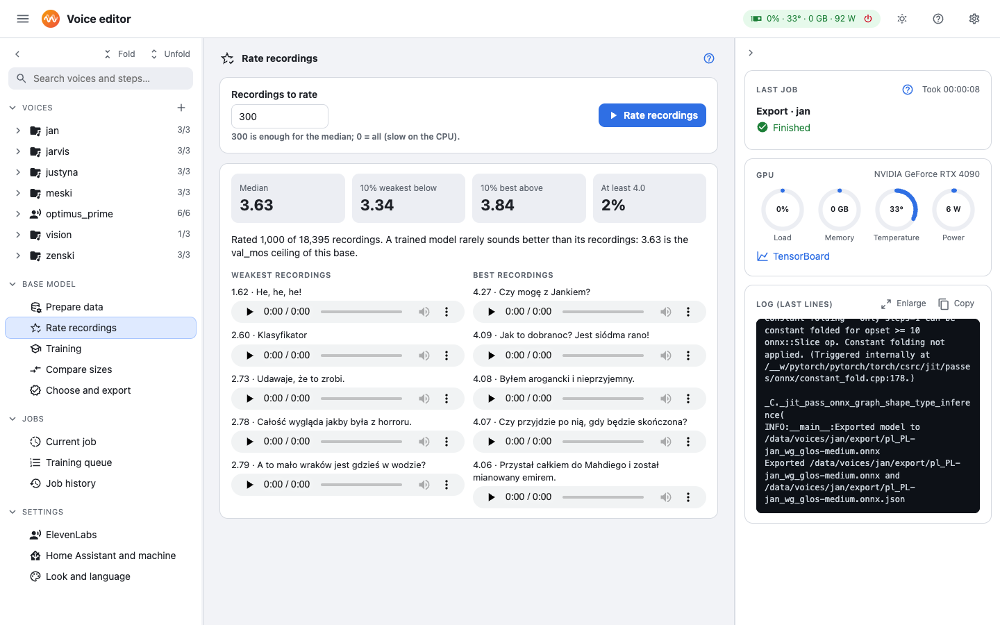

# Rate recordings

A Piper voice is never better than its recordings. That is why the editor lets you listen and rate at
several moments. This page shows where, what the numbers mean and what to do with them:

- **before generating** (way A): Audition – choose the settings of the cloning model;
- **after generating** (way A): Filter – keep the good clips, drop the bad ones;
- **before the base:** Rate recordings – how good the base can get at most.

Own recordings (way B) are checked by the import; its result looks like the filter's (see
[Train a voice](guide-train.md#import)).

!!! tip "Your ears decide"
    Every number here is a hint. UTMOS rates how *pleasant* a clip sounds, not whether it sounds like the
    original nor whether the words are right. Always listen to a few clips before you go on.

## 1. Audition: choose the settings (way A) {#audition}

The cloning model (Chatterbox, XTTS-v2) can read with different settings. The audition tries several of
them on a few sentences, so you can pick the best before generating thousands of clips.

{ .shot }

1. Open the voice → Audition. The steps Recording and
   Sentences must be done.
2. **Sentences** – how many sentences to try. 12 is enough.
3. Click Try the settings. It takes a few minutes on the GPU.
4. A table appears: Settings, Score, CER,
   Similarity, MOS. The best score is on top.
5. Click a row and listen. Pick what sounds **most like the original** – not just the top row.
6. Click Use these settings. They go to `voice.yaml` and the next step uses them.

Nothing sounds right? Improve the recording (a longer, cleaner one) and try again. Bad settings make
thousands of bad clips.

With an ElevenLabs voice the audition is not needed: ElevenLabs reads with its own settings.

## 2. Filter: keep the good clips (way A) {#filter}

After Generate, every clip is checked. Only the good ones go into the training
set.

{ .shot }

1. Open the voice → Filter.
2. **Clips to keep** – empty means the target of the voice. The hint says how many
   clips were generated.
3. Choose the checks (all three are on by default):
    - Text (Whisper, CER) – Whisper must hear the right words. Drops garbled and
      cut clips.
    - Similarity to the recording – drops clips where the model drifted to another
      voice. Needs the speaker embedding from Recording; with ElevenLabs it has
      nothing to compare with.
    - Naturalness (UTMOS) – drops the worst-sounding 10%.
4. Click Filter.
5. Read **Filter result**: how many clips went into the dataset (here 1449 of
   1496) and a table Reason – Clips –
   What it means. Common reasons:
    - `ok` – kept;
    - `asr_mismatch` – Whisper heard other words;
    - `speaker_mismatch` – it does not sound like the recording;
    - `too_fast_or_cut` / `too_slow_or_hallucinated` – the length does not fit the text;
    - `low_mos` – among the worst sounding;
    - `surplus` – good, but more than needed.
6. Listen to both lists: Kept clips on the left,
   Rejected clips on the right (with the reason in brackets).

What to look for:

- **A rejected clip sounds fine** – the filter is too strict for this voice. Example: Whisper writes a
  time like "szósta czterdzieści" differently and counts it as `asr_mismatch`. A few such clips do not
  matter.
- **A kept clip sounds bad** – make the filter stricter in Voice settings
  (Max CER, Drop worst MOS) and filter again. Filtering
  again is quick; the clips stay.

!!! warning "More than about 30% rejected"
    Look for the cause before training: a noisy or short recording, bad audition settings, or sentences
    that are hard to read. Training on what is left gives a weak voice.

## 3. Rate the base recordings {#score}

Before you train the base `bazowy-pl` (see [Train the base voice](guide-base.md)), rate its recordings.
It tells you how good the base can get.

{ .shot }

1. First Base model → Prepare data.
2. Open Base model → Rate recordings.
3. **Recordings to rate** – 300 is enough for the median; 0 rates all (slow).
4. Click Rate recordings. It runs on the CPU, about 7 recordings per second,
   so it can run next to a training.
5. Read the four tiles:
    - Median – the typical recording (here 3.63);
    - 10% weakest below and 10% best above – the spread;
    - **At least 4.0** – the share of very good recordings.
6. Listen to Weakest recordings and Best recordings.

**The median is the ceiling.** A trained model rarely sounds better than its recordings. With a median of
3.63, a `val_mos` of about 3.6 in training is already very good – more epochs will not lift it.

The weakest recordings are often short exclamations ("He, he, he!") or single words. When many of them
are noisy or cut off, leave them out of the dataset and prepare the data again.

More: [Base model → Rating the recordings](base-model.md#score).

## 4. Listening during the training {#listening}

The training reads a few test sentences after every epoch. You will find them under
**Listen to the training** in the training step. How to use them:
[Train a voice](guide-train.md#listen).

Next: [Train a voice](guide-train.md).
