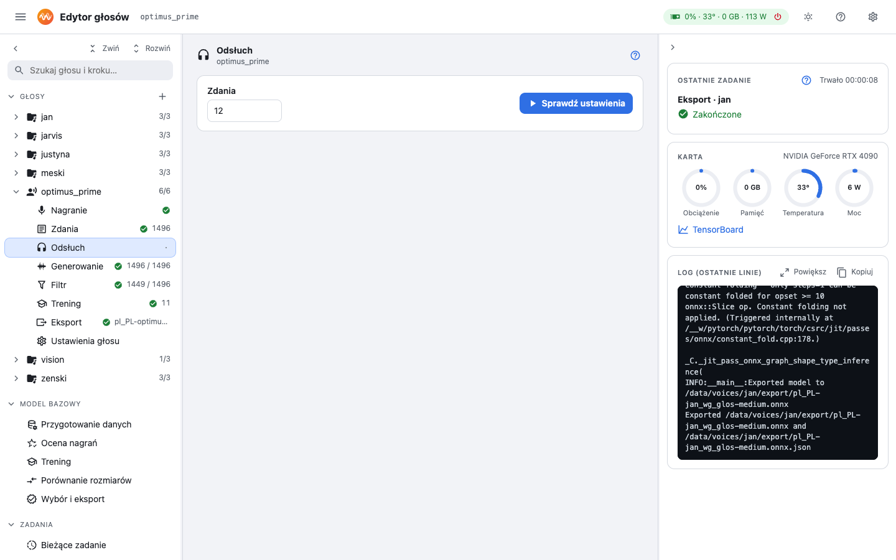
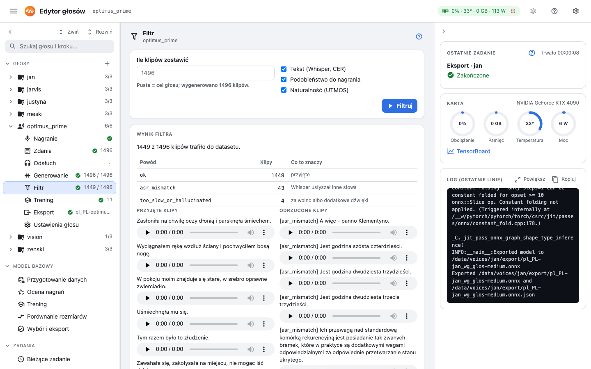
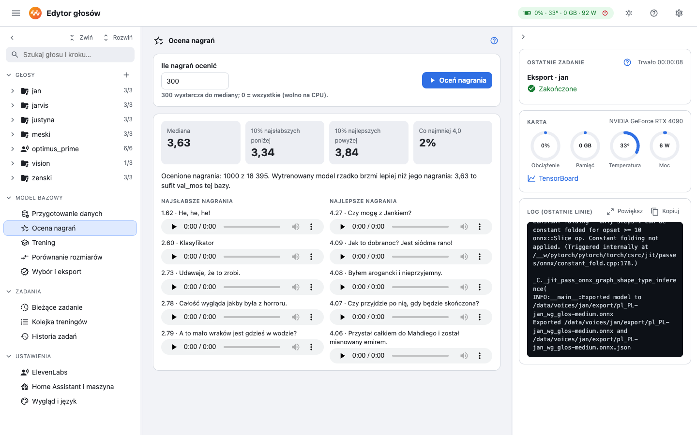

# Oceń nagrania

Głos Piper nie będzie lepszy niż jego nagrania. Dlatego edytor pozwala słuchać i oceniać w kilku
momentach. Ta strona pokazuje gdzie, co znaczą liczby i co z nimi zrobić:

- **przed generowaniem** (ścieżka A): Odsłuch – wybór ustawień modelu klonującego;
- **po generowaniu** (ścieżka A): Filtr – dobre klipy zostają, złe odpadają;
- **przed bazą:** Ocena nagrań – jak dobra może być baza w najlepszym razie.

Własne nagrania (ścieżka B) sprawdza import, a jego wynik wygląda jak wynik filtra (zob.
[Wytrenuj głos](guide-train.md#import)).

!!! tip "Decydują Twoje uszy"
    Każda liczba tutaj to tylko wskazówka. UTMOS ocenia, jak *przyjemnie* brzmi klip, a nie czy brzmi
    jak oryginał ani czy słowa są dobre. Zanim pójdziesz dalej, zawsze posłuchaj kilku klipów.

## 1. Odsłuch: wybór ustawień (ścieżka A) {#audition}

Model klonujący (Chatterbox, XTTS-v2) może czytać z różnymi ustawieniami. Odsłuch sprawdza kilka z nich
na paru zdaniach, żeby wybrać najlepsze, zanim powstaną tysiące klipów.

{ .shot }

1. Otwórz głos → Odsłuch. Kroki Nagranie i
   Zdania muszą być zrobione.
2. **Zdania** – ile zdań sprawdzić. 12 wystarczy.
3. Kliknij Sprawdź ustawienia. Na GPU trwa to kilka minut.
4. Pojawi się tabela: Ustawienia, Wynik, CER,
   Podobieństwo, MOS. Najlepszy wynik jest na górze.
5. Kliknij wiersz i posłuchaj. Wybierz to, co **najbardziej przypomina oryginał** – niekoniecznie
   pierwszy wiersz.
6. Kliknij Użyj tych ustawień. Trafią do `voice.yaml` i użyje ich następny krok.

Nic nie brzmi dobrze? Popraw nagranie (dłuższe, czystsze) i spróbuj jeszcze raz. Złe ustawienia to
tysiące złych klipów.

Przy głosie z ElevenLabs odsłuch nie jest potrzebny: ElevenLabs czyta z własnymi ustawieniami.

## 2. Filtr: zostaw dobre klipy (ścieżka A) {#filter}

Po Generowanie każdy klip jest sprawdzany. Do zbioru treningowego trafiają tylko
dobre.

{ .shot }

1. Otwórz głos → Filtr.
2. **Ile klipów zostawić** – puste pole oznacza cel głosu. Podpowiedź mówi, ile
   klipów wygenerowano.
3. Wybierz sprawdzenia (domyślnie wszystkie trzy):
    - Tekst (Whisper, CER) – Whisper musi usłyszeć właściwe słowa. Odpadają klipy
      zniekształcone i ucięte.
    - Podobieństwo do nagrania – odpadają klipy, w których model odpłynął w inny
      głos. Potrzebny jest embedding mówcy z kroku Nagranie; przy ElevenLabs nie
      ma z czym porównać.
    - Naturalność (UTMOS) – odpada 10% najgorzej brzmiących.
4. Kliknij Filtruj.
5. Przeczytaj **Wynik filtra**: ile klipów trafiło do datasetu (tu 1449 z 1496)
   i tabelę Powód – Klipy –
   Co to znaczy. Częste powody:
    - `ok` – przyjęty;
    - `asr_mismatch` – Whisper usłyszał inne słowa;
    - `speaker_mismatch` – nie brzmi jak nagranie;
    - `too_fast_or_cut` / `too_slow_or_hallucinated` – długość nie pasuje do tekstu;
    - `low_mos` – wśród najgorzej brzmiących;
    - `surplus` – dobry, ale ponad potrzebę.
6. Posłuchaj obu list: Przyjęte klipy po lewej,
   Odrzucone klipy po prawej (z powodem w nawiasie).

Na co zwrócić uwagę:

- **Odrzucony klip brzmi dobrze** – filtr jest dla tego głosu za ostry. Przykład: Whisper zapisuje
  godzinę „szósta czterdzieści” inaczej i liczy to jako `asr_mismatch`. Kilka takich klipów nie ma
  znaczenia.
- **Przyjęty klip brzmi źle** – zaostrz filtr w Ustawienia głosu
  (Maks. CER, Odrzuć najgorsze MOS) i przefiltruj jeszcze
  raz. Ponowne filtrowanie jest szybkie, a klipy zostają.

!!! warning "Odpada więcej niż ok. 30%"
    Przed treningiem poszukaj przyczyny: zaszumione albo krótkie nagranie, złe ustawienia z odsłuchu,
    trudne do przeczytania zdania. Trening na tym, co zostało, da słaby głos.

## 3. Oceń nagrania bazy {#score}

Zanim wytrenujesz bazę `bazowy-pl` (zob. [Wytrenuj głos bazowy](guide-base.md)), oceń jej nagrania.
Dowiesz się, jak dobra może być baza.

{ .shot }

1. Najpierw Model bazowy → Przygotowanie danych.
2. Otwórz Model bazowy → Ocena nagrań.
3. **Ile nagrań ocenić** – 300 wystarcza do mediany; 0 ocenia wszystkie (wolno).
4. Kliknij Oceń nagrania. Ocena liczy się na CPU, ok. 7 nagrań na sekundę, więc
   może działać obok treningu.
5. Przeczytaj cztery kafelki:
    - Mediana – typowe nagranie (tu 3,63);
    - 10% najsłabszych poniżej i 10% najlepszych powyżej – rozrzut;
    - **Co najmniej 4.0** – udział bardzo dobrych nagrań.
6. Posłuchaj list Najsłabsze nagrania i Najlepsze nagrania.

**Mediana to sufit.** Wytrenowany model rzadko brzmi lepiej niż jego nagrania. Przy medianie 3,63 wynik
`val_mos` ok. 3,6 w treningu jest już bardzo dobry – więcej epok go nie podniesie.

Najsłabsze nagrania to często krótkie okrzyki („He, he, he!”) albo pojedyncze słowa. Jeśli wiele z nich
jest zaszumionych albo uciętych, usuń je z datasetu i przygotuj dane jeszcze raz.

Więcej: [Model bazowy → Ocena nagrań](base-model.md#score).

## 4. Słuchanie w czasie treningu {#listening}

Trening po każdej epoce czyta kilka zdań testowych. Znajdziesz je w części
**Odsłuch z treningu** w kroku treningu. Jak z nich korzystać:
[Wytrenuj głos](guide-train.md#listen).

Dalej: [Wytrenuj głos](guide-train.md).
