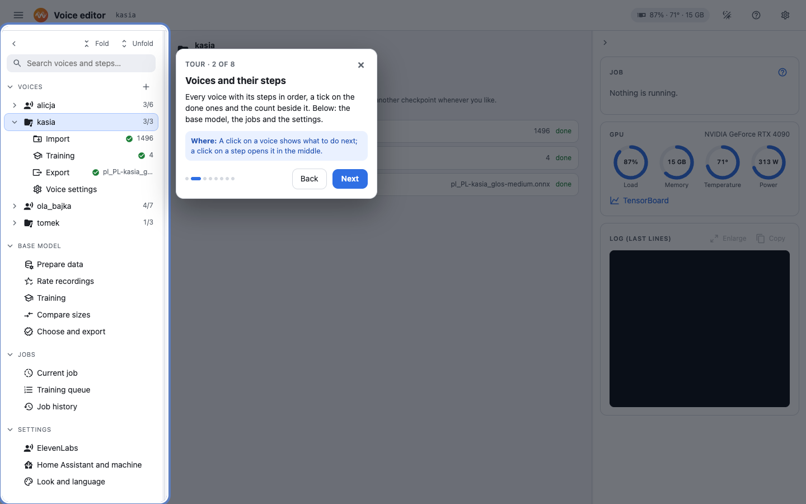
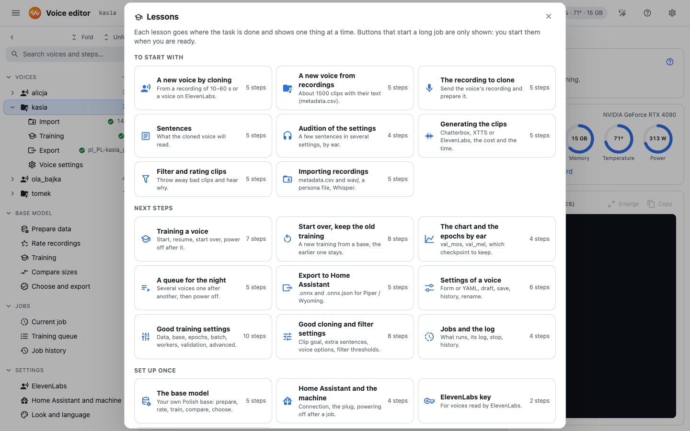
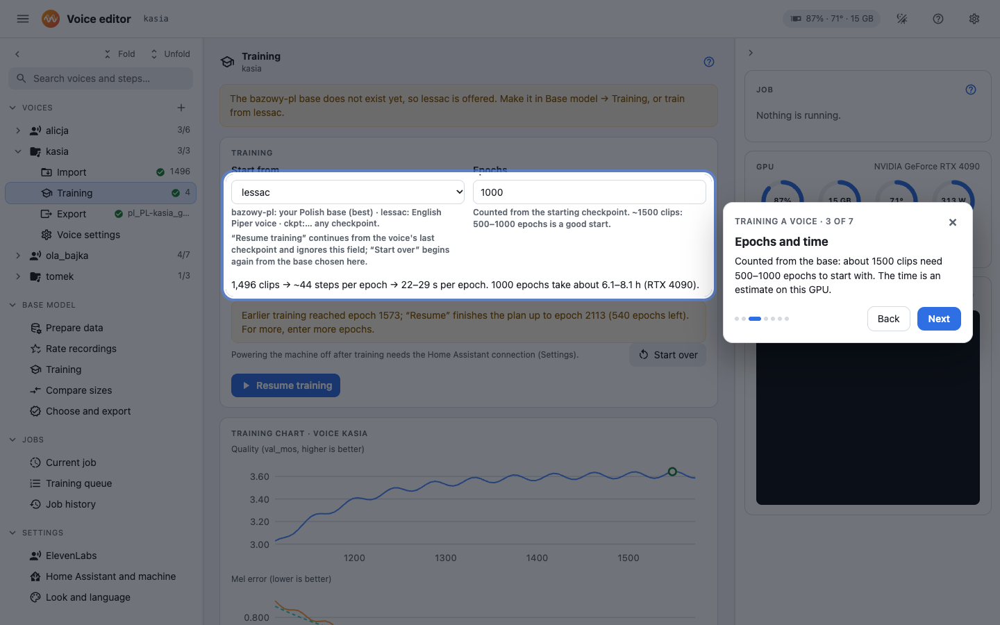
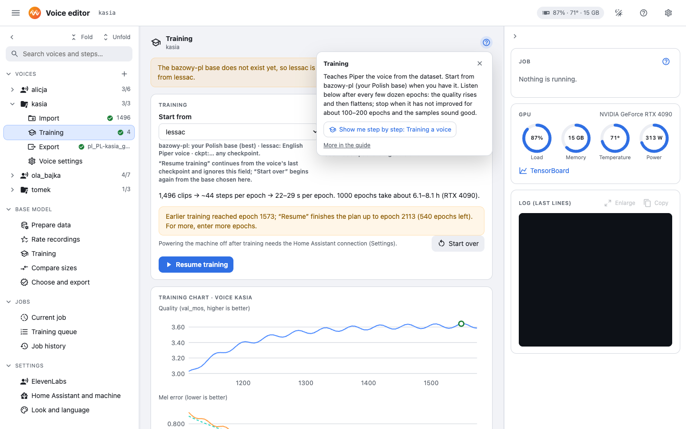

# Tour and lessons

The editor teaches where things are by itself. It has two helpers for that: the **Tour of the editor** and the
**Lessons**. Open them from ⚙ in the top right corner or in **Settings → Look and language**.

## Tour of the editor {#tour}

The first time in a browser the tour starts by itself. It shows the parts of the screen one at a time: the tree
of voices, the new voice button, the middle with the chosen step, the right column with the job, the top bar,
the help and the menu. One part is framed, the rest is dimmed, and a bubble says what it is and where it is set.

- Next and Back (or the arrow keys) move between the steps.
- Skip, × or Esc end the tour. The editor remembers it in the browser and the tour does
  not come back by itself.
- Open it again from ⚙ → Tour of the editor.

## Lessons {#lessons}

⚙ → Lessons opens a list of tasks in three groups. Each lesson is a short tour of one
task. It goes where the task is done by itself (it chooses the voice and its step in the tree) and shows one
thing at a time.

| Group | Lessons |
|---|---|
| To start with | A new voice by cloning · A new voice from recordings · The recording to clone · Sentences · Audition of the settings · Generating the clips · Filter and rating clips · Importing recordings |
| Next steps | Training a voice · Start over, keep the old training · The chart and the epochs by ear · A queue for the night · Export to Home Assistant · Settings of a voice · Good training settings · Good cloning and filter settings · Jobs and the log |
| Set up once | The base model · Home Assistant and the machine · ElevenLabs key · Look and language |

- When the bubble says "Click the framed part to go on", click the framed button. You then do the task while
  you learn it: in the new voice lesson you really make the voice.
- Buttons that start a long job (generating, training, the queue) are the only ones a lesson does not wait
  for. It shows them and you start the job when you are ready.
- Lessons gone through get a green tick in the list (in this browser).
- A lesson that needs a voice of a kind says in the list what it is missing, e.g. "Needs a voice made by
  cloning".
- Some things appear only after a job, e.g. the results of the audition or the filter report. Until then the
  frame shows the place where they will appear.

## "Show me step by step" in "?" {#help}

The "?" beside the title of a step says what it does. Below the text it has a button with the lesson of that
place, e.g. "Show me step by step: Training a voice".

