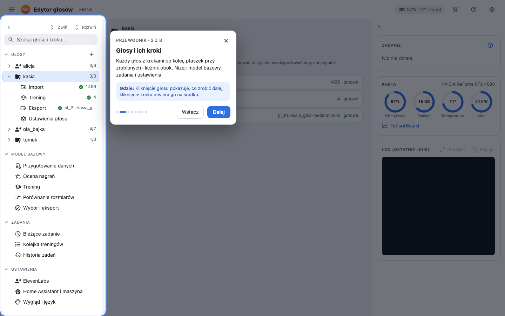
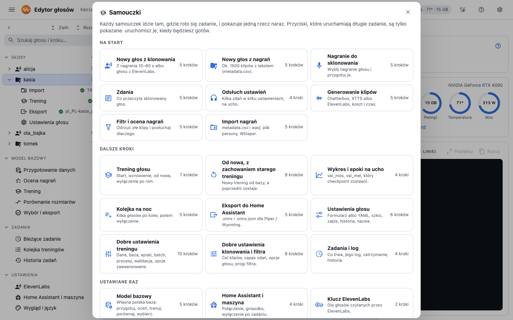
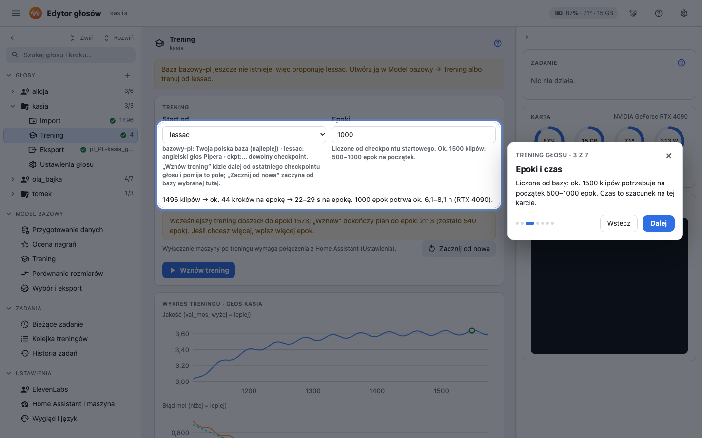
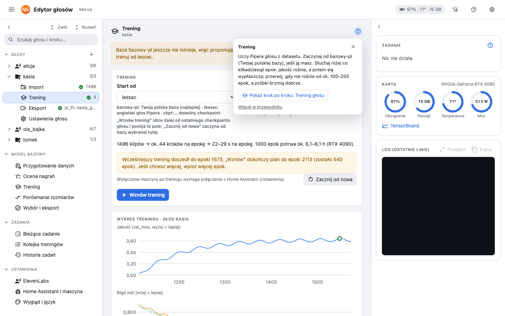

# Przewodnik i samouczki

Edytor sam uczy, gdzie co jest. Ma do tego dwa dodatki: **Przewodnik po edytorze** i **Samouczki**. Otwierasz je
z ⚙ w prawym górnym rogu albo w **Ustawienia → Wygląd i język**.

## Przewodnik po edytorze {#tour}

Za pierwszym razem w danej przeglądarce przewodnik startuje sam. Pokazuje po kolei części ekranu: drzewo głosów,
przycisk nowego głosu, środek z wybranym krokiem, prawą kolumnę z zadaniem, pasek górny, pomoc i menu. Część
ekranu jest w ramce, reszta jest przyciemniona, a dymek mówi, co to jest i gdzie się to ustawia.

- Dalej i Wstecz (albo strzałki) przechodzą między krokami.
- Pomiń, × albo Esc kończą przewodnik. Edytor zapamiętuje to w przeglądarce
  i przewodnik nie wraca sam.
- Znowu otworzysz go z ⚙ → Przewodnik po edytorze.

## Samouczki {#lessons}

⚙ → Samouczki otwiera listę zadań w trzech grupach. Każdy samouczek to krótki przewodnik
po jednym zadaniu. Sam przechodzi tam, gdzie zadanie się robi (wybiera głos i jego krok w drzewie), i pokazuje
jedną rzecz naraz.

| Grupa | Samouczki |
|---|---|
| Na start | Nowy głos z klonowania · Nowy głos z nagrań · Nagranie do sklonowania · Zdania · Odsłuch ustawień · Generowanie klipów · Filtr i ocena nagrań · Import nagrań |
| Dalsze kroki | Trening głosu · Od nowa, z zachowaniem starego treningu · Wykres i epoki na ucho · Kolejka na noc · Eksport do Home Assistant · Ustawienia głosu · Dobre ustawienia treningu · Dobre ustawienia klonowania i filtra · Zadania i log |
| Ustawiane raz | Model bazowy · Home Assistant i maszyna · Klucz ElevenLabs · Wygląd i język |

- Gdy dymek mówi „Kliknij to, co jest w ramce, aby przejść dalej”, kliknij przycisk w ramce. Zadanie robisz
  wtedy w trakcie nauki, np. w samouczku nowego głosu naprawdę tworzysz głos.
- Przycisków, które uruchamiają długie zadanie (generowanie, trening, kolejka), samouczek tylko nie klika.
  Pokazuje je, a Ty uruchamiasz zadanie, kiedy jesteś gotów.
- Przerobione samouczki mają na liście zielony znaczek (w tej przeglądarce).
- Samouczek, który potrzebuje głosu danego rodzaju, mówi na liście, czego mu brakuje, np. „Potrzebny głos
  z klonowania”.
- Część rzeczy pojawia się dopiero po zadaniu, np. wyniki odsłuchu albo raport filtra. Do tego czasu ramka
  pokazuje miejsce, w którym się pojawią.

## „Pokaż krok po kroku” w „?” {#help}

„?” obok tytułu kroku mówi, co on robi. Pod opisem ma przycisk z samouczkiem tego miejsca, np.
„Pokaż krok po kroku: Trening głosu”.

