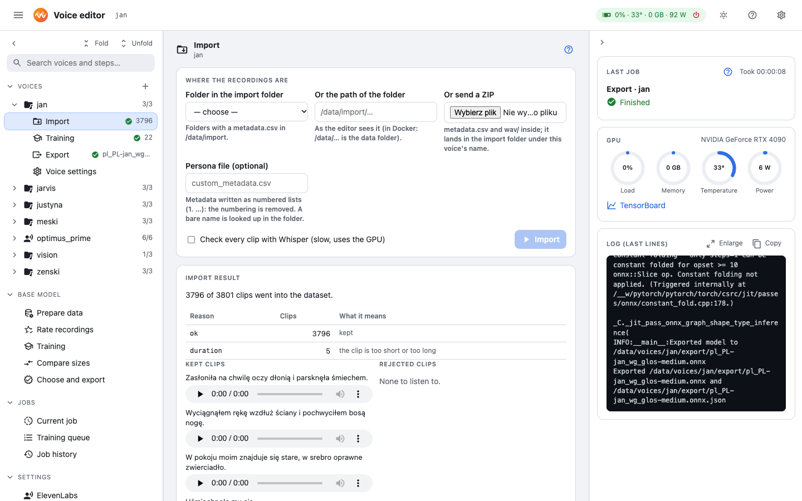
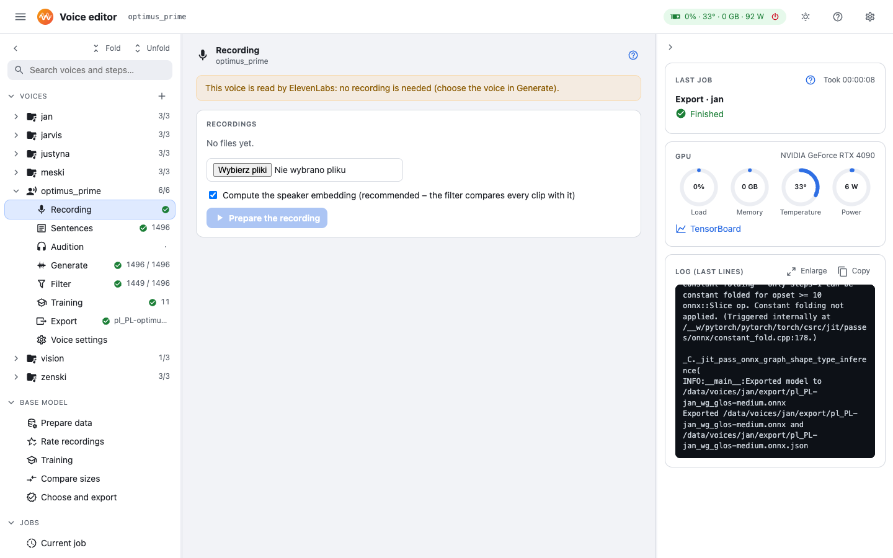
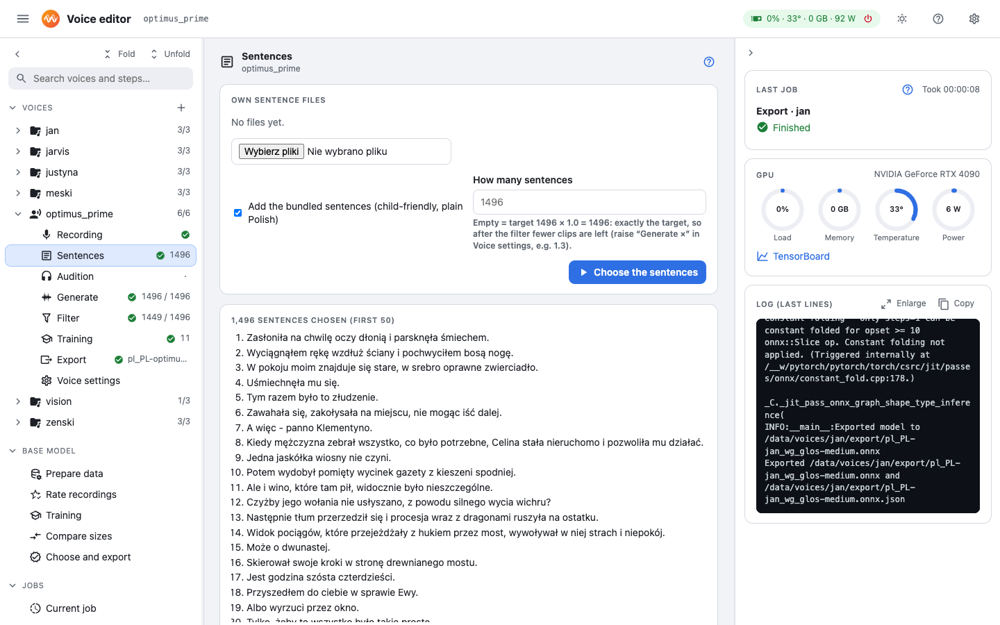
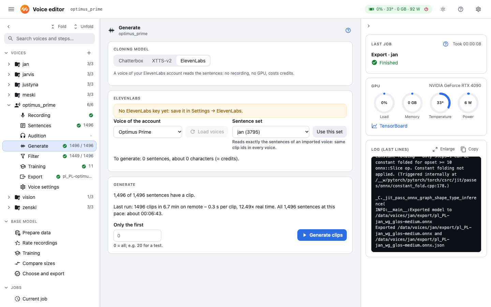
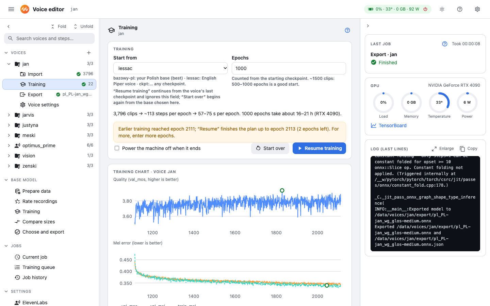
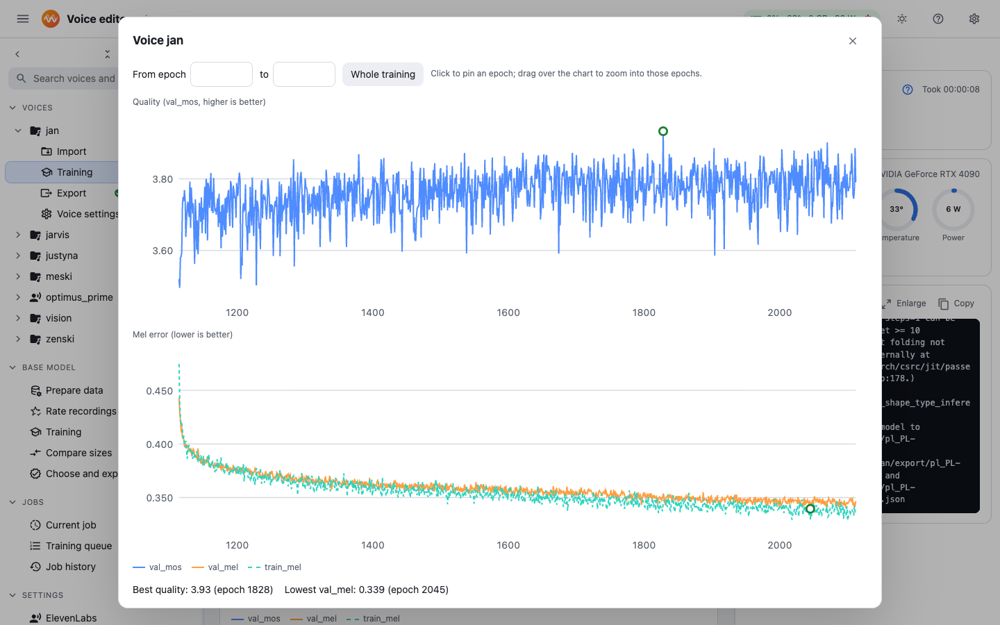
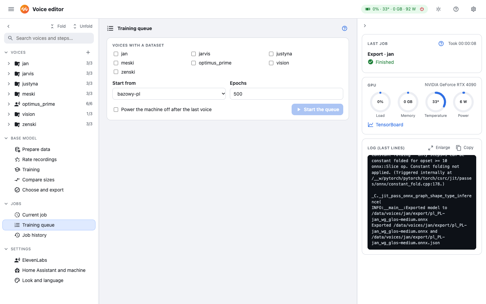

# Train a voice

Here you take a voice from an empty folder to a trained Piper model. First you build the **dataset**
(about 1500 clips with their text), then you **train**, listen and choose the best moment. Way B gets its
dataset from the import, way A from cloning.

You need a voice first: [Add a new voice](guide-new-voice.md).

## 1. The dataset, way B: import {#import}

{ .shot }

1. Prepare the folder: `metadata.csv` (`id|text`, one line per clip) and `wav/` with the clips. The format
   in detail: [Way B: own recordings](path-import.md).
2. Open the voice → Import.
3. Under **Where the recordings are** choose one of three:
    - Folder in the import folder – copy the folder to
      `~/piper-voice-cloner/data/import/` on the machine first; it shows up in the list;
    - Or the path of the folder – a path as the editor sees it (`/data/…`);
    - Or send a ZIP – an archive from your computer.
4. Optionally:
    - Persona file (optional) – when the text is written as a numbered list;
    - Check every clip with Whisper (slow, uses the GPU) – drops clips whose words
      differ from the text.
5. Click Import.
6. Read **Import result** (here 3796 of 3801 clips) and listen to a few
   Kept clips and Rejected clips. Lines with digits,
   abbreviations or symbols are always dropped – the voice would learn to read them wrongly.

Done? Go to [step 3: Training](#train).

## 2. The dataset, way A: cloning {#clone}

Five steps, each in the tree under the voice. Details of every step: [Way A: cloning](path-clone.md).

### Recording {#recording}

{ .shot }

1. Open Recording and send 10–60 s of clean speech (wav, mp3, m4a). No music, no
   TV, no other people.
2. Leave Compute the speaker embedding (recommended – the filter compares every clip with it)
   ticked.
3. Click Prepare the recording.

The voice in the picture (`optimus_prime`) is read by ElevenLabs, so the editor says no recording is
needed – the step counts as done.

### Sentences {#sentences}

{ .shot }

1. Open Sentences.
2. Send your own text files (one sentence per line) and/or keep
   Add the bundled sentences (child-friendly, plain Polish).
3. **How many sentences** – empty means the target × 1.3 (the filter drops some).
4. Click Choose the sentences. The first 50 chosen sentences show below.

### Audition {#audition}

Try the settings of the cloning model on a few sentences and pick the best by ear. Step by step:
[Rate recordings → Audition](guide-rate.md#audition). Not needed with ElevenLabs.

### Generate {#generate}

{ .shot }

1. Open Generate.
2. Choose the **Cloning model**: Chatterbox (local, free),
   XTTS-v2 or ElevenLabs (no GPU, costs credits).
3. With ElevenLabs: Load voices, choose the Voice of the account.
   Optionally pick a Sentence set of an imported voice and click
   Use this set. The editor shows how many characters (credits) are left to read.
4. **Test first:** type 20 in Only the first and click
   Generate clips. Listen to a few clips.
5. Then type 0 (all) and Generate clips again. Finished clips stay, so you can
   stop and continue whenever you like. The editor shows the pace of the last run and estimates the
   rest.

### Filter {#filter}

Check every clip and keep the good ones. Step by step:
[Rate recordings → Filter](guide-rate.md#filter).

With about 1500 clips in the dataset, go on.

## 3. Training {#train}

{ .shot }

1. Open the voice → Training.
2. **Start from** – the model the training starts from:
    - `bazowy-pl` – your Polish base. The best choice once you have it ([Train the base voice](guide-base.md));
    - `lessac` – the English Piper voice. Works without a base, learns Polish more slowly;
    - `ckpt:…` – any checkpoint (for experiments).
3. **Epochs** – for about 1500 clips from `bazowy-pl`: 500–1000. The epochs count
   from the starting checkpoint.
4. Read the estimate below: clips → steps per epoch → seconds per epoch → the whole time on an RTX 4090
   (e.g. “15–21 h”).
5. Tick Power the machine off when it ends if you train overnight. (Without the
   Home Assistant connection the editor says the box needs it.)
6. Click Train. A voice that has trained before shows
   Resume training instead.

The progress is in the job chip at the top and on the right: epochs, the time left, the log. The very
first run prepares its cache for a few minutes before epoch 1.

!!! warning "Resuming or starting over"
    Resume training continues the voice's own last checkpoint – the
    Start from field does not matter then (the hint under it says so). The yellow
    note says exactly what happens. Here: the earlier training reached epoch 2111 and the plan ended at
    2113, so only 2 epochs are left. Want more? Enter more epochs. Details:
    [Training → Resuming](training.md#resume).

    Want to train the voice again, e.g. from a new `bazowy-pl`? Choose it in
    Start from and click Start over. The editor asks
    first. The earlier checkpoints stay on disk and in the checkpoint list.

### Start over without losing the earlier training {#start-over}

Start over deletes and overwrites nothing.

1. **The checkpoints stay.** The new training goes into a new folder (`lightning_logs/version_1`,
   `_2`…). The old checkpoints (`version_0`) stay in the list in Training and in Export.
2. **The chart and the samples stay.** The chart and the listening of the old training go whole to
   `train/runs/` and are never thinned again. Above the chart the Training field
   chooses which one to show: Current training or an earlier one, with its base,
   epochs and best `val_mos`. This works even when both have the same epoch numbers (two starts from the
   same base).
3. **An export never overwrites.** When `pl_PL-meski-medium.onnx` is already there, the next export
   writes `pl_PL-meski_2-medium.onnx`, then `_3`. The hint under Export shows the
   name the next file gets.
4. Choose the base in Start from and the epochs. They count from the base (lessac
   starts at about epoch 2164).
5. Click Start over. From now on Resume training continues
   only the new training, even when it stopped before its first checkpoint.
6. Liked the old one more? Export its checkpoint from the list (`version_0`). Nothing has to be trained
   again.

The lesson **Start over, keep the old training** (⚙ → Lessons) shows the same.

Stop (on the right) ends a training at any time. Resuming later loses a few
epochs at most.

## 4. The chart {#chart}

Below the settings is the **training chart**. It refreshes every 20 s.

- **val_mos** (top, blue): the predicted naturalness of the test sentences, 1–5. **Higher is better.**
  About 3 is understandable, 3.5+ good.
- **val_mel** (bottom, orange): how far the sound is from the real one. **Lower is better.** It falls
  fast at the start, then hardly moves.
- **train_mel** (dashed): the same on the training sentences.
- The green circles mark the best `val_mos` and the lowest `val_mel`.

Click the chart to open it big:

{ .shot }

- type the range in From epoch and to, or drag over the
  chart to zoom into those epochs; Whole training zooms out;
- click to pin one epoch and read its values;
- the line at the bottom names the best moments, e.g. "Best quality: 3.93 (epoch 1828)".

How to read it in depth: [Training](training.md).

## 5. Listen and choose the checkpoint {#listen}

Under the chart is **Listen to the training**.

1. Choose an epoch from the list. At first you hear noise and a robot, later a clearer voice.
2. Epochs marked 💾 checkpoint have a saved model – only those can be exported.
3. Samples (ZIP) saves all samples to your computer, with a table to sort.
4. **Checkpoints** below says why each file was kept: the best `val_mos`, the
   lowest `val_mel` or the newest.

**When to stop:**

- `val_mos` has not risen for about 150–200 epochs, `val_mel` does not rise and the samples sound good;
- `train_mel` keeps falling while `val_mel` rises – overtraining; take a checkpoint from before.

!!! tip "Choose by ear"
    The best `val_mos` does not always sound best. Listen to two or three candidate epochs with the same
    sentences and take the one you like. You can export several and compare them in Home Assistant.

## 6. Several voices overnight: the queue {#queue}

{ .shot }

1. Open Jobs → Training queue.
2. Under **Voices with a dataset** tick the voices in the order they should train.
3. Choose Start from and Epochs – the same for every voice.
4. Optionally tick Power the machine off after the last voice.
5. Click Start the queue.

A failed voice does not stop the next one. Stop ends the whole queue. In the
morning, Job history has the log of every voice.

Next: [Export to Home Assistant](guide-export.md).
