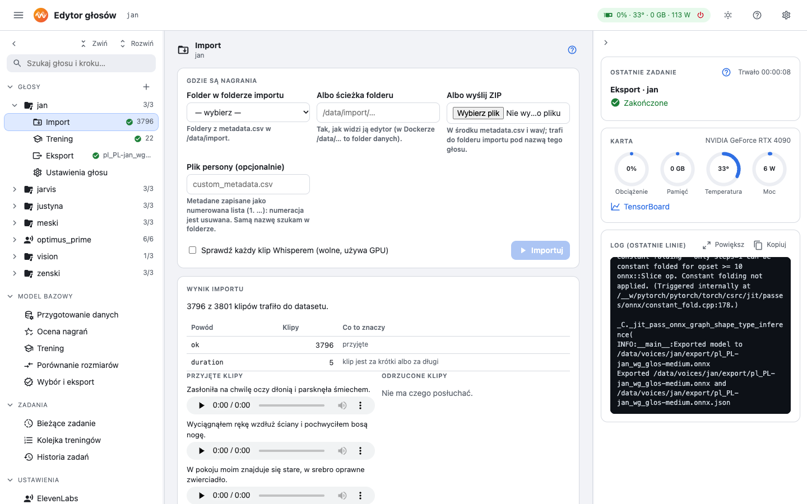
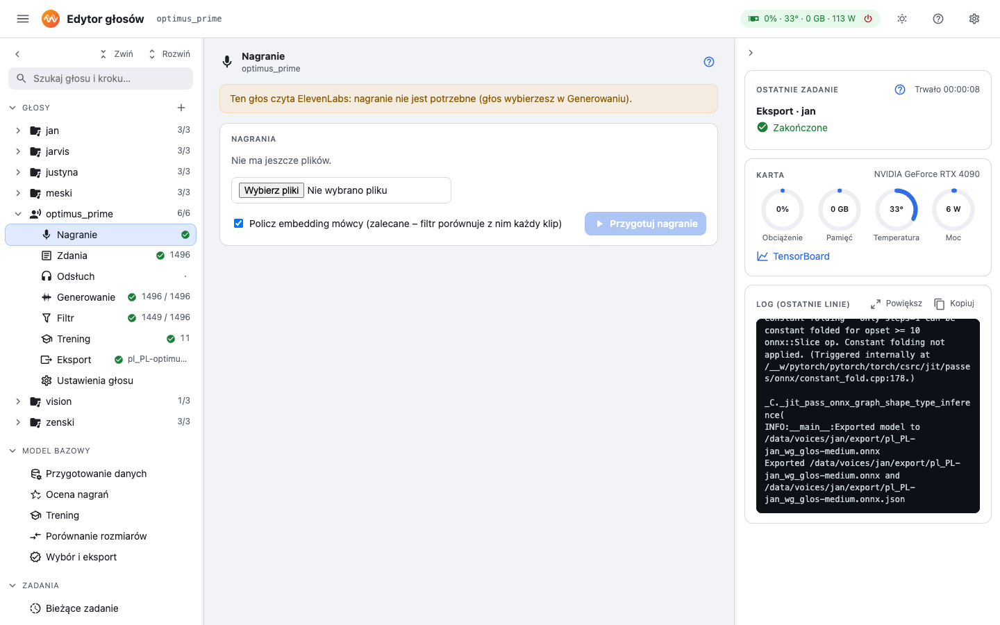
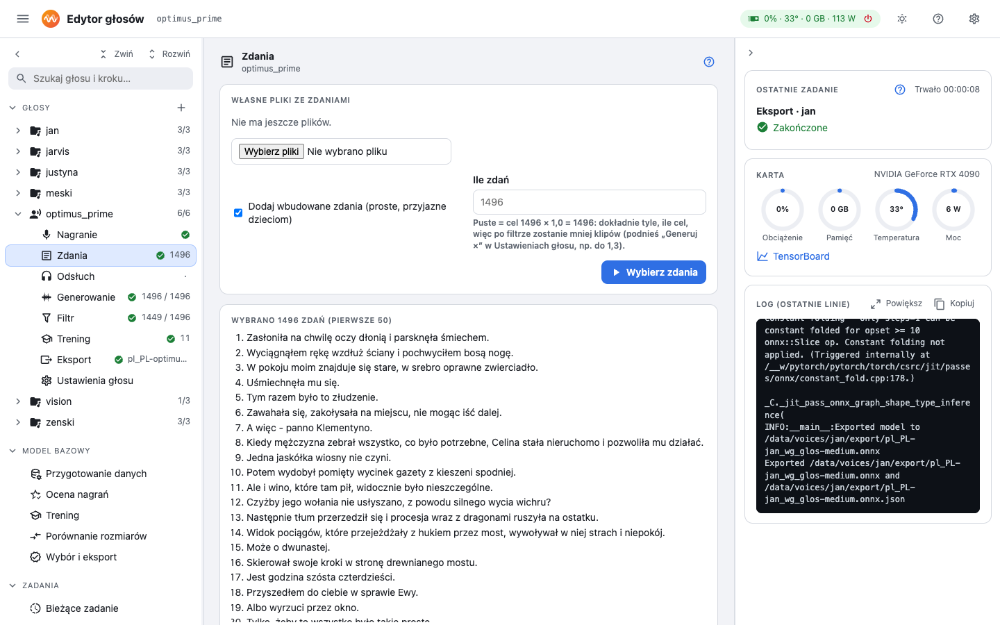
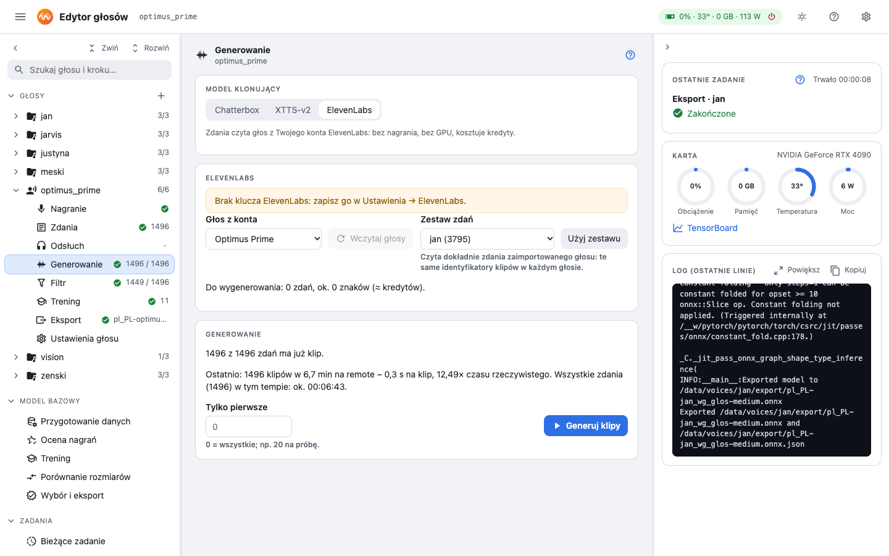
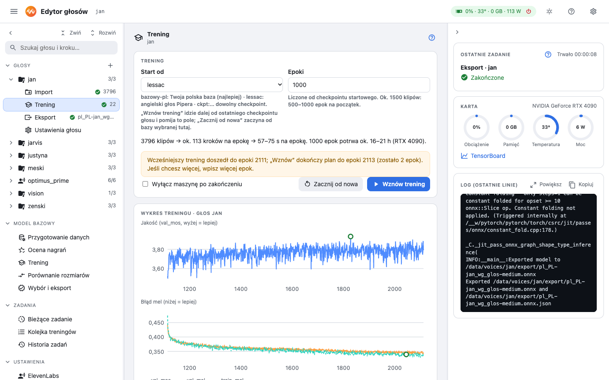
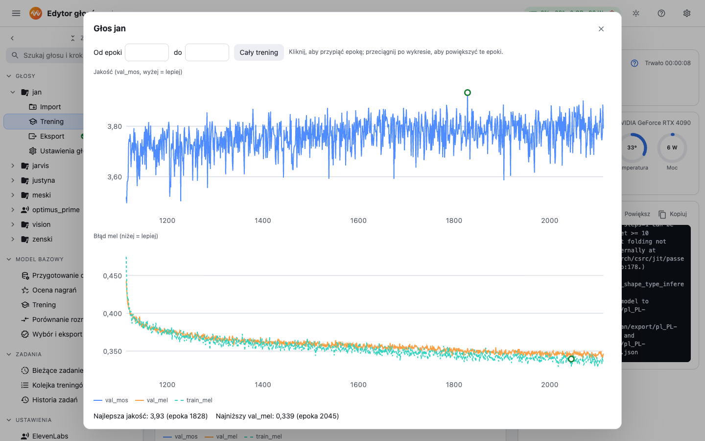
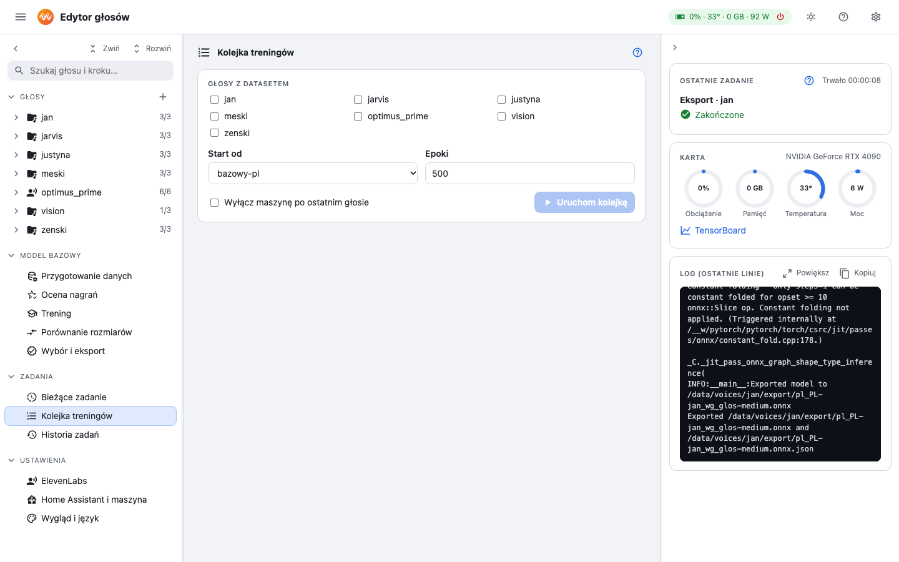

# Wytrenuj głos

Tu prowadzisz głos od pustego folderu do wytrenowanego modelu Piper. Najpierw budujesz **dataset**
(ok. 1500 klipów z tekstem), potem **trenujesz**, słuchasz i wybierasz najlepszy moment. Ścieżka B
dostaje dataset z importu, ścieżka A z klonowania.

Najpierw potrzebny jest głos: [Dodaj nowy głos](guide-new-voice.md).

## 1. Dataset, ścieżka B: import {#import}

{ .shot }

1. Przygotuj folder: `metadata.csv` (`id|tekst`, jedna linia na klip) i `wav/` z klipami. Format
   dokładnie: [Ścieżka B: własne nagrania](path-import.md).
2. Otwórz głos → Import.
3. W części **Gdzie są nagrania** wybierz jedną z trzech dróg:
    - Folder w folderze importu – najpierw skopiuj folder do
      `~/piper-voice-cloner/data/import/` na maszynie; pojawi się na liście;
    - Albo ścieżka folderu – ścieżka tak, jak widzi ją edytor (`/data/…`);
    - Albo wyślij ZIP – archiwum z Twojego komputera.
4. Opcjonalnie:
    - Plik persony (opcjonalnie) – gdy tekst jest zapisany jako numerowana lista;
    - Sprawdź każdy klip Whisperem (wolne, używa GPU) – odrzuca klipy, w których
      słowa różnią się od tekstu.
5. Kliknij Importuj.
6. Przeczytaj **Wynik importu** (tu 3796 z 3801 klipów) i posłuchaj kilku
   Przyjęte klipy i Odrzucone klipy. Linie z cyframi,
   skrótami albo symbolami zawsze odpadają – głos nauczyłby się czytać je źle.

Gotowe? Przejdź do [kroku 3: Trening](#train).

## 2. Dataset, ścieżka A: klonowanie {#clone}

Pięć kroków, każdy w drzewie pod głosem. Szczegóły każdego kroku: [Ścieżka A: klonowanie](path-clone.md).

### Nagranie {#recording}

{ .shot }

1. Otwórz Nagranie i wyślij 10–60 s czystej mowy (wav, mp3, m4a). Bez muzyki,
   telewizora i innych osób.
2. Zostaw zaznaczone Policz embedding mówcy (zalecane – filtr porównuje z nim każdy klip).
3. Kliknij Przygotuj nagranie.

Głos na obrazku (`optimus_prime`) czyta ElevenLabs, więc edytor pisze, że nagranie nie jest potrzebne –
krok liczy się jako zrobiony.

### Zdania {#sentences}

{ .shot }

1. Otwórz Zdania.
2. Wyślij własne pliki tekstowe (jedno zdanie w linii) i/lub zostaw zaznaczone
   Dodaj wbudowane zdania (proste, przyjazne dzieciom).
3. **Ile zdań** – puste pole to cel × 1,3 (filtr część odrzuci).
4. Kliknij Wybierz zdania. Poniżej widać pierwsze 50 wybranych zdań.

### Odsłuch {#audition}

Sprawdź ustawienia modelu klonującego na kilku zdaniach i wybierz najlepsze na ucho. Krok po kroku:
[Oceń nagrania → Odsłuch](guide-rate.md#audition). Przy ElevenLabs niepotrzebny.

### Generowanie {#generate}

{ .shot }

1. Otwórz Generowanie.
2. Wybierz **Model klonujący**: Chatterbox (lokalnie,
   za darmo), XTTS-v2 albo ElevenLabs (bez GPU, kosztuje
   kredyty).
3. Przy ElevenLabs: Wczytaj głosy, wybierz Głos z konta.
   Opcjonalnie wybierz Zestaw zdań zaimportowanego głosu i kliknij
   Użyj zestawu. Edytor pokazuje, ile znaków (kredytów) zostało do przeczytania.
4. **Najpierw próba:** wpisz 20 w Tylko pierwsze i kliknij
   Generuj klipy. Posłuchaj kilku klipów.
5. Potem wpisz 0 (wszystkie) i znowu Generuj klipy. Gotowe klipy zostają, więc
   możesz przerwać i wrócić, kiedy chcesz. Edytor pokazuje tempo ostatniego biegu i szacuje resztę.

### Filtr {#filter}

Sprawdź każdy klip i zostaw dobre. Krok po kroku: [Oceń nagrania → Filtr](guide-rate.md#filter).

Gdy w datasecie jest ok. 1500 klipów, idź dalej.

## 3. Trening {#train}

{ .shot }

1. Otwórz głos → Trening.
2. **Start od** – model, od którego zaczyna się trening:
    - `bazowy-pl` – Twoja polska baza. Najlepszy wybór, gdy już ją masz ([Wytrenuj głos bazowy](guide-base.md));
    - `lessac` – angielski głos Pipera. Działa bez bazy, wolniej uczy się polskiego;
    - `ckpt:…` – dowolny checkpoint (do eksperymentów).
3. **Epoki** – dla ok. 1500 klipów od `bazowy-pl`: 500–1000. Epoki liczą się od
   checkpointu startowego.
4. Przeczytaj szacunek pod polami: klipy → kroki na epokę → sekundy na epokę → czas całości na RTX 4090
   (np. „15–21 h”).
5. Zaznacz Wyłącz maszynę po zakończeniu, jeśli trenujesz w nocy. (Bez połączenia
   z Home Assistant edytor napisze, że to pole go wymaga).
6. Kliknij Trenuj. Głos, który już był trenowany, ma w tym miejscu
   Wznów trening.

Postęp widać w chipie zadania u góry i po prawej: epoki, pozostały czas, log. Pierwszy bieg przez kilka
minut przygotowuje cache, zanim ruszy epoka 1.

!!! warning "Wznawianie albo od nowa"
    Wznów trening kontynuuje od ostatniego checkpointu tego głosu – pole
    Start od nie ma wtedy znaczenia (mówi o tym podpowiedź pod polem). Żółta ramka
    mówi dokładnie, co się stanie. Tu: poprzedni trening doszedł do epoki 2111, a plan kończył się na
    2113, więc zostały tylko 2 epoki. Chcesz więcej? Wpisz więcej epok. Szczegóły:
    [Trening → Wznawianie](training.md#resume).

    Chcesz zacząć głos jeszcze raz, np. od nowej bazy `bazowy-pl`? Wybierz ją w
    Start od i kliknij Zacznij od nowa. Edytor zapyta
    o potwierdzenie. Wcześniejsze checkpointy zostają na dysku i na liście checkpointów.

### Od nowa bez utraty poprzedniego treningu {#start-over}

„Zacznij od nowa” niczego nie kasuje ani nie nadpisuje.

1. **Checkpointy zostają.** Nowy trening idzie do nowego folderu (`lightning_logs/version_1`, `_2`…).
   Stare checkpointy (`version_0`) są dalej na liście w Treningu i w Eksporcie.
2. **Wykres i próbki zostają.** Wykres i odsłuch starego treningu trafiają w całości do `train/runs/`
   i nikt ich już nie przycina. Nad wykresem pole Trening wybiera, który pokazać:
   Obecny trening albo wcześniejszy, z jego bazą, epokami i najlepszym `val_mos`.
   Działa nawet wtedy, gdy oba treningi mają te same numery epok (dwa starty od tej samej bazy).
3. **Eksport nigdy nie nadpisuje.** Gdy `pl_PL-meski-medium.onnx` już jest, kolejny eksport zapisze
   `pl_PL-meski_2-medium.onnx`, potem `_3`. Podpowiedź pod przyciskiem Eksportuj
   pokazuje nazwę, którą dostanie następny plik.
4. Wybierz bazę w Start od i epoki. Liczą się od bazy (lessac zaczyna od epoki
   ok. 2164).
5. Kliknij Zacznij od nowa. Od tej chwili Wznów trening
   kontynuuje tylko nowy trening, nawet jeśli nowy zatrzymał się przed pierwszym checkpointem.
6. Stary podobał się bardziej? Wyeksportuj jego checkpoint z listy (`version_0`). Nic nie trzeba trenować
   ponownie.

To samo pokazuje samouczek **Od nowa, z zachowaniem starego treningu** (⚙ → Samouczki).

Zatrzymaj (po prawej) przerywa trening w każdej chwili. Późniejsze wznowienie
traci najwyżej kilka epok.

## 4. Wykres {#chart}

Pod ustawieniami jest **wykres treningu**. Odświeża się co 20 s.

- **val_mos** (u góry, niebieski): przewidywana naturalność zdań testowych, 1–5. **Wyżej = lepiej.**
  Ok. 3 to głos zrozumiały, 3,5+ dobry.
- **val_mel** (na dole, pomarańczowy): jak bardzo dźwięk różni się od prawdziwego. **Niżej = lepiej.**
  Na początku szybko spada, potem prawie stoi.
- **train_mel** (przerywany): to samo na zdaniach treningowych.
- Zielone kółka zaznaczają najlepszy `val_mos` i najniższy `val_mel`.

Kliknij wykres, żeby otworzyć go w dużym oknie:

{ .shot }

- wpisz zakres w Od epoki i do albo przeciągnij po
  wykresie, żeby powiększyć te epoki; Cały trening wraca do całości;
- kliknij, żeby przypiąć jedną epokę i odczytać jej wartości;
- linia na dole podaje najlepsze momenty, np. „Najlepsza jakość: 3,93 (epoka 1828)”.

Jak czytać wykres dokładniej: [Trening](training.md).

## 5. Posłuchaj i wybierz checkpoint {#listen}

Pod wykresem jest **Odsłuch z treningu**.

1. Wybierz epokę z listy. Na początku słychać szum i „robota”, później coraz wyraźniejszy głos.
2. Epoki oznaczone 💾 checkpoint mają zapisany model – tylko je da się
   wyeksportować.
3. Próbki (ZIP) zapisuje wszystkie próbki na Twoim komputerze, z tabelą do
   sortowania.
4. **Checkpointy** niżej mówią, dlaczego każdy plik został zachowany: najlepszy
   `val_mos`, najniższy `val_mel` albo najnowszy.

**Kiedy przerwać:**

- `val_mos` nie rośnie od ok. 150–200 epok, `val_mel` nie rośnie, a próbki brzmią dobrze;
- `train_mel` dalej spada, a `val_mel` rośnie – to przetrenowanie; weź checkpoint sprzed wzrostu.

!!! tip "Wybieraj uchem"
    Najlepszy `val_mos` nie zawsze brzmi najlepiej. Posłuchaj dwóch, trzech kandydatów na tych samych
    zdaniach i weź ten, który Ci się podoba. Możesz wyeksportować kilka i porównać je w Home Assistant.

## 6. Kilka głosów przez noc: kolejka {#queue}

{ .shot }

1. Otwórz Zadania → Kolejka treningów.
2. W części **Głosy z datasetem** zaznacz głosy w kolejności treningu.
3. Wybierz Start od i Epoki – te same dla każdego głosu.
4. Opcjonalnie zaznacz Wyłącz maszynę po ostatnim głosie.
5. Kliknij Uruchom kolejkę.

Błąd jednego głosu nie zatrzymuje następnego. Zatrzymaj kończy całą kolejkę.
Rano w Historia zadań jest log każdego głosu.

Dalej: [Eksport do Home Assistant](guide-export.md).
