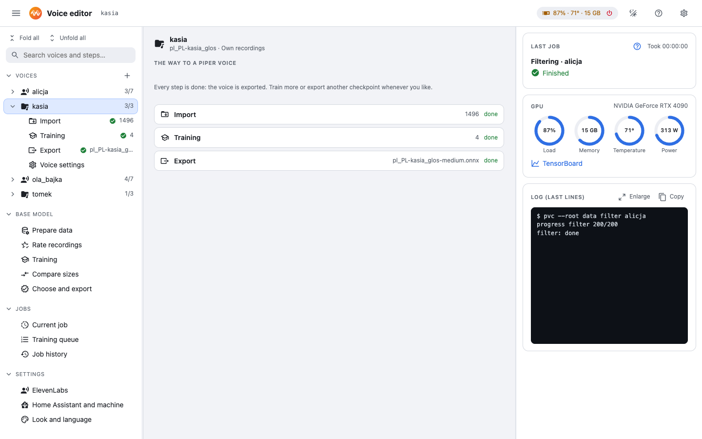

# Piper Voice Cloner

A voice editor for [Piper](https://github.com/OHF-Voice/piper1-gpl) that runs on a machine with an
NVIDIA card. It takes you step by step to a Piper voice file (`.onnx`) for Home Assistant. The
editor runs in Docker and starts with the machine; you open it in a browser on any computer, phone
or tablet at home.

{ .shot }

## Which way?

First decide where the recordings come from. The New voice window asks this first.

| | Way A: cloning | Way B: own recordings |
|---|---|---|
| You have | 10–60 s of the voice **or** a voice in your ElevenLabs account | about 1500 WAV/MP3 clips with their text (`metadata.csv`) |
| Steps | Recording → Sentences → Audition → Generate → Filter → Training → Export | Import → Training → Export |
| Time | a few hours of generating + 3–8 h of training | 3–8 h of training |
| Read | [Way A: cloning](path-clone.md) | [Way B: own recordings](path-import.md) |

!!! tip "The one rule"
    A Piper voice is never better than its recordings. Clean, even recordings without noise or echo
    help more than any number of epochs. More in [Training](training.md).

## The editor

- **Left:** the tree with Voices, Base model,
  Jobs and Settings. Each voice shows the steps of its
  way; a green mark means done, the number beside it says how much.
- **Middle:** the chosen step – a short explanation, its settings, the button that runs it and the
  results (players, tables, the chart). Its **?** opens a small window saying what the step does,
  with a link to the right chapter here.
- **Right:** the job running now – progress, time left, the GPU and the log
  (Enlarge, Copy). Stop ends it;
  a training resumes from its last checkpoint later.

One GPU job runs at a time; rating the base recordings can run next to it (on the CPU). Jobs keep
running when the browser is closed – come back tomorrow.

## Where to start

1. [Install the editor on Ubuntu](installation.md) – once; afterwards it starts by itself.
2. With a big clean voice (thousands of clips), make the [base model](base-model.md) `bazowy-pl`:
   new voices learn from it faster and sound more natural than from the English `lessac`.
3. Make a voice (New voice) and follow the steps of its way.
4. [Export it and choose it in Home Assistant](export.md).
