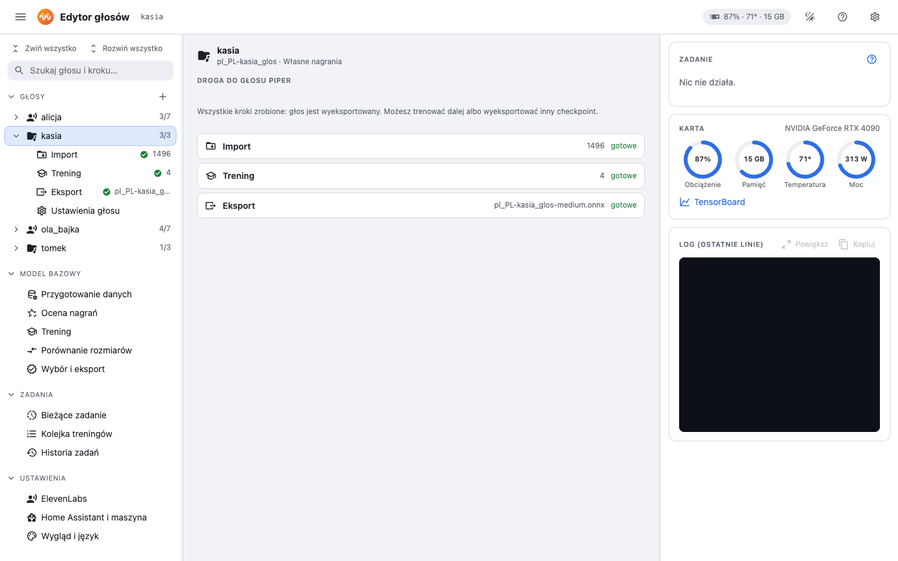

# Piper Voice Cloner

Edytor głosów dla [Piper](https://github.com/OHF-Voice/piper1-gpl), który działa na maszynie z kartą
NVIDIA. Prowadzi krok po kroku do pliku głosu Piper (`.onnx`), który wstawisz do Home Assistant.
Edytor uruchamia się w Dockerze razem z maszyną. Otwierasz go w przeglądarce na dowolnym komputerze,
telefonie albo tablecie w sieci domowej.

{ .shot }

## Którą drogę wybrać?

Najpierw ustal, skąd wezmą się nagrania. Okno Nowy głos pyta o to na początku.

| | Ścieżka A: klonowanie | Ścieżka B: własne nagrania |
|---|---|---|
| Masz | 10–60 s nagrania głosu **albo** głos na koncie ElevenLabs | ok. 1500 klipów WAV/MP3 z tekstem (`metadata.csv`) |
| Kroki | Nagranie → Zdania → Odsłuch → Generowanie → Filtr → Trening → Eksport | Import → Trening → Eksport |
| Czas | generowanie kilka godzin + trening 3–8 h | trening 3–8 h |
| Opis | [Ścieżka A: klonowanie](path-clone.md) | [Ścieżka B: własne nagrania](path-import.md) |

!!! tip "Najważniejsza zasada"
    Głos Piper nie będzie lepszy niż jego nagrania. Czyste, równe nagrania bez szumu i pogłosu
    dadzą więcej niż każda liczba epok. Więcej w rozdziale [Trening](training.md).

## Jak wygląda edytor

- **Po lewej** jest drzewo z grupami Głosy, Model bazowy,
  Zadania i Ustawienia. Każdy głos ma kroki swojej
  ścieżki. Zielony znaczek oznacza, że krok jest zrobiony, a liczba obok mówi, ile go jest.
- **Pośrodku** jest wybrany krok: krótki opis, ustawienia, przycisk uruchomienia i wyniki
  (odtwarzacze, tabele, wykres). **?** przy kroku otwiera małe okienko z opisem, co ten krok robi,
  i linkiem do właściwego rozdziału.
- **Po prawej** widać zadanie, które właśnie działa: postęp, pozostały czas, stan karty graficznej
  i log. Przyciski Powiększ i Kopiuj pomagają przy
  długich logach. Zatrzymaj przerywa zadanie, a trening wznowi się później od
  ostatniego checkpointu.

Naraz działa jedno zadanie na GPU. Ocena nagrań bazy może działać obok niego, bo liczy się na CPU.
Zadania działają dalej po zamknięciu przeglądarki, więc możesz wrócić następnego dnia.

## Od czego zacząć

1. [Zainstaluj edytor na Ubuntu](installation.md). Robisz to raz, potem edytor startuje sam.
2. Jeśli masz duży czysty głos (tysiące klipów), zrób [model bazowy](base-model.md) `bazowy-pl`.
   Nowe głosy uczą się od niego szybciej i brzmią naturalniej niż od angielskiego `lessac`.
3. Utwórz głos (Nowy głos) i przejdź kroki wybranej ścieżki.
4. [Wyeksportuj głos i wybierz go w Home Assistant](export.md).
