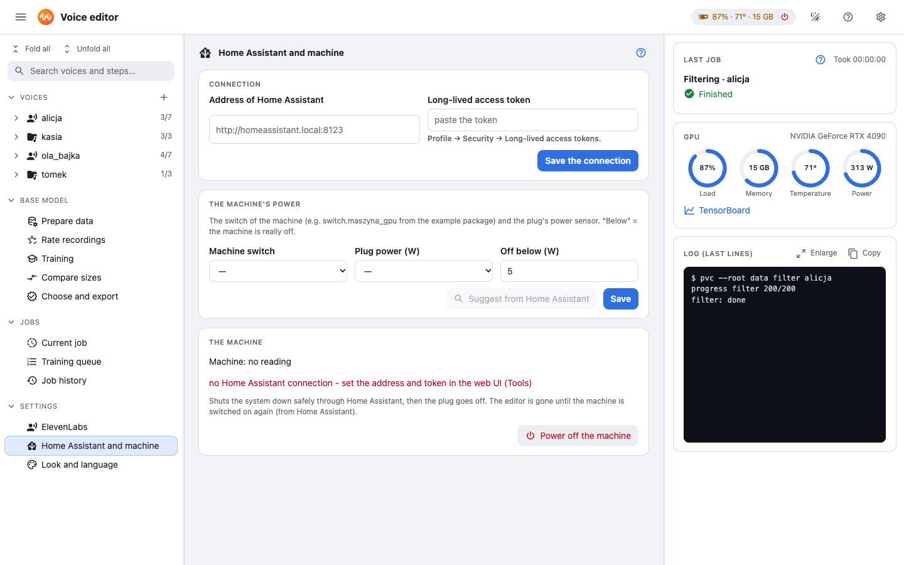

# Installation on Ubuntu

The editor runs in Docker on the machine with the NVIDIA card and starts with it: once the machine is
on, it answers at `http://<machine>:7860`. You install it once and then only update it.

**Tested on:** Ubuntu 24.04, RTX 4090 24 GB, NVIDIA driver 580 (CUDA 13.0), 128 GB RAM. The image takes
about 15 GB, a trained voice about 10 GB.

## 1. Docker and the GPU in containers

The NVIDIA driver should already work (`nvidia-smi`). On the machine install Docker and NVIDIA's container
toolkit (once, needs `sudo`):

```bash
sudo apt update && sudo apt install -y docker.io docker-compose-v2 git make rsync curl
sudo systemctl enable --now docker          # Docker starts with the machine
sudo usermod -aG docker $USER               # log out and in again afterwards

curl -fsSL https://nvidia.github.io/libnvidia-container/gpgkey \
  | sudo gpg --dearmor -o /usr/share/keyrings/nvidia-container-toolkit-keyring.gpg
curl -s -L https://nvidia.github.io/libnvidia-container/stable/deb/nvidia-container-toolkit.list \
  | sed 's#deb https://#deb [signed-by=/usr/share/keyrings/nvidia-container-toolkit-keyring.gpg] https://#g' \
  | sudo tee /etc/apt/sources.list.d/nvidia-container-toolkit.list
sudo apt update && sudo apt install -y nvidia-container-toolkit
sudo nvidia-ctk runtime configure --runtime=docker
sudo systemctl restart docker

docker run --rm --gpus all ubuntu nvidia-smi   # must show the card
```

## 2. The editor from the Mac: `make install` {#from-the-mac}

The machine's address is shared by every studio (wake words, router trainer, this editor) – save it once
in `~/.config/gpu-studio/host.mk`:

```make
GPU_HOST = user@192.168.1.21
```

If the code should live elsewhere on the machine than `~/piper-voice-cloner`, put it in `Makefile.local`
in the repository (not in git):

```make
GPU_DIR = piper-voice-cloner/repo
```

Then, in the repository folder on the Mac:

```bash
make install    # once: code, checks, password, the old panel off, build (15–30 min), start
make login      # the editor's user and password
make deploy     # after every change: code to the machine and a rebuild (usually seconds)
make status     # does the editor answer, the GPU in the container, the version
make logs       # the editor's log
```

## Or on the machine itself

```bash
git clone https://github.com/witold-gren/piper-voice-cloner.git ~/piper-voice-cloner
cd ~/piper-voice-cloner
docker/install-ubuntu.sh               # first install
docker/install-ubuntu.sh --show-login  # user and password
git pull && make docker-up             # update
```

`docker/install-ubuntu.sh` checks the card, Docker, the NVIDIA toolkit and the free space, makes the
password, switches the old panel's services off (same ports), builds and starts, and ends with the card
as seen from the container and the address. `--remove` stops and removes the containers (data and
settings stay).

## What is where {#folders}

| What | Where on the machine |
|---|---|
| The editor | `http://<machine>:7860` (port: `PVC_UI_PORT` in `docker/.env`) |
| TensorBoard | `http://<machine>:6006`, linked from the GPU card (no login: home network or VPN only) |
| Data: voices, bases, jobs, model caches | `PVC_DATA` in `docker/.env` – an existing `~/piper-voice-cloner/data` by default, else `docker/data` |
| Recordings to import | `<data>/import/<folder>` → `/data/import/<folder>` |
| Login, Home Assistant connection, ElevenLabs key, session secret | `docker/config/` (files with mode 600) |

The container runs with your user id (`UID`, `GID` in `docker/.env`), so the files in the data folder are
yours. The data folder may lie outside the repository (e.g. from an older install); nothing is copied.

**Backup** = the data folder + `docker/config`. Downloaded models and caches come back by themselves.

**From outside the home** only through the VPN (WireGuard); no port is opened to the internet.

### Login

One user: `PVC_UI_AUTH=admin:<password>` in `docker/config/env` (`make login` shows it). A session lasts
30 days; after 5 wrong passwords from one address it waits a minute. Change the password in that file and
`docker compose -f docker/compose.yaml restart` – every browser is logged out.

### After a restart of the machine

Nothing to do: Docker starts both containers. A job cut by powering off shows as **Interrupted**; start the
training again and it resumes from its last checkpoint.

## 3. Home Assistant and powering off {#home-assistant}

Optional. With it:

- **Power off when it ends:** tick <span class="ui">Power the machine off when it ends</span> at a
  training, a queue or on the card of the running job. When the job ends – well or with an error – the top
  bar shows "Power-off in 2:00" with <span class="ui">Cancel</span>; after 120 s the editor asks Home
  Assistant to switch the machine's switch off. Never after <span class="ui">Stop</span>; a job started
  during the countdown stops it, a restart of the editor drops it; a job running beside (e.g. rating the
  recordings) is finished first.
- **The machine** in the top bar: GPU load, temperature, memory, the plug's power; ⏻ switches it off at
  once (not during a job).

The container never powers the computer off itself; Home Assistant's switch does it. The example package
[`maszyna_gpu.yaml`](https://github.com/witold-gren/piper-voice-cloner/blob/main/docs/home-assistant/maszyna_gpu.yaml):
on = the plug on (the BIOS starts the machine); off = shutdown over SSH (`sudo poweroff`), then – once the
plug draws less than the threshold – the plug off.

1. Add the package to Home Assistant with your entities (plug, power sensor) and SSH command.
2. Home Assistant: **Profile → Security → Long-lived access tokens** – make one for an admin user.
3. Editor: <span class="ui">Settings</span> → <span class="ui">Home Assistant and machine</span>:
   address and token, <span class="ui">Save the connection</span>.
4. <span class="ui">Suggest from Home Assistant</span>, choose the machine's switch and the power sensor,
   <span class="ui">Save</span>.

{ .shot }

Switch the machine on from Home Assistant – the editor lives on it.

## Try it on a Mac {#try-on-a-mac}

1. **You need** only Docker Desktop, running. No GPU, no Python, no Home Assistant.
2. **One command:** `make demo` (the first build of the demo image takes a minute or so, later ones seconds).
3. **Open** http://localhost:7861 and log in as `demo` / `demo`.
4. **What is pretend:** made-up voices, a fake GPU and jobs that only pretend to work, all inside the
   container; nothing goes to Home Assistant, ElevenLabs or the machine. Ctrl+C stops and removes the
   container; `make demo-clean` removes the image too.
5. **The guide and programmers:** `make docs` builds this guide in Docker and opens it. `make test` and
   `make test-browser` need `make setup` (uv, which fetches the Python itself; Google Chrome for the
   browser tests). `make doctor` says what is missing.
