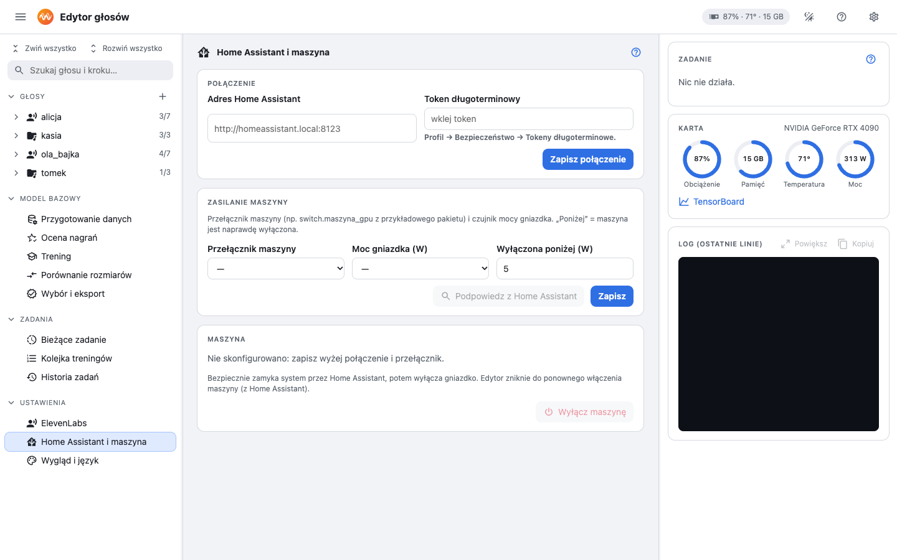

# Instalacja na Ubuntu

Edytor działa w Dockerze na maszynie z kartą NVIDIA i startuje razem z nią. Po włączeniu maszyny jest
od razu pod `http://<maszyna>:7860`. Instalujesz go raz, potem tylko aktualizujesz.

**Sprawdzona maszyna:** Ubuntu 24.04, RTX 4090 24 GB, sterownik NVIDIA 580 (CUDA 13.0), 128 GB RAM.
Obraz zajmuje ok. 15 GB, a jeden głos z treningiem ok. 10 GB.

## 1. Docker i karta w kontenerze

Sterownik NVIDIA powinien już działać, co pokazuje `nvidia-smi`. Na maszynie zainstaluj Dockera i
zestaw NVIDIA dla kontenerów (raz, wymaga `sudo`):

```bash
sudo apt update && sudo apt install -y docker.io docker-compose-v2 git make rsync curl
sudo systemctl enable --now docker          # Docker startuje z maszyną
sudo usermod -aG docker $USER               # potem wyloguj się i zaloguj ponownie

curl -fsSL https://nvidia.github.io/libnvidia-container/gpgkey \
  | sudo gpg --dearmor -o /usr/share/keyrings/nvidia-container-toolkit-keyring.gpg
curl -s -L https://nvidia.github.io/libnvidia-container/stable/deb/nvidia-container-toolkit.list \
  | sed 's#deb https://#deb [signed-by=/usr/share/keyrings/nvidia-container-toolkit-keyring.gpg] https://#g' \
  | sudo tee /etc/apt/sources.list.d/nvidia-container-toolkit.list
sudo apt update && sudo apt install -y nvidia-container-toolkit
sudo nvidia-ctk runtime configure --runtime=docker
sudo systemctl restart docker

docker run --rm --gpus all ubuntu nvidia-smi   # musi pokazać kartę
```

## 2. Edytor z Maca: `make install` {#from-the-mac}

Adres maszyny jest wspólny dla wszystkich studiów (słowa budzące, trener routera, ten edytor). Zapisz go
raz w `~/.config/gpu-studio/host.mk`:

```make
GPU_HOST = user@192.168.1.21
```

Jeśli kod ma leżeć na maszynie w innym folderze niż `~/piper-voice-cloner`, wpisz go w `Makefile.local`
w repozytorium. Ten plik nie trafia do gita.

```make
GPU_DIR = piper-voice-cloner/repo
```

Potem w folderze repozytorium na Macu:

```bash
make install    # raz: kod, kontrole, hasło, wyłączenie starego panelu, budowa (15–30 min), start
make login      # użytkownik i hasło edytora
make deploy     # po każdej zmianie: kod na maszynę i przebudowa (zwykle kilkanaście sekund)
make status     # czy edytor odpowiada, karta w kontenerze, wersja
make logs       # log edytora
```

## Albo na samej maszynie

```bash
git clone https://github.com/witold-gren/piper-voice-cloner.git ~/piper-voice-cloner
cd ~/piper-voice-cloner
docker/install-ubuntu.sh               # pierwsza instalacja
docker/install-ubuntu.sh --show-login  # użytkownik i hasło
git pull && make docker-up             # aktualizacja
```

`docker/install-ubuntu.sh` sprawdza kartę, Dockera, zestaw NVIDIA i wolne miejsce. Tworzy hasło, wyłącza
usługi dawnego panelu (zajmowały te same porty), buduje obraz i uruchamia edytor. Na końcu pokazuje kartę
widzianą z kontenera i adres edytora. `--remove` zatrzymuje i usuwa kontenery, ale dane i ustawienia
zostają.

## Co jest gdzie {#folders}

| Co | Gdzie na maszynie |
|---|---|
| Edytor | `http://<maszyna>:7860` (port: `PVC_UI_PORT` w `docker/.env`) |
| TensorBoard | `http://<maszyna>:6006`, link w karcie GPU edytora (bez logowania: tylko w sieci domowej lub przez VPN) |
| Dane: głosy, bazy, zadania, cache modeli | `PVC_DATA` w `docker/.env`, domyślnie istniejący `~/piper-voice-cloner/data`, inaczej `docker/data` |
| Nagrania do importu | `<dane>/import/<folder>`, w kontenerze `/data/import/<folder>` |
| Login, połączenie z HA, klucz ElevenLabs, sekret sesji | `docker/config/` (pliki z prawami 600) |

Kontener działa z Twoim numerem użytkownika (`UID`, `GID` w `docker/.env`), więc pliki w folderze danych
należą do Ciebie. Folder danych może leżeć poza repozytorium (np. z dawnej instalacji). Przy instalacji nic
nie jest kopiowane.

**Kopia zapasowa** to folder danych i `docker/config`. Pobierane modele i cache odtworzą się same.

**Spoza domu** łącz się tylko przez VPN (WireGuard). Portów nie wystawiamy do internetu.

### Logowanie

Jest jeden użytkownik: `PVC_UI_AUTH=admin:<hasło>` w `docker/config/env`. Pokazuje go `make login`.
Sesja trwa 30 dni. Po 5 złych hasłach z jednego adresu trzeba odczekać minutę. Hasło zmienisz w tym pliku,
a potem uruchomisz `docker compose -f docker/compose.yaml restart`. Zmiana hasła wylogowuje wszystkie
przeglądarki.

### Po restarcie maszyny

Nic nie trzeba robić, bo Docker uruchamia oba kontenery sam. Zadanie przerwane wyłączeniem maszyny ma stan
**Przerwane**. Trening uruchomiony ponownie wznowi się od ostatniego checkpointu.

## 3. Home Assistant i wyłączanie maszyny {#home-assistant}

Połączenie z Home Assistant jest opcjonalne. Daje dwie rzeczy:

- **Wyłączenie maszyny po zakończeniu:**
  - zaznacz <span class="ui">Wyłącz maszynę po zakończeniu</span> przy treningu, kolejce albo na karcie
    trwającego zadania;
  - po końcu zadania, udanym albo z błędem, na górnym pasku pojawi się „Wyłączenie za 2:00” z przyciskiem
    <span class="ui">Anuluj</span>;
  - po 120 s edytor prosi Home Assistant o wyłączenie przełącznika maszyny;
  - po <span class="ui">Zatrzymaj</span> maszyna nigdy się nie wyłącza;
  - zadanie uruchomione w czasie odliczania je przerywa, a restart edytora w czasie odliczania je kasuje;
  - zadanie działające obok (np. ocena nagrań) jest najpierw dokańczane.
- **Stan maszyny** na górnym pasku: obciążenie karty, temperatura, pamięć i moc z gniazdka. Przycisk ⏻
  wyłącza maszynę od razu, ale nie w trakcie zadania.

Kontener nie wyłącza komputera sam, robi to przełącznik Home Assistant. Przykładowy pakiet
[`maszyna_gpu.yaml`](https://github.com/witold-gren/piper-voice-cloner/blob/main/docs/home-assistant/maszyna_gpu.yaml)
działa tak: włączenie włącza gniazdko, a BIOS uruchamia maszynę. Wyłączenie zamyka system przez SSH
(`sudo poweroff`), czeka, aż gniazdko pokaże mniej niż próg, i wyłącza gniazdko.

1. Dodaj pakiet do Home Assistant i podstaw swoje encje (gniazdko, czujnik mocy) oraz komendę SSH.
2. W Home Assistant otwórz **Profil → Bezpieczeństwo → Tokeny długoterminowe** i utwórz token konta
   administratora.
3. W edytorze otwórz <span class="ui">Ustawienia</span> → <span class="ui">Home Assistant i maszyna</span>.
   Wpisz adres i token, a potem kliknij <span class="ui">Zapisz połączenie</span>.
4. Kliknij <span class="ui">Podpowiedz z Home Assistant</span>, wybierz przełącznik maszyny i czujnik mocy,
   potem <span class="ui">Zapisz</span>.

{ .shot }

Maszynę włączasz z Home Assistant, bo edytor działa tylko na włączonej maszynie.

## Wypróbuj na Macu {#try-on-a-mac}

1. **Potrzebujesz** tylko uruchomionego Docker Desktop. Bez karty graficznej, bez Pythona, bez Home Assistanta.
2. **Jedno polecenie:** `make demo` (pierwsza budowa obrazu demo trwa około minuty, kolejne kilka sekund).
3. **Otwórz** http://localhost:7861 i zaloguj się jako `demo` / `demo`.
4. **Co jest udawane:** wymyślone głosy, udawana karta i zadania, które tylko udają pracę, wszystko w
   kontenerze. Nic nie trafia do Home Assistanta, ElevenLabs ani na maszynę. Ctrl+C zatrzymuje i usuwa
   kontener, a `make demo-clean` usuwa też obraz.
5. **Instrukcja i dla programisty:** `make docs` buduje tę instrukcję w Dockerze i ją otwiera. `make test`
   i `make test-browser` potrzebują `make setup` (uv, który sam pobiera Pythona; Google Chrome do testów w
   przeglądarce). `make doctor` mówi, czego brakuje.
