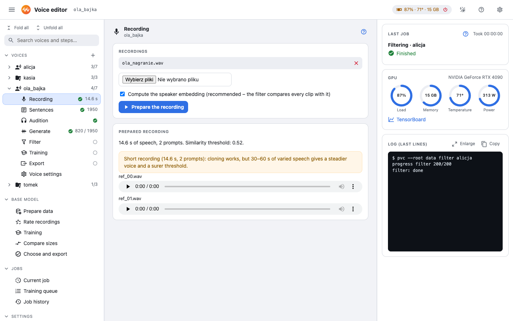
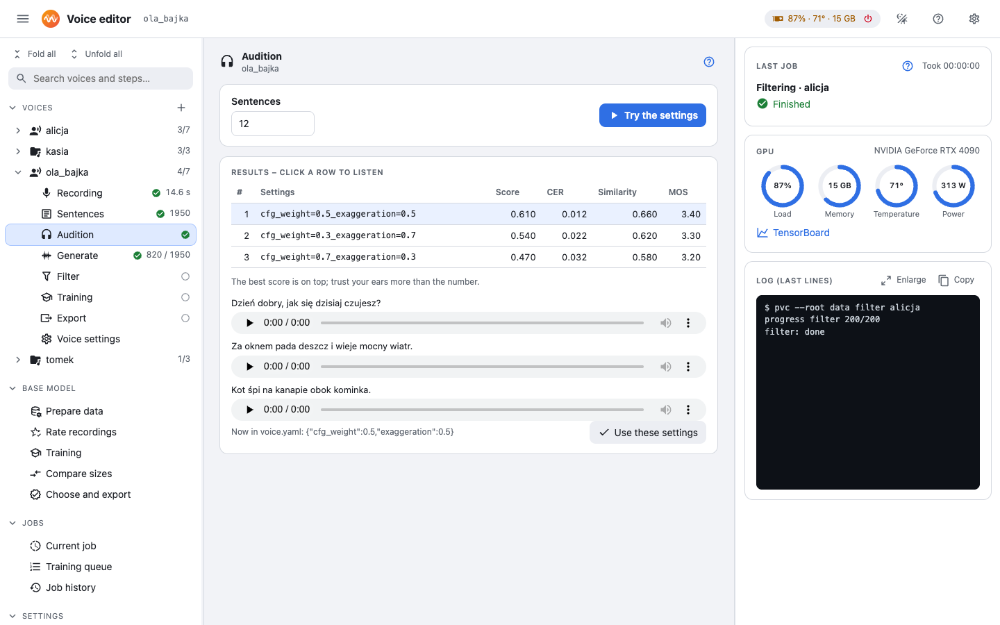
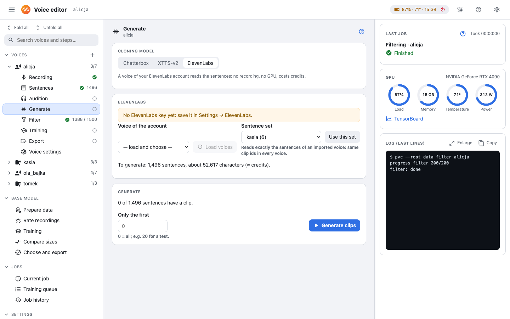
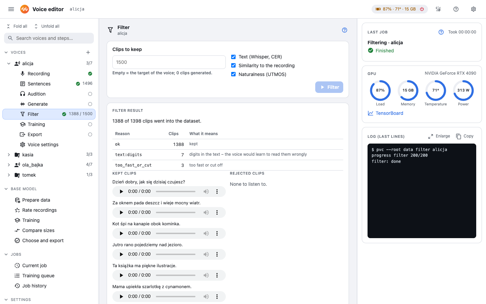

# Way A: cloning a voice

You have a short recording of the voice, or the voice is in your ElevenLabs account – but not
thousands of recordings. A cloning model reads about 2000 chosen sentences in that voice, a filter
drops the bad clips and the rest (about 1500) trains the Piper voice.

**Order:** New voice (I clone a voice) →
Recording → Sentences → Audition →
Generate → Filter → [Training](training.md) →
[Export](export.md).

!!! info "ElevenLabs or Chatterbox?"
    - **Chatterbox** – local, on the GPU, free; clones from your recording, good Polish. A few seconds per
      clip on an RTX 4090: 2000 clips take a few hours.
    - **ElevenLabs** – a voice of your account reads the sentences: no recording, no GPU, but credits
      (about 1 per character: about 78 000 for 1500 sentences) and the text goes to their cloud. Usually
      the most even clips.

## 1. Recording {#recording}

{ .shot }

Send 10–60 seconds of **clean** speech (wav, mp3, m4a…) and click Prepare the recording.
The editor trims silence, evens the level, cuts it into 3–12 s prompts and computes the speaker
embedding – the similarity threshold the filter later checks every clip against.

Watch out for:

- **No music, TV, echo or other people** – the model clones the room too.
- **30–60 s of varied speech** (questions, exclamations, calm sentences) gives a steadier voice than
  10 s. Shorter recordings get a warning: cloning works, the threshold is less sure.
- **Natural speech** beats a read list. A recording that is itself synthetic (another TTS) loses its
  character when cloned.
- With ElevenLabs this step is not needed (it shows as done).

## 2. Sentences {#sentences}

Choose the sentences picks sentences covering all Polish sounds evenly, from your
own text files (one sentence per line, or `id<TAB>text`) and/or the bundled ones (simple,
child-friendly).

- **Plain text only:** lines with digits, dates, times, list numbers, symbols or abbreviations are
  dropped, never rewritten. Piper's text normalizer reads numbers later – the voice should learn words.
- By default target × 1.3 sentences (e.g. 1950 for 1500 clips): the filter drops some.

## 3. Audition {#audition}

{ .shot }

Try the settings reads a few sentences with several settings of the cloning model.
The best score is on top; click a row, listen and pick what **sounds** most like the original, then
Use these settings.

If nothing sounds right, improve the recording (step 1) – do not generate thousands of bad clips.

## 4. Generate {#generate}

{ .shot }

1. Choose the **cloning model** (Chatterbox, XTTS-v2, ElevenLabs).
2. ElevenLabs: save the key in Settings → ElevenLabs,
   Load voices and choose the voice of the account (you also see the credits
   left). Optionally a **Sentence set** of an imported voice → Use this set:
   every voice reads the same sentences with the same ids. The editor shows how many characters
   (credits) are left to generate.
3. A test first: 20 in “Only the first” → Generate clips; listen to a few clips
   in `raw/`.
4. Then all of them (0). Stop and resume whenever you like – finished clips stay. The editor shows the
   pace (seconds per clip) and estimates the whole.

## 5. Filter {#filter}

{ .shot }

Filter checks every clip and builds the training set:

- **Text (Whisper, CER):** Whisper must hear the right words – drops garbled and cut clips.
- **Similarity to the recording:** drops clips where the model drifted to another voice.
- **Naturalness (UTMOS):** drops the worst-sounding 10%.
- **Length for the text:** drops cut-off, too fast or extra-sound clips.

The table lists the reasons with what they mean; listen to kept and rejected clips. When more than
about 30% go, look for the cause (recording, audition) before training. Thresholds:
Voice settings.

With about 1500 clips in the dataset, go on to [training](training.md).
