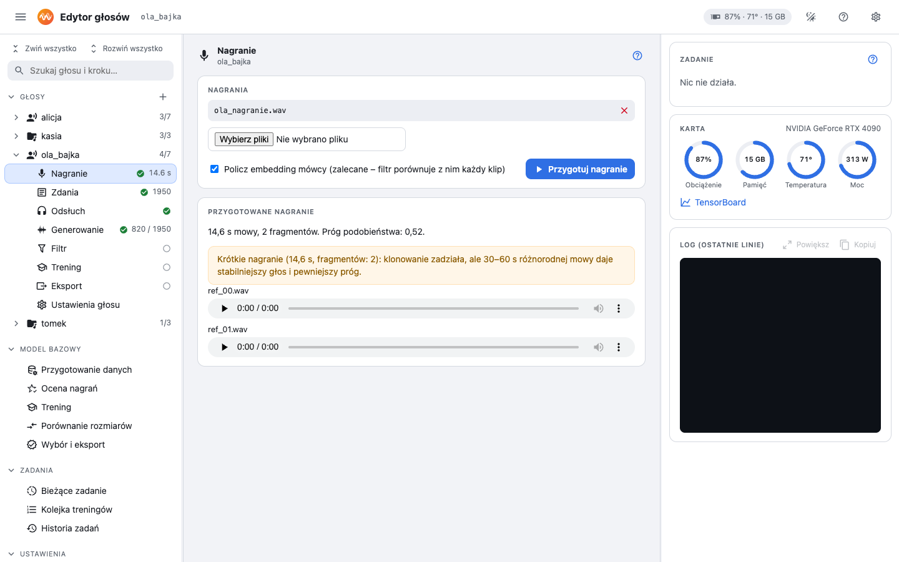
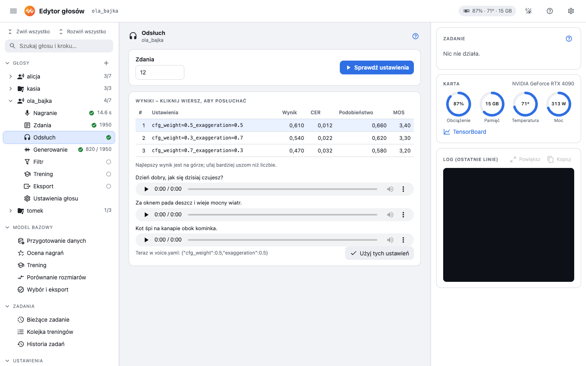
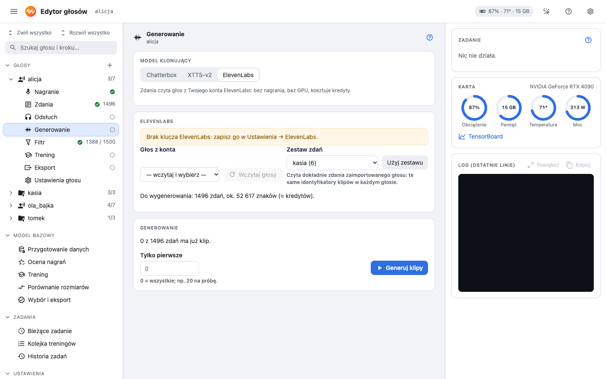
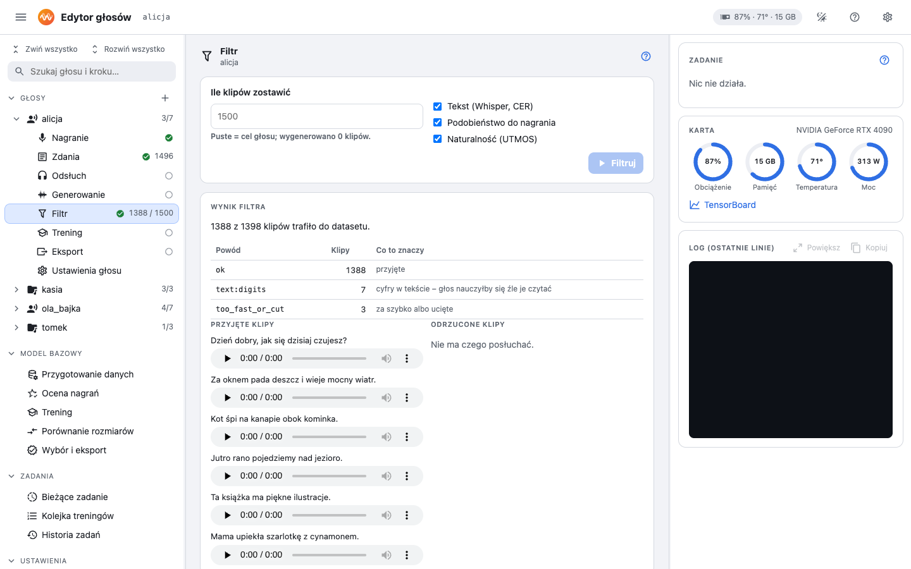

# Ścieżka A: klonowanie głosu

Masz krótkie nagranie głosu albo głos na koncie ElevenLabs, ale nie masz tysięcy nagrań. Model
klonujący przeczyta wtedy ok. 2000 dobranych zdań tym głosem. Filtr odrzuci nieudane klipy, a z reszty
(ok. 1500) wytrenujesz głos Piper.

**Kolejność:** Nowy głos (Klonuję głos) →
Nagranie → Zdania → Odsłuch →
Generowanie → Filtr → [Trening](training.md) →
[Eksport](export.md).

!!! info "ElevenLabs czy Chatterbox?"
    - **Chatterbox** działa lokalnie na karcie, za darmo. Klonuje z Twojego nagrania i dobrze mówi
      po polsku. Na RTX 4090 robi kilka sekund na klip, więc 2000 klipów to kilka godzin.
    - **ElevenLabs** czyta zdania głosem z Twojego konta. Nie potrzebuje nagrania ani karty, ale
      kosztuje kredyty: ok. 1 kredyt na znak, czyli ok. 78 000 kredytów za 1500 zdań. Tekst trafia do
      chmury ElevenLabs. Zwykle daje najrówniejsze klipy.

## 1. Nagranie {#recording}

{ .shot }

Wyślij 10–60 sekund **czystej** mowy, w dowolnym formacie (wav, mp3, m4a). Kliknij
Przygotuj nagranie. Edytor przytnie ciszę, wyrówna głośność, potnie nagranie na
fragmenty 3–12 s i policzy embedding mówcy. Z embeddingu powstaje próg podobieństwa, którym filtr
sprawdzi później każdy klip.

Na co uważać:

- **Bez muzyki, telewizora, pogłosu i innych osób.** Model sklonuje także tło.
- **30–60 s różnorodnej mowy** (pytania, wykrzyknienia, spokojne zdania) daje stabilniejszy głos niż
  10 s. Przy krótszym nagraniu edytor pokaże ostrzeżenie. Klonowanie zadziała, ale próg będzie mniej
  pewny.
- **Naturalna mowa** działa lepiej niż czytana lista. Nagranie, które samo jest syntetyczne (np. z
  innego TTS), traci charakter przy klonowaniu.
- Przy ElevenLabs ten krok jest zbędny. Edytor oznaczy go jako zrobiony.

## 2. Zdania {#sentences}

Kliknij Wybierz zdania. Edytor wybierze zdania, które równomiernie pokrywają
wszystkie polskie głoski. Możesz dodać własne pliki tekstowe (jedno zdanie w linii albo `id<TAB>tekst`),
możesz też użyć wbudowanych (prostych, przyjaznych dzieciom).

- **Tylko zwykły tekst.** Linie z cyframi, datami, godzinami, numeracją list, symbolami albo skrótami
  są odrzucane, a nie przerabiane. Liczby czyta potem normalizacja tekstu Pipera, więc głos ma uczyć się
  słów, nie cyfr.
- Domyślnie powstaje cel × 1,3 zdań, np. 1950 dla 1500 klipów, bo filtr część odrzuci.

## 3. Odsłuch ustawień {#audition}

{ .shot }

Sprawdź ustawienia czyta kilka zdań różnymi ustawieniami modelu klonującego. Na
górze tabeli jest najlepszy wynik. Kliknij wiersz, posłuchaj i wybierz to, co **brzmi** najbardziej jak
oryginał, a potem kliknij Użyj tych ustawień.

Jeśli nic nie brzmi dobrze, popraw nagranie (krok 1). Nie generuj tysięcy złych klipów.

## 4. Generowanie {#generate}

{ .shot }

1. Wybierz **model klonujący**: Chatterbox, XTTS-v2 albo ElevenLabs.
2. Przy ElevenLabs:
   - zapisz klucz w Ustawienia → ElevenLabs;
   - kliknij Wczytaj głosy i wybierz głos z konta. Zobaczysz też pozostałe kredyty;
   - opcjonalnie wybierz **Zestaw zdań** z zaimportowanego głosu i kliknij Użyj zestawu.
     Każdy głos przeczyta wtedy te same zdania z tymi samymi identyfikatorami;
   - edytor pokaże, ile znaków (kredytów) zostało do wygenerowania.
3. Najpierw zrób próbę: wpisz 20 w polu „Tylko pierwsze” i kliknij Generuj klipy.
   Posłuchaj kilku klipów w folderze `raw/`.
4. Potem generuj wszystkie (0). Możesz przerwać i wznowić w każdej chwili, bo gotowe klipy zostają.
   Edytor pokazuje tempo (sekundy na klip) i szacuje czas całości.

## 5. Filtr {#filter}

{ .shot }

Filtruj sprawdza każdy klip i buduje dataset do treningu:

- **Tekst (Whisper, CER).** Whisper musi usłyszeć właściwe słowa. Odrzuca przekręcone i urwane klipy.
- **Podobieństwo do nagrania.** Odrzuca klipy, w których model „odpłynął” w inny głos.
- **Naturalność (UTMOS).** Odrzuca 10% najgorzej brzmiących.
- **Długość do tekstu.** Odrzuca klipy ucięte, za szybkie albo z dodatkowymi dźwiękami.

Tabela pokazuje powody odrzuceń z wyjaśnieniem. Możesz posłuchać przyjętych i odrzuconych klipów. Gdy
odpada więcej niż ok. 30% klipów, poszukaj przyczyny w nagraniu albo w ustawieniach odsłuchu, zanim
zaczniesz trenować. Progi zmienisz w Ustawienia głosu.

Gdy dataset ma ok. 1500 klipów, przejdź do [treningu](training.md).
