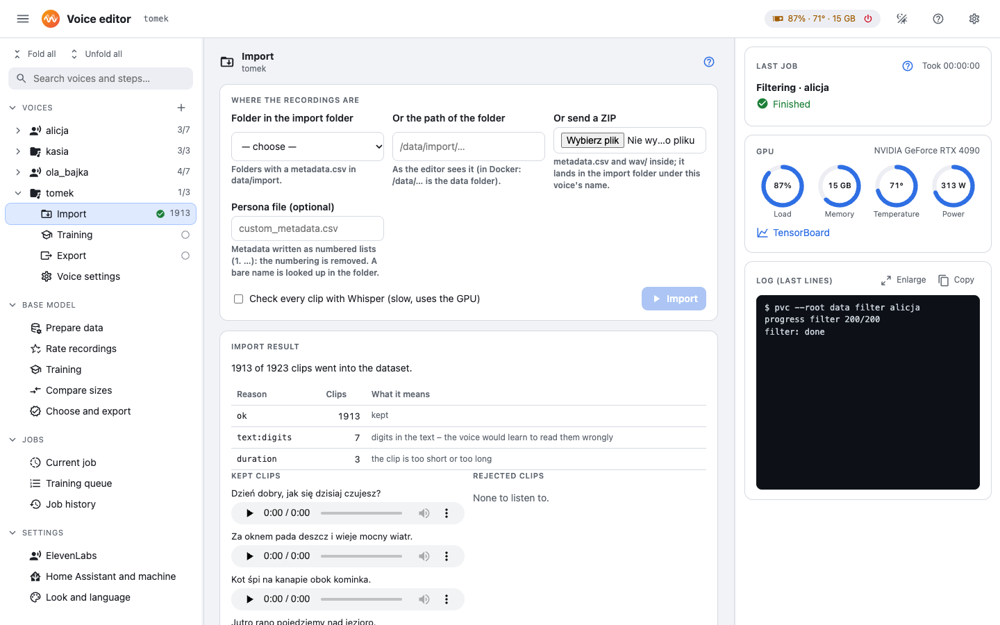

# Way B: own recordings

You already have about 1500 recordings of the voice with their text – an old dataset, a narrator, or
clips made earlier in ElevenLabs. No cloning and no choosing of sentences: three steps,
<span class="ui">Import</span> → [Training](training.md) → [Export](export.md).

Make the voice with <span class="ui">New voice</span> → <span class="ui">I already have recordings</span>.

## Preparing the recordings

The LJSpeech format, a folder with:

```text
nagrania_basi/
├── metadata.csv      # id|text, one line per clip, no header
└── wav/
    ├── b0001.wav
    └── b0002.wav
```

```text
b0001|Dzień dobry, jak się dzisiaj czujesz?
b0002|Za oknem pada deszcz i wieje mocny wiatr.
```

- **How many:** 1000–2000 clips of 2–10 s. Fewer than about 800 gives an unsteady voice.
- **Audio:** WAV or MP3 (also MP3 named `.wav`); the import makes 22 050 Hz WAV.
- **Text:** exactly what is heard, **in words**. Lines with digits, abbreviations, symbols or list
  numbers are dropped – the voice would learn them wrongly.
- **One speaker, one room, an even level.** Noise in the pauses is learned too – the finished voice
  then hisses between words (see [Training](training.md#data)).
- **Persona file** (optional): metadata written as a numbered list (`b0001|1. Czy mogę…`); the numbering
  is removed.

## Import

{ .shot }

1. Point at the recordings, one of three ways:
    - **Import folder:** copy the folder to `~/piper-voice-cloner/data/import/` on the machine – it
      shows up in the list;
    - **ZIP:** send an archive from the browser – it lands in the import folder under the voice's name;
    - **Path:** as the editor sees it (in Docker `/data/…`).
2. Optionally the persona file and the Whisper check (drops clips whose words differ from the text;
   slower, uses the GPU).
3. <span class="ui">Import</span>. The result shows how many clips went in, why the others did not,
   and examples to listen to.

With the dataset ready, go on to [training](training.md).

!!! note "An imported voice keeps its recordings"
    No new clips can be generated for it. For extra cloned clips make a new voice (way A) – it can use
    the sentences of the imported voice as its **Sentence set**.
