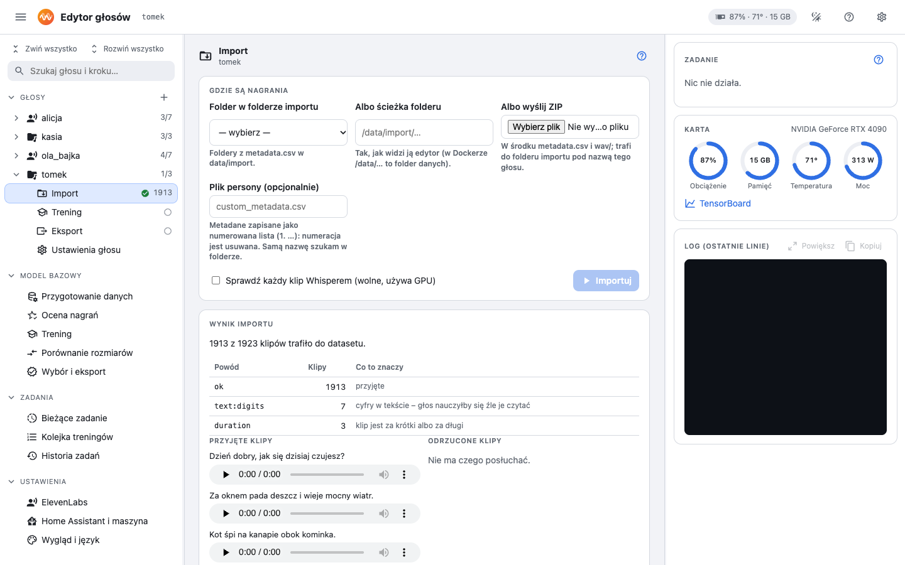

# Ścieżka B: własne nagrania

Masz już ok. 1500 nagrań głosu z tekstem: z dawnego zbioru, z nagrań lektora albo wygenerowane wcześniej
w ElevenLabs. Klonowanie i dobór zdań są wtedy zbędne. Wystarczą trzy kroki:
<span class="ui">Import</span> → [Trening](training.md) → [Eksport](export.md).

Utwórz głos przez <span class="ui">Nowy głos</span> → <span class="ui">Mam już nagrania</span>.

## Jak przygotować nagrania

Format LJSpeech, czyli folder z dwiema rzeczami:

```text
nagrania_basi/
├── metadata.csv      # id|tekst, jedna linia na klip, bez nagłówka
└── wav/
    ├── b0001.wav
    └── b0002.wav
```

```text
b0001|Dzień dobry, jak się dzisiaj czujesz?
b0002|Za oknem pada deszcz i wieje mocny wiatr.
```

- **Ile:** 1000–2000 klipów po 2–10 s. Mniej niż ok. 800 daje głos niestabilny.
- **Dźwięk:** WAV albo MP3, także MP3 z nazwą `.wav`. Import zamieni wszystko na WAV 22 050 Hz.
- **Tekst:** dokładnie to, co słychać, zapisane **słowami**. Linie z cyframi, skrótami, symbolami albo
  numeracją import odrzuci, bo głos uczyłby się ich źle.
- **Jeden mówca, jedno miejsce nagrania, równa głośność.** Szum w pauzach głos też się nauczy. Gotowy głos
  szumi wtedy między słowami (zob. [Trening](training.md#data)).
- **Plik persony** (opcjonalnie): metadane zapisane jako numerowana lista (`b0001|1. Czy mogę…`).
  Import usuwa numerację.

## Import

{ .shot }

1. Wskaż nagrania na jeden z trzech sposobów:
   - **Folder importu:** skopiuj folder do `~/piper-voice-cloner/data/import/` na maszynie, a pojawi się
     na liście;
   - **ZIP:** wyślij archiwum z przeglądarki. Trafi do folderu importu pod nazwą głosu; wcześniej wysłany
     folder tego głosu zostaje jako `<głos>_2` (`_3`…), nic nie jest kasowane;
   - **Ścieżka:** wpisz ścieżkę, jaką widzi edytor (w Dockerze `/data/…`).
2. Opcjonalnie wpisz plik persony i zaznacz sprawdzanie Whisperem. Whisper odrzuci klipy, w których
   słychać co innego niż w tekście. To trwa dłużej i zajmuje kartę.
3. Kliknij <span class="ui">Importuj</span>. Wynik pokaże, ile klipów przyjęto i dlaczego odrzucono
   resztę. Możesz posłuchać przykładów.

Gdy dataset jest gotowy, przejdź do [treningu](training.md).

!!! note "Zaimportowany głos zostaje przy swoich nagraniach"
    Nie wygenerujesz do niego nowych klipów. Jeśli chcesz dołożyć sklonowane, utwórz nowy głos
    (ścieżka A). Możesz wtedy użyć zdań zaimportowanego głosu jako **Zestawu zdań**.
