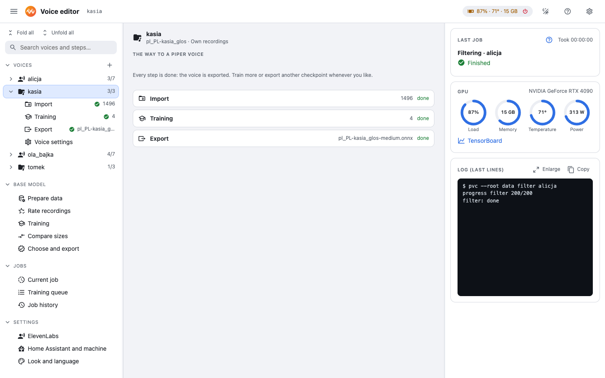
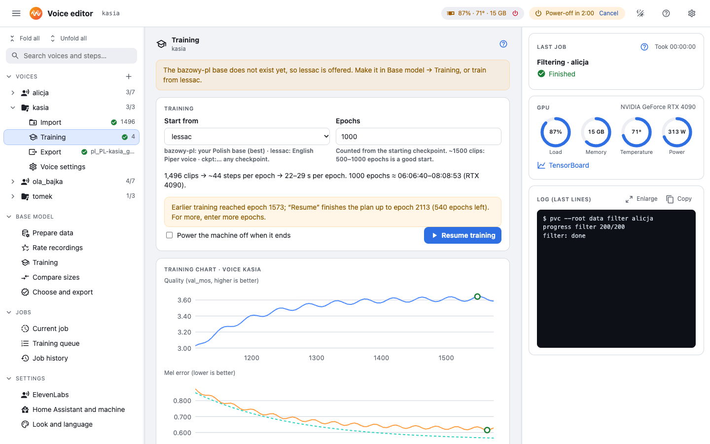
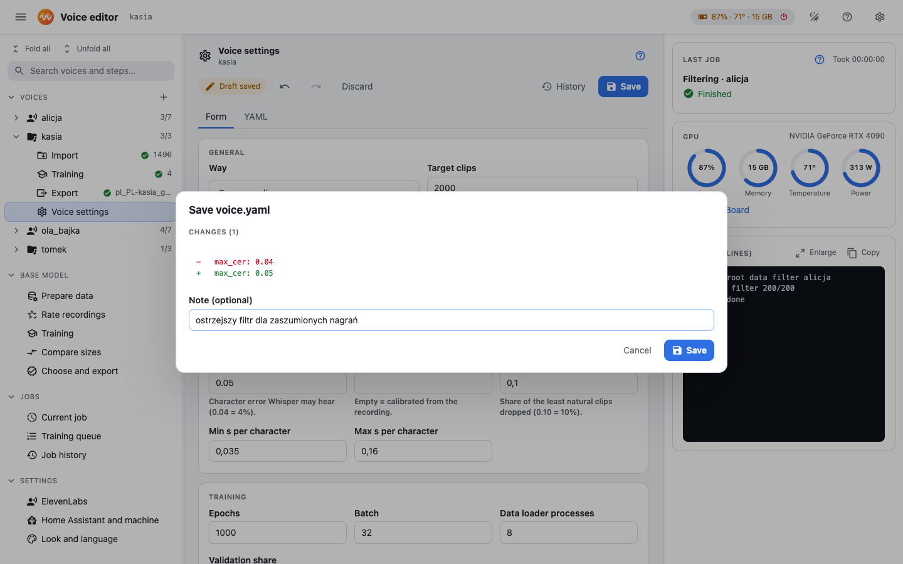

# The screen

The editor looks and works like the other studios (Home Dashboard editor, Assist Router editor, the wake
word studio).

{ .shot }

## The top bar {#top-bar}

From the left:

1. **☰ menu** – the guide, who is logged in and how to change the password, Log out;
   the icon and the name.
2. **Job chip** – what runs, its percentage and the time left; a click opens Current job.
3. **Machine chip** – GPU load, temperature, memory, the plug's power; ⏻ switches the machine off (with
   Home Assistant, when nothing runs).
4. **Countdown** after a job with the wish: "Power-off in 1:45" with Cancel; when
   powering off fails, a red pill with the reason.
5. **Theme**, **?** (this guide – only this "?" opens the guide; the "?" of steps and cards show a small
   window), **⚙** (Look and language).

{ .shot }

{ .shot }

## The tree {#tree}

- Voices – each voice with the steps of its way; ✓ = done, the number = how much
  (e.g. clips). At the end Voice settings. "+" makes a new voice (it asks for the
  way first).
- Base model – everything about the `bazowy-pl` base.
- Jobs – Current job, Training queue,
  Job history.
- Settings – ElevenLabs, Home Assistant and the machine, look and language.

Search filters the tree; folds and column widths are remembered by the browser. The left and right
columns fold with ‹ / › at their top or Ctrl/⌘+B (left) and Ctrl/⌘+Alt+B (right): a narrow bar with the
unfold button stays and the middle gets wider. In a narrow window (below 900 px) the right column starts
folded. The page's address
(`#voice/kasia/train`) leads straight to a step – send it or bookmark it.

## The middle and the right column {#columns}

**The middle** is the chosen step: **?** with a short explanation in a small window (and a link to the chapter),
the settings, the button that runs it and the results.

**The right column** is the job live: stage, progress, the GPU, the queue, the log
(Enlarge, Copy), Stop and
Power the machine off when it ends.

## Voice settings: draft, save, history {#draft}

Every change in Voice settings goes at once to a **draft on the machine** (it
survives closing the browser); `voice.yaml` changes only on Save.

- Form or YAML; changing a field changes exactly one line of the file (comments and layout stay).
- Undo / Redo (Ctrl/⌘+Z, Shift+Ctrl/⌘+Z); typing in one
  field for 1.5 s is one step.
- Save (Ctrl/⌘+S) shows the changed lines and a note field. When someone changed the
  file meanwhile, it asks Save anyway.
- History keeps 30 earlier versions with their notes; Bring back
  puts one into the draft.

{ .shot }
