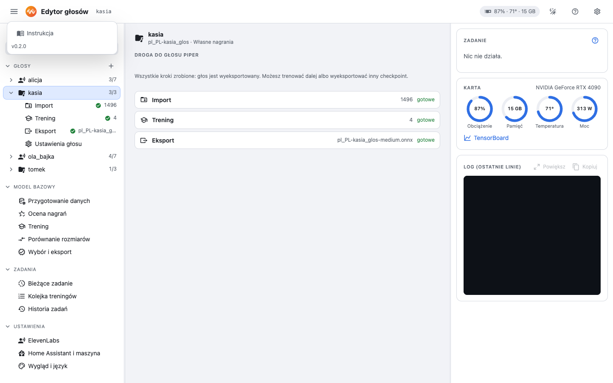
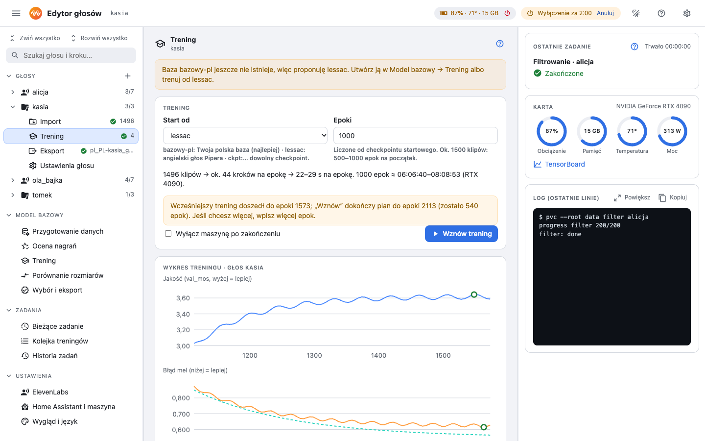
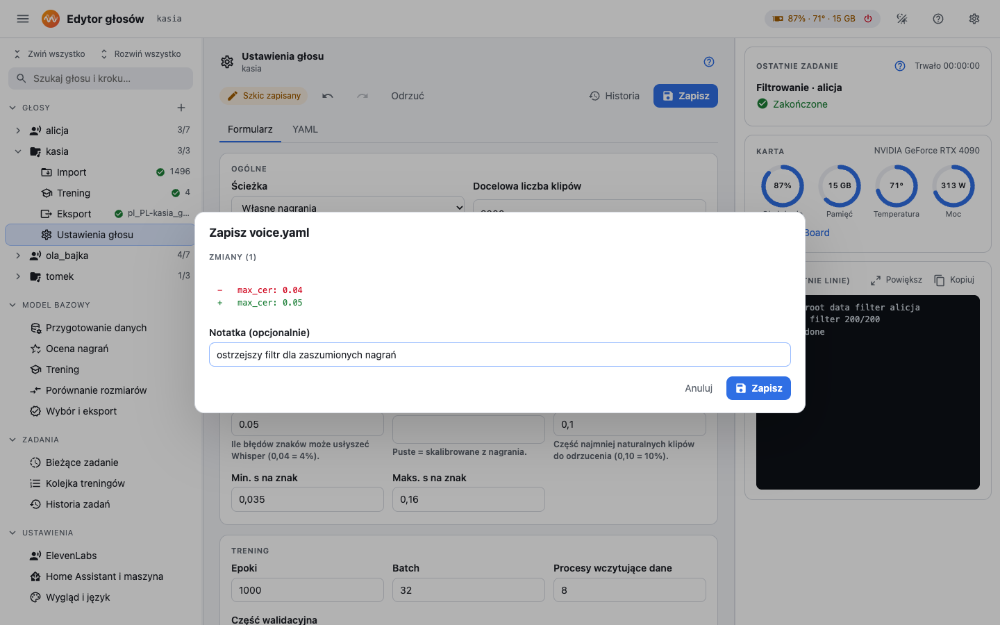

# Ekran

Edytor wygląda i działa jak pozostałe studia: Edytor Home Dashboard, Edytor Assist Routera, studio słów
budzących.

{ .shot }

## Pasek górny {#top-bar}

Od lewej:

1. **☰ menu:** instrukcja, kto jest zalogowany, jak zmienić hasło, Wyloguj.
   Obok ikona i nazwa.
2. **Chip zadania:** co trwa, procent i pozostały czas. Kliknięcie otwiera Bieżące
   zadanie.
3. **Chip maszyny:** obciążenie karty, temperatura, pamięć i moc z gniazdka. ⏻ wyłącza maszynę (gdy
   Home Assistant jest połączony i nic nie trwa).
4. **Odliczanie** po zadaniu z zaznaczonym wyłączeniem: „Wyłączenie za 1:45” z Anuluj.
   Gdy wyłączenie się nie uda, w tym miejscu pojawi się czerwona pigułka z powodem.
5. **Motyw**, **?** (ta instrukcja; tylko ten „?” otwiera instrukcję, „?” przy krokach i kartach pokazują
   okienko z opisem) i **⚙**: okienko pod ikoną z motywem i językiem, które zmieniają się od razu. Zamykają je Esc,
   kliknięcie obok albo ponowne ⚙, a Cały wygląd i język otwiera pełny widok.

{ .shot }

{ .shot }

## Drzewo {#tree}

- Głosy: każdy głos ma kroki swojej ścieżki. ✓ oznacza krok zrobiony, a liczba
  obok mówi, ile go jest (np. klipów). Na końcu jest Ustawienia głosu. Przycisk „+”
  tworzy nowy głos i najpierw pyta o ścieżkę.
- Model bazowy: wszystko o bazie `bazowy-pl`.
- Zadania: Bieżące zadanie,
  Kolejka treningów i Historia zadań.
- Ustawienia: ElevenLabs, Home Assistant i maszyna, wygląd i język.

Wyszukiwarka filtruje drzewo, a zwinięcia i szerokości kolumn zapamiętuje przeglądarka. Lewą i prawą kolumnę
zwiniesz przyciskiem ‹ / › na ich górze albo skrótem Ctrl/⌘+B (lewa) i Ctrl/⌘+Alt+B (prawa). Zostaje wtedy
wąski pasek z przyciskiem rozwinięcia, a środek robi się szerszy. W wąskim oknie (poniżej 900 px) prawa
kolumna jest zwinięta od startu. Adres strony
(`#voice/kasia/train`) prowadzi prosto do kroku, więc można go wysłać albo dodać do zakładek.

## Środek i prawa kolumna {#columns}

**Środek** to wybrany krok: **?** z krótkim opisem w okienku (i linkiem do właściwego rozdziału),
ustawienia, przycisk uruchomienia i wyniki.

**Prawa kolumna** to zadanie na żywo: etap, postęp, karta graficzna, kolejka, log
(Powiększ, Kopiuj), Zatrzymaj i
Wyłącz maszynę po zakończeniu.

## Ustawienia głosu: szkic, zapis, historia {#draft}

Każda zmiana w Ustawienia głosu trafia od razu do **szkicu na maszynie**. Szkic
przetrwa zamknięcie przeglądarki, a `voice.yaml` zmienia się dopiero po Zapisz.

- Formularz albo YAML. Zmiana pola zmienia dokładnie jedną linię pliku, a komentarze i układ zostają.
- Cofnij i Ponów (Ctrl/⌘+Z, Shift+Ctrl/⌘+Z).
  Pisanie w jednym polu przez 1,5 s to jeden krok.
- Zapisz (Ctrl/⌘+S) pokazuje zmienione linie i pole na notatkę.
- Gdy ktoś zmienił plik w międzyczasie, edytor zapyta o Zapisz mimo to.
- Historia trzyma 30 poprzednich wersji z notatkami.
  Przywróć wstawia wersję do szkicu.

{ .shot }
