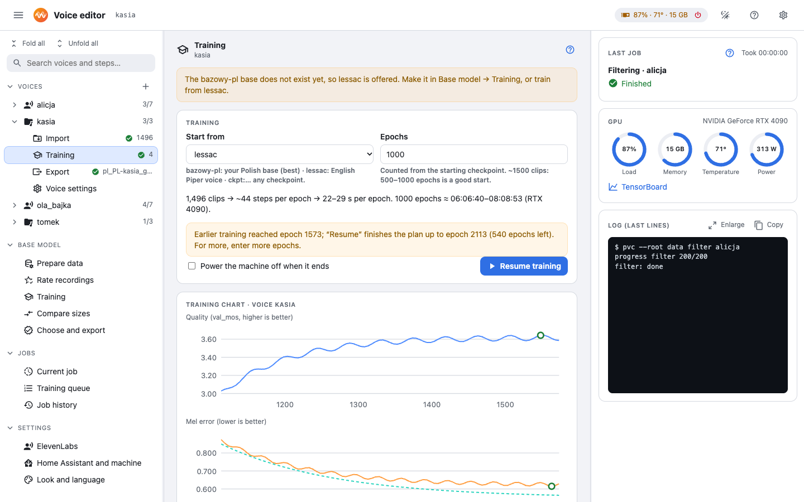
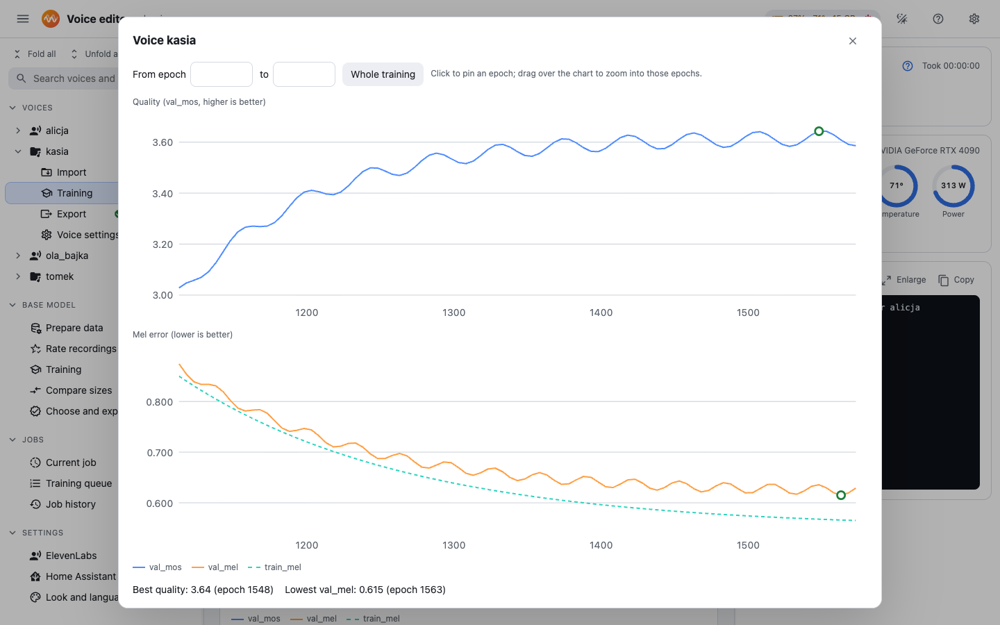
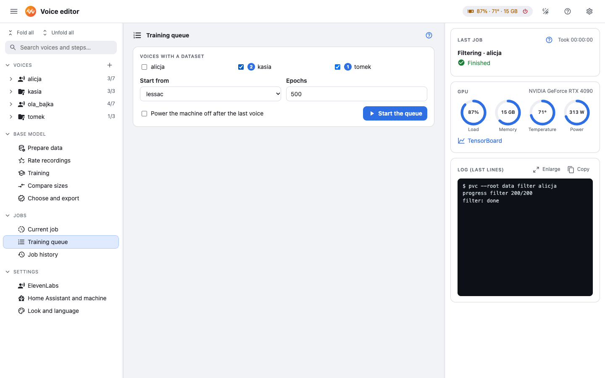

# Training

Training teaches Piper the voice of the dataset. It starts from a ready model (the base) and fits it to
your recordings. The same step on both ways.

{ .shot }

## Settings

| Field | What to choose |
|---|---|
| **Start from** | `bazowy-pl` – your Polish base – when you have it ([Base model](base-model.md)); otherwise `lessac` (English Piper voice – it learns Polish anyway, more slowly). |
| **Epochs** | About 1500 clips from `bazowy-pl`: **500–1000**. Epochs count from the starting checkpoint. |

Below them the editor estimates steps per epoch and the whole time on an RTX 4090 – about 1500 clips: ~45
steps, ~25–30 s per epoch, **3–8 h** in all. The very first run prepares its cache first (phonemes,
spectrograms), a few minutes.

Train starts it. The progress (epochs of the whole run, time left) is on the
right; the chart below the settings refreshes every 20 s.

### Resuming {#resume}

Once a voice has been trained, the button says Resume training and the editor
says what will happen – it depends on whether the earlier plan was finished:

- **Plan not finished:** resuming **finishes** it (start epoch + the epochs set). With the earlier
  training at epoch 1605 and a plan up to 1613 it trains only 8 epochs – for longer, enter more epochs
  (e.g. 1000 instead of 500).
- **Plan finished:** resuming trains the epochs you enter **on top** of the last checkpoint.

Stop can end a training at any time; resuming starts from the newest
checkpoint, losing a few epochs at most.

## Parameters {#parameters}

Every setting of `voice.yaml` (Voice settings). The default comes straight from the
code; a test keeps this table equal to it.

| Parameter | Default | Range | What it changes |
|---|---|---|---|
| `target_clips` | 2000 | ≥ 10 | Clips the dataset should have after the filter; about 1500 makes a good voice. |
| `synthesis.overgenerate` | 1.3 | 1–3 | How many times more sentences than the target are generated (the filter drops some). |
| `synthesis.seeds` | [1, 2, 3, 4] | list | Random seeds of cloning, rotated so the voice is not monotone. |
| `quality.asr_model` | large-v3 | a Whisper model | Checks the text of the clips; smaller is faster, less exact. |
| `quality.max_cer` | 0.04 | 0–1 | Character errors Whisper may hear; lower = stricter. |
| `quality.min_similarity` | null | 0–1 | Least similarity to the recording; `null` = calibrated from it. |
| `quality.mos_drop_fraction` | 0.1 | 0–0.5 | Share of the least natural clips dropped. |
| `quality.min_seconds_per_char` | 0.035 | > 0 | Shorter per text character = cut off or too fast. |
| `quality.max_seconds_per_char` | 0.16 | > 0 | Longer per character = extra sounds or too slow. |
| `train.base` | bazowy-pl | bazowy-pl, lessac, ckpt:… | The model the training starts from. |
| `train.batch_size` | 32 | ≥ 1 | Clips per step; lower it when the card runs out of memory. |
| `train.max_epochs` | 1000 | ≥ 1 | Epochs counted from the starting checkpoint (see [Resuming](#resume)). |
| `train.num_workers` | 8 | ≥ 0 | Data loader processes; too few and the card waits for data. |
| `train.validation_split` | 0.05 | 0–0.5 | Share of clips kept aside for checking (`val_mel`, `val_mos`). |
| `train.num_test_examples` | 5 | ≥ 0 | Test sentences read after every epoch (listening, `val_mos`). |

## What to watch

### The chart

- **val_mos** (top): predicted naturalness of the test sentences, 1–5. About 2 raw, about 3
  understandable, 3.5+ good. **Higher is better.**
- **val_mel** (bottom): how far the sound is from the real one on sentences outside the training.
  **Lower is better**; it falls fast, then hardly moves – that alone is not the end.
- **train_mel** (dashed): the same error on the training sentences; falls slowly all along.

Click the chart for full screen: drag to zoom into epochs, click to pin one.

{ .shot }

### Listening

After every epoch the trainer reads a few test sentences. In **Listen to the training** pick an epoch:
noise and a robot at first, clearer later. Epochs with a checkpoint are marked 💾 – only those can be
exported. Samples (ZIP) saves all samples to your computer with a table to sort
(`index.html`).

**Trust your ears more than the numbers:** UTMOS rates "pleasantness", not likeness to the original
nor correct pronunciation.

### When to stop

- `val_mos` has not risen for about **150–200 epochs**, `val_mel` is not rising and the samples sound
  good – take the checkpoint with the highest `val_mos` from that stretch.
- **Overtraining:** `train_mel` keeps falling while `val_mel` rises – the model learns the sentences by
  heart. Take a checkpoint from before the rise.
- **The ceiling:** a model rarely sounds better than its recordings. With recordings of median UTMOS
  about 3.6 (see [Rating the recordings](base-model.md#score)), a `val_mos` of 3.5–3.6 is already very
  good; more epochs will not lift it.

## Training well {#tips}

### The data decides {#data}

- **Noise in the pauses:** the voice learns the silence between words too. Recordings with background
  noise around −56 dB gave a voice that clearly hisses; at −75 dB and quieter it was clean. Denoise
  **before** the import, or leave out the worst recordings.
- **Choppy speech and cut-offs:** clips that end abruptly or drop to silence make a voice that stutters.
  Listen to what the filter rejected and to some kept clips from all over the set.
- **An even level and one room:** mixed microphones and rooms make a voice that wanders.
- **Clean text:** every word in `metadata.csv` must be exactly what is heard. Wrong text gives wrong
  sounds – a data problem, not an epochs problem.
- **About 1500 clips is enough.** More helps less than you would think; bad clips hurt more than
  missing ones.

### Start and length

- **Start from `bazowy-pl`:** Polish comes faster and more natural. With 1500 clips the base's colour
  usually turns into the new voice after 50–100 epochs.
- **500–1000 epochs** for about 1500 clips. Big sets (tens of thousands of clips) need fewer epochs –
  an epoch has more steps. Think in steps: 20–60 thousand is a good range.
- **Don't overdo it:** after `val_mos` flattens, hundreds more epochs rarely help and sometimes hurt.

### Hardware

- **Batch:** 32 for medium and 16 for high fit 24 GB. A bigger batch is not a better voice, it only needs
  more memory. On `torch.OutOfMemoryError` lower it in Voice settings (24, then 16
  for medium). A smaller batch makes more steps per epoch, so fewer epochs are needed.
- **Steps, not epochs:** one epoch is clips × 0.95 ÷ batch steps (1500 clips, batch 32: about 44).
  20–60 thousand steps is a good range.
- **Data loader processes:** 8. When the load of the card in the right column stays well under 90%, the
  card waits for data: give more (up to the number of CPU cores).
- **Validation share and test sentences:** 0.05 (75 of 1500 clips) and 5 sentences are enough. Keep at
  least ~50 validation clips; 10 test sentences give a steadier `val_mos`.
- **`train.extra_args`** (YAML only) adds options of Piper's trainer, for experiments. A training always
  starts from a checkpoint and the optimizer comes back from it with its learning rate, so options like
  `--model.learning_rate` change less than their name says.
- The lesson **Good training settings** (⚙ → Lessons) goes through these fields in
  the editor one by one.
- **Disk:** a checkpoint is about 800 MB; up to about 9 GB per voice plus the cache.
- **Overnight:** the Training queue trains several voices one after another; tick
  Power the machine off after the last voice and Home Assistant switches it off.

### The training queue {#queue}

{ .shot }

Tick the voices in training order (the numbers show it), set the epochs and the start,
Start the queue. A failed voice does not stop the next one;
Stop ends the whole queue.

## Choosing the checkpoint

**Checkpoints** says why each file was kept: best `val_mos`, lowest `val_mel` or the newest
(`last.ckpt`). Listen to those epochs and pick the best-sounding one in [Export](export.md) – the best
`val_mos` does not always sound best.
