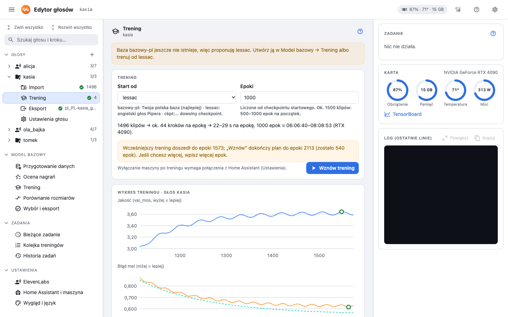
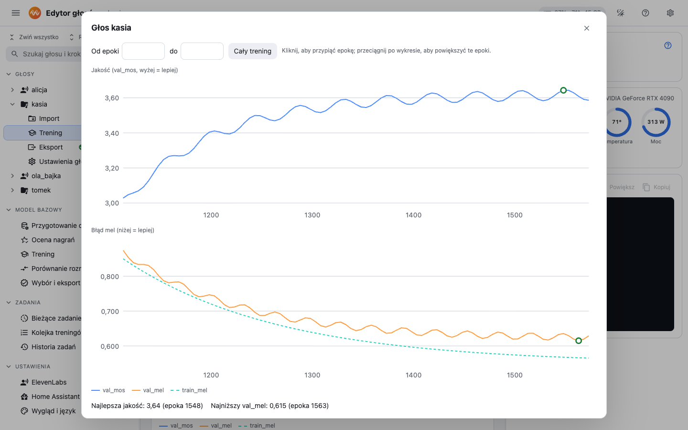
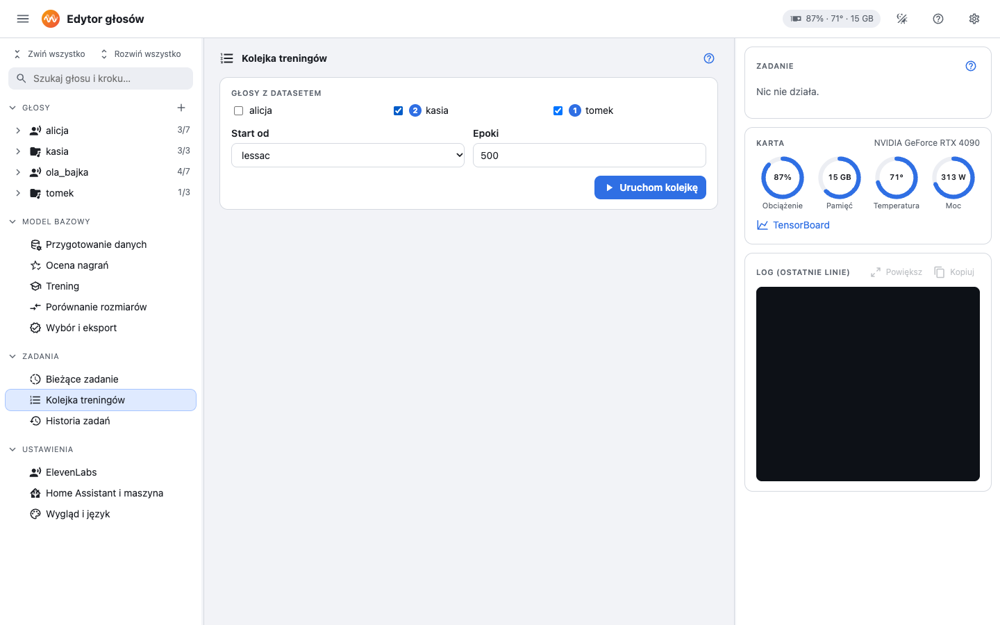

# Trening

Trening uczy Pipera głosu z datasetu. Zaczyna od gotowego modelu, czyli bazy, i dopasowuje go do Twoich
nagrań. Ten krok jest ten sam w obu ścieżkach.

{ .shot }

## Ustawienia

| Pole | Co wybrać |
|---|---|
| **Start od** | `bazowy-pl`, czyli Twoja polska baza, jeśli ją masz ([Model bazowy](base-model.md)). W przeciwnym razie `lessac` (angielski głos Pipera). Polski i tak się nauczy, tylko wolniej. |
| **Epoki** | Dla ok. 1500 klipów od `bazowy-pl`: **500–1000**. Epoki liczą się od checkpointu startowego. |

Pod polami edytor pokazuje szacunek: liczbę kroków na epokę i czas całości na RTX 4090. Przy 1500 klipach
to ok. 45 kroków na epokę, ok. 25–30 s na epokę i **3–8 h** na cały trening. Pierwsze uruchomienie
najpierw przygotowuje cache (głoski, spektrogramy), co zajmuje kilka minut.

Trenuj uruchamia trening. Postęp widać po prawej (epoki całego biegu i pozostały
czas), a wykres pod ustawieniami odświeża się co 20 s.

### Wznawianie {#resume}

Gdy głos był już trenowany, przycisk nazywa się Wznów trening. Edytor pisze wprost,
co się stanie, a zależy to od tego, czy poprzedni plan się skończył:

- **Plan nieskończony:** wznowienie **dokończy** plan, czyli epokę startową plus ustawione epoki. Jeśli
  poprzedni trening doszedł do epoki 1605, a plan był do 1613, wytrenuje tylko 8 epok. Żeby trenować
  dłużej, wpisz więcej epok, np. 1000 zamiast 500.
- **Plan skończony:** wznowienie dotrenuje **jeszcze** tyle epok, ile wpiszesz, licząc od ostatniego
  checkpointu.

Trening można przerwać w każdej chwili przyciskiem Zatrzymaj. Wznowienie zaczyna od
najnowszego checkpointu, więc traci najwyżej kilka epok.

## Parametry {#parameters}

Wszystkie ustawienia z `voice.yaml` (Ustawienia głosu). Wartość domyślna pochodzi
prosto z kodu, a test pilnuje, żeby ta tabela się z nim zgadzała.

| Parametr | Domyślnie | Zakres | Na co wpływa |
|---|---|---|---|
| `target_clips` | 2000 | ≥ 10 | Ile klipów ma mieć dataset po filtrze. Ok. 1500 daje dobry głos. |
| `synthesis.overgenerate` | 1.3 | 1–3 | Ile razy więcej zdań generować niż cel, bo filtr część odrzuci. |
| `synthesis.seeds` | [1, 2, 3, 4] | lista | Ziarna losowania klonowania, rotowane, żeby głos nie był monotonny. |
| `quality.asr_model` | large-v3 | model Whisper | Model sprawdzający tekst klipów; mniejszy jest szybszy, ale mniej dokładny. |
| `quality.max_cer` | 0.04 | 0–1 | Ile błędów znaków może usłyszeć Whisper. Niżej = ostrzej. |
| `quality.min_similarity` | null | 0–1 | Najmniejsze podobieństwo do nagrania; `null` = skalibrowane z nagrania. |
| `quality.mos_drop_fraction` | 0.1 | 0–0.5 | Jaka część najmniej naturalnych klipów odpada. |
| `quality.min_seconds_per_char` | 0.035 | > 0 | Klip krótszy na znak tekstu jest ucięty albo za szybki. |
| `quality.max_seconds_per_char` | 0.16 | > 0 | Klip dłuższy na znak ma dodatkowe dźwięki albo jest za wolny. |
| `train.base` | bazowy-pl | bazowy-pl, lessac, ckpt:… | Model, od którego zaczyna trening. |
| `train.batch_size` | 32 | ≥ 1 | Klipy w jednym kroku. Mniej przy braku pamięci karty. |
| `train.max_epochs` | 1000 | ≥ 1 | Epoki liczone od checkpointu startowego (zob. [Wznawianie](#resume)). |
| `train.num_workers` | 8 | ≥ 0 | Procesy wczytujące dane. Za mało, a karta czeka na dane. |
| `train.validation_split` | 0.05 | 0–0.5 | Część klipów odłożona do sprawdzania (`val_mel`, `val_mos`). |
| `train.num_test_examples` | 5 | ≥ 0 | Zdania testowe czytane po każdej epoce (odsłuch, `val_mos`). |

## Na co patrzeć

### Wykres

- **val_mos** (górny): przewidywana naturalność zdań testowych w skali 1–5. Ok. 2 to surowy głos, ok. 3
  zrozumiały, 3,5 i więcej dobry. **Wyżej = lepiej.**
- **val_mel** (dolny): jak bardzo dźwięk różni się od prawdziwego na zdaniach spoza treningu. **Niżej =
  lepiej.** Szybko spada, potem prawie stoi, a to samo w sobie nie znaczy, że trening się skończył.
- **train_mel** (przerywana): ten sam błąd na zdaniach treningowych. Spada powoli przez cały trening.

Kliknij wykres, żeby otworzyć go na pełnym ekranie. Przeciągnięcie powiększa zakres epok, a kliknięcie
przypina epokę.

{ .shot }

### Odsłuch

Po każdej epoce trener czyta kilka zdań testowych. W **Odsłuchu z treningu** wybierasz epokę i słuchasz.
Na początku słychać szum i „robota”, potem głos jest coraz wyraźniejszy. Epoki z checkpointem mają dopisek
💾. Tylko z nich można zrobić eksport. Próbki (ZIP) zapisuje wszystkie próbki na
komputerze, z tabelą do sortowania (`index.html`).

**Najważniejsze jest ucho, nie liczby.** UTMOS ocenia „ładność”, a nie podobieństwo do oryginału ani
poprawność wymowy.

### Kiedy przerwać

- `val_mos` nie rośnie od ok. **150–200 epok**, `val_mel` nie rośnie, a próbki brzmią dobrze. Wtedy weź
  checkpoint z najwyższym `val_mos` z tego okresu.
- **Przetrenowanie:** `train_mel` dalej spada, a `val_mel` zaczyna rosnąć. Model uczy się zdań na pamięć.
  Weź checkpoint sprzed wzrostu.
- **Sufit:** model rzadko brzmi lepiej niż jego nagrania. Przy nagraniach z medianą UTMOS ok. 3,6 (zob.
  [Ocena nagrań](base-model.md#score)) `val_mos` ok. 3,5–3,6 to już wynik bardzo dobry. Dalsze epoki go
  nie podniosą.

## Jak dobrze trenować {#tips}

### Dane decydują o wszystkim {#data}

- **Szum w pauzach.** Głos uczy się także ciszy między słowami. Nagrania z szumem tła ok. −56 dB dały głos,
  który wyraźnie szumi. Przy −75 dB i ciszej był czysty. Odszumiaj nagrania **przed** importem albo
  odrzuć najgorsze.
- **„Rwanie” i ucięcia.** Gdy w datasecie są klipy urwane albo z nagłymi spadkami do ciszy, gotowy głos
  też się zacina. Posłuchaj odrzuconych przez filtr i sprawdź kilka przyjętych z różnych miejsc zbioru.
- **Równa głośność i jedno miejsce nagrania.** Pomieszane mikrofony i pomieszczenia dają głos, który
  „pływa”.
- **Czysty tekst.** Każde słowo w `metadata.csv` musi być dokładnie tym, co słychać. Błędy w tekście
  dają złą wymowę konkretnych głosek. To problem danych, nie liczby epok.
- **Ok. 1500 klipów wystarczy.** Więcej pomaga mniej, niż się wydaje, a słabe klipy szkodzą bardziej
  niż ich brak.

### Ocena nagrań (UTMOS) {#score}

Krok Ocena nagrań każdego głosu ocenia jego nagrania tym samym modelem UTMOS,
który liczy `val_mos`. Mediana to mniej więcej sufit `val_mos`, a lista najsłabszych nagrań pokazuje,
czego posłuchać i co ewentualnie usunąć.

- **Ocena jest zapamiętana.** Każdy wynik trafia do `dataset/utmos.json` razem z rozmiarem i czasem
  zmiany pliku. Kolejna ocena liczy tylko nagrania nowe albo zmienione, resztę bierze z pliku.
  Z raportu znikają nagrania usunięte z datasetu.
- **Przerwanie nic nie psuje.** Wyniki zapisują się co 100 nagrań i przy Zatrzymaj,
  więc kolejna ocena rusza od miejsca, w którym skończyła.
- **Liczba nagrań:** 0 ocenia wszystkie. Liczba ocenia tyle losowych, zawsze tych samych.
- **Poniżej progu:** podsumowanie mówi, ile nagrań ma wynik poniżej 2,5, 3,0 i 3,3.
- Z wiersza poleceń: `pvc score <głos>` (`--sample 300` dla próbki).
- **Usuń słabe nagrania** (pod wynikami): usuwa z `dataset/metadata.csv` nagrania z oceną poniżej
  progu (np. 3,0) albo zostawia tylko N najlepszych (np. 3000 z dużego zbioru). Nic nie jest kasowane:
  pliki WAV zostają, poprzedni `metadata.csv` trafia do `metadata.before-prune-<czas>.csv`, a lista
  usuniętych do `pruned-<czas>.csv`. Żeby przywrócić dataset, skopiuj kopię z powrotem jako
  `metadata.csv`. Gdy zostanie mniej niż ok. 1500 nagrań, edytor pisze, ilu brakuje. Wymaga oceny
  wszystkich nagrań. Z wiersza poleceń: `pvc prune <głos> --below 3.0` albo `--keep-best 3000`.
- **Podgląd przed usunięciem:** pod polami od razu widać, ile nagrań zostanie, ile wypadnie i ilu
  zabraknie do 1500 przy wpisanym progu albo liczbie najlepszych.
- **Wszystkie ocenione nagrania:** tabela pod spodem pokazuje każde nagranie z oceną i tekstem, w datasecie
  albo usunięte, najsłabsze albo najlepsze najpierw, opcjonalnie tylko poniżej progu, po 50 na stronę.
  ▶ odtwarza nagranie.

### Start i długość

- **Startuj od `bazowy-pl`.** Głos uczy się polskiego szybciej i brzmi naturalniej. Przy 1500 klipach
  głos zwykle przechodzi z barwy bazy w nowy po 50–100 epokach.
- **500–1000 epok** dla ok. 1500 klipów. Duże zbiory (kilkanaście tysięcy klipów) potrzebują mniej epok,
  bo epoka ma więcej kroków. Myśl w krokach: 20–60 tys. kroków to dobry zakres.
- **Nie przesadzaj.** Po wypłaszczeniu `val_mos` kolejne setki epok rzadko pomagają i czasem szkodzą
  (przetrenowanie).

### Sprzęt

- **Batch:** 32 dla medium i 16 dla high mieści się w 24 GB. Większy batch nie daje lepszego głosu, tylko
  zużywa więcej pamięci. Przy `torch.OutOfMemoryError` zmniejsz batch w Ustawienia
  głosu (24, potem 16 dla medium). Mniejszy batch to więcej kroków na epokę, więc wystarczy mniej epok.
- **Kroki zamiast epok:** jedna epoka to klipy × 0,95 ÷ batch kroków (1500 klipów, batch 32: ok. 44).
  Dobry zakres to 20–60 tys. kroków.
- **Procesy wczytujące dane:** 8. Gdy obciążenie karty w prawej kolumnie zostaje wyraźnie poniżej 90%,
  karta czeka na dane: daj więcej (do liczby rdzeni procesora).
- **Część walidacyjna i zdania testowe:** 0,05 (z 1500 klipów to 75) i 5 zdań wystarczą. Zostaw co
  najmniej ok. 50 klipów walidacyjnych; 10 zdań testowych daje stabilniejszy `val_mos`.
- **`train.extra_args`** (tylko YAML) dokłada opcje trenera Pipera, do eksperymentów. Trening startuje
  zawsze od checkpointu, a optymalizator wraca z niego ze swoim współczynnikiem uczenia, więc opcje
  w rodzaju `--model.learning_rate` zmieniają mniej, niż sugeruje nazwa.
- Samouczek **Dobre ustawienia treningu** (⚙ → Samouczki) przechodzi te pola
  w edytorze jedno po drugim.
- **Dysk:** checkpoint ma ok. 800 MB. Trening trzyma do ok. 9 GB na głos plus cache.
- **Noc:** Kolejka treningów trenuje kilka głosów po kolei. Zaznacz
  Wyłącz maszynę po ostatnim głosie, a Home Assistant wyłączy ją po skończeniu.
  Głos z checkpointami kolejka trenuje dalej od nich. Zaznacz Zacznij każdy głos od
  nowa od wybranej bazy, żeby każdy głos zaczął nowy trening od bazy (jak „Zacznij od nowa”;
  wcześniejsze treningi zostają w całości).

### Kolejka treningów {#queue}

{ .shot }

Zaznacz głosy w kolejności treningu (numerki pokazują kolejność), ustaw epoki i start, potem kliknij
Uruchom kolejkę. Błąd jednego głosu nie zatrzymuje następnego.
Zatrzymaj kończy całą kolejkę.

## Wybór checkpointu

Na liście **Checkpointy** widać, za co zapisano każdy plik: najlepszy `val_mos`, najniższy `val_mel`
albo najnowszy (`last.ckpt`). Posłuchaj tych epok w odsłuchu i wybierz najlepiej brzmiącą w
[Eksporcie](export.md). Najlepszy `val_mos` nie zawsze brzmi najlepiej.
